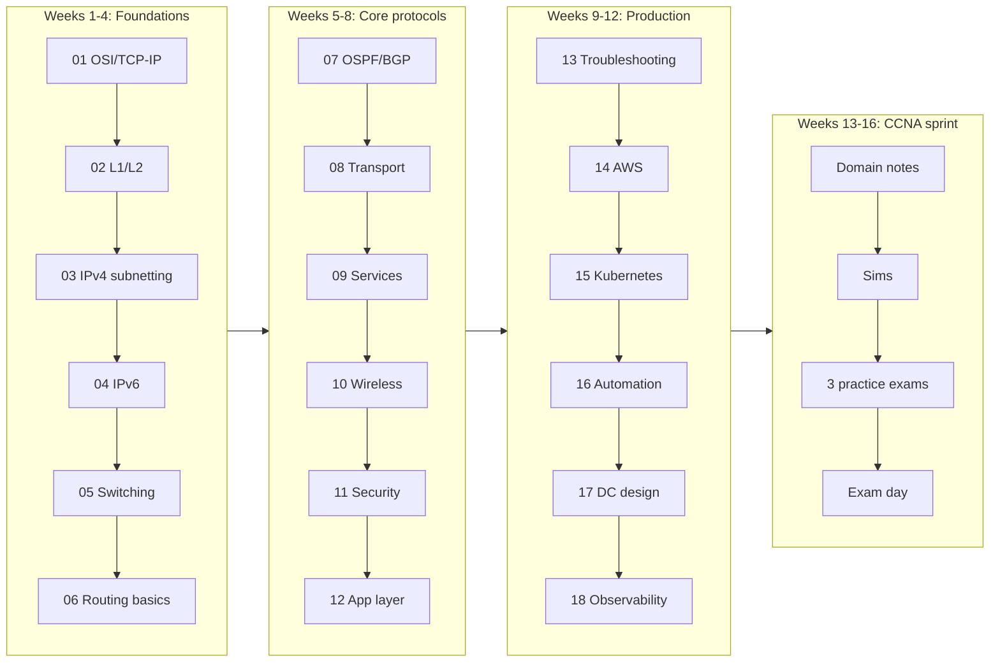

# Networking Mastery

A self-paced networking curriculum for DevOps and cloud engineers. It goes from the bits on the wire to AWS, Kubernetes and network automation. It also has a full prep track for the **Cisco CCNA 200-301 v2.0** exam.

- **Time:** 12 weeks at about 1.5 hours per day, then a 4-week exam sprint.
- **Labs:** free tools only (Containerlab, FRRouting, Nokia SR Linux, Packet Tracer, kind, LocalStack).
- **Style:** about 80% ASD-STE100 Simplified Technical English. Every concept has a Mermaid diagram.

## Roadmap



## Certification recommendation (summary)

| Role | Certification | Why |
|---|---|---|
| **Primary** | Cisco CCNA 200-301 **v2.0** (first test date 3 Feb 2027) | The most recognized associate networking cert. v2.0 is troubleshooting-heavy and adds Ansible and AI operations. Your 12-week plan ends after the v1.1 cutoff (2 Feb 2027). |
| **Follow-up** | Cisco CCNA Automation (200-901 v1.1) | Python, REST APIs, Ansible, Terraform, CI/CD for networks. It is a direct fit for a DevOps engineer. |

The full comparison and source URLs are in [cert/ccna-200-301/README.md](cert/ccna-200-301/README.md). The reasons for each choice are in [DECISIONS.md](DECISIONS.md).

## How to use this repo

1. Read [labs/setup/README.md](labs/setup/README.md). Run the install script on Ubuntu or WSL2.
2. Do one module at a time, in order. For each module:
   1. Read `README.md`. Draw the diagrams yourself.
   2. Do `lab.md`. Do the "break it and fix it" challenge.
   3. Take `quiz.md`, or run `python3 tools/quiz_runner.py modules/<module>`.
   4. Keep `cheatsheet.md` open while you work.
   5. Optional: record a video from `video-script.md`.
3. Tick items in [progress-tracker.md](progress-tracker.md).
4. Do the 5 capstones in [labs/capstones/](labs/capstones/).
5. Do the exam sprint in [cert/ccna-200-301/study-plan.md](cert/ccna-200-301/study-plan.md).

## Modules

| # | Module | Week | Key lab |
|---|---|---|---|
| 01 | [Network models: OSI, TCP/IP, encapsulation](modules/01-osi-tcpip/README.md) | 1 | Capture one HTTP request and label every header |
| 02 | [Physical and data link](modules/02-physical-datalink/README.md) | 1 | ARP, MAC tables and MTU black holes in Linux namespaces |
| 03 | [IPv4 addressing and subnetting](modules/03-ipv4-subnetting/README.md) | 2 | 50 problems + Python subnet calculator |
| 04 | [IPv6](modules/04-ipv6/README.md) | 3 | SLAAC and NDP between FRR routers |
| 05 | [Switching](modules/05-switching/README.md) | 3-4 | VLANs, trunks, RSTP, EtherChannel (Packet Tracer) |
| 06 | [Routing basics](modules/06-routing-basics/README.md) | 4 | Static, floating static, longest prefix match |
| 07 | [Dynamic routing](modules/07-dynamic-routing/README.md) | 5 | Multi-area OSPF and eBGP in Containerlab |
| 08 | [Transport](modules/08-transport/README.md) | 6 | Handshake, windowing and loss with `tc netem` |
| 09 | [Network services](modules/09-network-services/README.md) | 6-7 | DHCP relay, DNS deep dive, NAT/PAT |
| 10 | [Wireless](modules/10-wireless/README.md) | 7 | WLC and WPA2/WPA3 (Packet Tracer) |
| 11 | [Security](modules/11-security/README.md) | 7-8 | ACLs, nftables, WireGuard and IPsec |
| 12 | [Application layer](modules/12-application-layer/README.md) | 8 | TLS 1.3, HTTP/2 vs HTTP/3, L4 vs L7 load balancing |
| 13 | [Troubleshooting method](modules/13-troubleshooting/README.md) | 9 | Ten fault tickets with tcpdump and mtr |
| 14 | [Cloud networking (AWS)](modules/14-cloud-networking/README.md) | 9-10 | Terraform VPC, TGW, PrivateLink |
| 15 | [Kubernetes networking](modules/15-kubernetes-networking/README.md) | 10 | kind + Cilium, NetworkPolicy, Gateway API |
| 16 | [Network automation](modules/16-network-automation/README.md) | 11 | Nornir, NAPALM, Ansible, NETCONF |
| 17 | [Data center and modern design](modules/17-datacenter-design/README.md) | 11 | Spine-leaf with BGP EVPN/VXLAN |
| 18 | [Observability](modules/18-observability/README.md) | 12 | sFlow + Prometheus + Grafana dashboards |

## Repository layout

```text
networking-mastery/
├── README.md              # this file
├── DECISIONS.md           # choices made for ambiguous items
├── progress-tracker.md    # checklist for every module, lab and exam
├── modules/01-osi-tcpip/ ... modules/18-observability/
├── labs/setup/            # install scripts (Ubuntu / WSL2)
├── labs/topologies/       # Containerlab .clab.yml files
├── labs/capstones/        # 5 capstone projects
├── cert/ccna-200-301/     # CCNA prep track
├── tools/                 # subnet calculator, quiz runner, flashcard generator, checkers
├── tests/                 # pytest for the tools
├── reference/             # glossary, ports, RFCs, interview prep
└── .github/workflows/     # markdown lint, link check, Mermaid validation, Python tests
```

## Day 1 (about 1.5 hours)

1. Run `bash labs/setup/install.sh`, then `bash labs/setup/verify.sh` (20 minutes, mostly waiting).
2. Read [modules/01-osi-tcpip/README.md](modules/01-osi-tcpip/README.md) sections 1-2 (40 minutes).
3. Do steps 1-4 of [modules/01-osi-tcpip/lab.md](modules/01-osi-tcpip/lab.md) (30 minutes).
4. Import [cert/ccna-200-301/flashcards.csv](cert/ccna-200-301/flashcards.csv) into Anki and review 20 cards. Do 20 per day from now on.

## What is in the box

| Item | Count |
|---|---|
| Modules (README, lab, quiz, cheatsheet, video script) | 18 |
| Module quiz questions | 270 |
| Subnetting practice problems | 50 (+ unlimited generator) |
| Containerlab / Compose topologies | 9 |
| Capstone projects | 5 |
| CCNA practice exams | 3 × 100 questions |
| CCNA simulations | 9 |
| Flashcards | 401 |
| Glossary terms | 269 |
| Interview questions with model answers | 100 |
| Mermaid diagrams (all validated) | 114 |

## Tools

| Tool | Command |
|---|---|
| Subnet calculator / drills | `python3 tools/subnet_calc.py info 10.1.2.3/20` · `practice --count 20` |
| Quiz runner | `python3 tools/quiz_runner.py modules/05-switching` · `modules --all --limit 50` |
| Practice exam builder | `python3 tools/build_practice_exams.py` |
| Flashcard generator | `python3 tools/flashcard_gen.py` |
| Checks | `python3 tools/validate_quizzes.py` · `python3 tools/check_links.py` · `(cd tools && npm ci) && node tools/validate_mermaid.mjs` |

## Conventions

- **Exam tip:** a fact that the CCNA exam tests.
- **Production note:** what experienced engineers do in real networks.
- Commands start with `$` (Linux shell), `R1#` (Cisco IOS privileged mode) or `A:srl#` (SR Linux).
