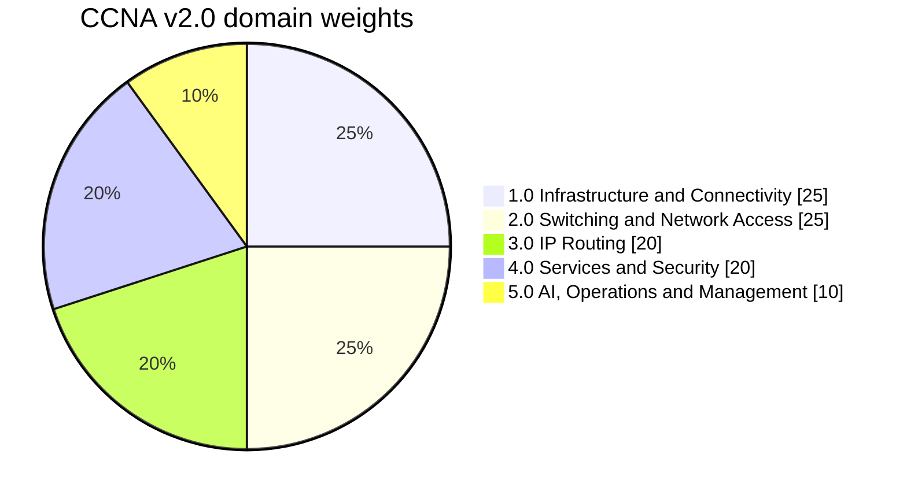

# CCNA 200-301 v2.0 Blueprint → Repo Map

Source: Cisco "Implementing and Administering Cisco Solutions (200-301 CCNA) v2.0" exam topics PDF (first test date 3 Feb 2027, 120 minutes). Topic wording is shortened; check the [official PDF](https://learningcontent.cisco.com/documents/marketing/exam-topics/200-301_CCNA_v2.0_Exam_Topics_PDF.pdf) for exact text. Cisco states that the list is a guideline and related topics may also appear.

## 1.0 Network Infrastructure and Connectivity — 25%

| Topic | What to know | Modules | Labs / sims |
|---|---|---|---|
| 1.1 Diagnose copper and fiber interface and cable issues | Media types, distances, SMF/MMF, transceivers, CRC/input errors, late collisions, duplex, `show interfaces` | [02](../../modules/02-physical-datalink/README.md) | Lab 02, sim 01 |
| 1.2 Describe hypervisors, virtual machines and containers | Type 1/2 hypervisors, vSwitch, VM vs container | [15](../../modules/15-kubernetes-networking/README.md), [17](../../modules/17-datacenter-design/README.md), [domain notes](domain-notes/d1-infrastructure.md) | — |
| 1.3 Troubleshoot IPv4 addressing, assignment and subnetting | Subnetting, VLSM, wrong mask/gateway, APIPA | [03](../../modules/03-ipv4-subnetting/README.md) | 50 problems, sim 02 |
| 1.4 Troubleshoot IPv6 addressing, assignment and prefix sizing | Address types, SLAAC, DHCPv6, EUI-64, /64 vs /127 | [04](../../modules/04-ipv6/README.md) | Lab 04, sim 02 |
| 1.5 Describe wireless principles (band/channel, RF, security, interference) | 2.4/5/6 GHz, 1/6/11, RSSI/SNR, WPA2/WPA3/SAE/PMF, interference sources | [10](../../modules/10-wireless/README.md) | Lab 10 |
| 1.6 Troubleshoot wired and wireless client connectivity | Layered client troubleshooting, ipconfig/ip, Wi-Fi association → DHCP → gateway | [10](../../modules/10-wireless/README.md), [13](../../modules/13-troubleshooting/README.md) | Lab 13 |
| 1.7 Troubleshoot DHCPv4 client, server and relay on IOS | DORA, pools, exclusions, `ip helper-address`, giaddr, bindings | [09](../../modules/09-network-services/README.md) | Lab 09, sim 03 |

## 2.0 Switching and Network Access — 25%

| Topic | What to know | Modules | Labs / sims |
|---|---|---|---|
| 2.1 Configure switch-to-switch and switch-to-router connectivity (L2/L3 interfaces, 802.1Q trunks, LACP EtherChannel L2/L3, SVIs) | `no switchport`, trunks, native VLAN, LACP modes, Po interfaces, `ip routing` | [05](../../modules/05-switching/README.md) | Lab 05, sim 04 |
| 2.2 Configure Layer 2 edge-host port attributes (desktops, printers, IoT, APs, VoIP, virtualized hosts, appliances) | Access vs trunk per device type, voice VLAN, PortFast, port security | [05](../../modules/05-switching/README.md), [10](../../modules/10-wireless/README.md) | Sim 04 |
| 2.3 Validate network documentation using CDP and LLDP | `show cdp/lldp neighbors [detail]`, Port ID vs local interface | [05](../../modules/05-switching/README.md) | Sim 04 |
| 2.4 Troubleshoot L2/L3 connectivity with show commands, ping, traceroute and packet capture | MAC table, trunks, STP, routing, SPAN, Wireshark | [13](../../modules/13-troubleshooting/README.md) | Lab 13, sim 06 |
| 2.5 Configure Rapid PVST+ (root, port names, states/roles, PortFast, root/loop/BPDU guard) | Election, costs, roles, states, guards | [05](../../modules/05-switching/README.md) | Lab 05, sim 04 |

## 3.0 IP Routing — 20%

| Topic | What to know | Modules | Labs / sims |
|---|---|---|---|
| 3.1 Interpret a routing table to identify the next hop | Codes, [AD/metric], LPM, gateway of last resort | [06](../../modules/06-routing-basics/README.md) | Lab 06 |
| 3.2 Troubleshoot IPv4 and IPv6 static routing (default, network, host, floating) | Recursive lookups, AD, link-local next hops | [06](../../modules/06-routing-basics/README.md) | Lab 06, sim 05 |
| 3.3 Configure single-area OSPFv2 and OSPFv3 (adjacencies, P2P, broadcast DR/BDR, router ID) | Neighbor states, timers, MTU, priority, RID rules | [07](../../modules/07-dynamic-routing/README.md) | Lab 07, sim 05 |
| 3.4 Interpret operational status of HSRP and VRRP | `show standby brief`, `show vrrp brief`, priority, preempt, virtual MAC | [06](../../modules/06-routing-basics/README.md) | Sim 05 |

## 4.0 Network Services and Security — 20%

| Topic | What to know | Modules | Labs / sims |
|---|---|---|---|
| 4.1 Configure local usernames and AAA clients (TACACS+, RADIUS) | `username ... secret`, `aaa new-model`, method lists, fallback | [11](../../modules/11-security/README.md) | Sim 07 |
| 4.2 Manage device files using SFTP/SCP | `ip scp server enable`, `copy ... scp://`, `copy ... sftp://` | [11](../../modules/11-security/README.md), [domain notes](domain-notes/d4-services-security.md) | Sim 07 |
| 4.3 Configure NAT/PAT on IOS XE routers | inside/outside, static, pool, overload, translations | [09](../../modules/09-network-services/README.md) | Lab 09, sim 03 |
| 4.4 Diagnose DNS records (A, AAAA, CNAME, MX, NS, PTR) | Record purpose, dig/nslookup, common faults | [09](../../modules/09-network-services/README.md) | Lab 09 |
| 4.5 Describe IPsec remote access and site-to-site VPNs | IKEv2, ESP, tunnel mode, UDP 500/4500, TLS VPN | [11](../../modules/11-security/README.md) | Lab 11 |
| 4.6 Configure IPv4 ACLs (standard, extended, numbered, named) | Wildcards, order, placement, implicit deny, VTY access-class | [11](../../modules/11-security/README.md) | Lab 11, sim 07 |
| 4.7 Configure L2 security (DHCP snooping, DAI, storm control, RA guard, port security) | Trust, bindings, rate limits, violation modes | [11](../../modules/11-security/README.md), [05](../../modules/05-switching/README.md) | Lab 11, sim 08 |

## 5.0 AI, and Network Operations and Management — 10%

| Topic | What to know | Modules | Labs / sims |
|---|---|---|---|
| 5.1 Describe the role of agentic AI in network operations | Agents, tools, guardrails, human approval | [16](../../modules/16-network-automation/README.md) | — |
| 5.2 Select a generative AI prompt (data classification, output format, persona, instructions) | Safe prompting | [16](../../modules/16-network-automation/README.md) | — |
| 5.3 Describe network management approaches (device, cloud, controller, automation, IaC) | Planes, north/southbound APIs | [16](../../modules/16-network-automation/README.md), [17](../../modules/17-datacenter-design/README.md) | — |
| 5.4 Describe the function of SNMP in network operations | Versions, MIB/OID, poll vs trap/inform | [09](../../modules/09-network-services/README.md), [18](../../modules/18-observability/README.md) | Lab 18 |
| 5.5 Use configuration management mechanisms such as Ansible to execute commands | Inventory, playbook, modules, check mode, idempotency | [16](../../modules/16-network-automation/README.md) | Lab 16, sim 09 |
| 5.6 Interpret syslog message content, severity levels and facilities | %FACILITY-SEVERITY-MNEMONIC, 0-7, `logging trap` | [09](../../modules/09-network-services/README.md) | Sim 07 |

## Modules outside the CCNA blueprint

Modules 08 (deep TCP/QUIC), 12 (HTTP/TLS/LB), 14 (AWS), 15 (Kubernetes), 17 (EVPN/SD-WAN) and 18 (observability) go beyond the exam. They are there for your DevOps/Cloud job. During the 4-week sprint, skip them.

## Reference: CCNA v1.1 domains (testing until 2 Feb 2027)

| Domain | Weight |
|---|---|
| 1.0 Network Fundamentals | 20% |
| 2.0 Network Access | 20% |
| 3.0 IP Connectivity | 25% |
| 4.0 IP Services | 10% |
| 5.0 Security Fundamentals | 15% |
| 6.0 Automation and Programmability | 10% |

**Main differences in v2.0:** a reorganized 5-domain structure; more "troubleshoot/configure" verbs and fewer "describe" verbs; new AI topics (agentic AI, prompting); Ansible moved from "describe" to "use"; topics such as HSRP/VRRP status, RA guard, storm control and SFTP/SCP file management appear explicitly; some v1.1 topics (for example detailed REST/JSON and controller internals) moved toward the CCNA Automation track.
