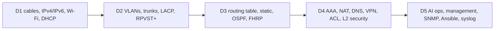

# Domain Notes (CCNA v2.0)

Condensed revision notes, one file per exam domain. Read them in the sprint weeks and in the final 7 days. Each file ends with "traps": the details the exam likes to test.

| Domain | Weight | File |
|---|---|---|
| 1.0 Network Infrastructure and Connectivity | 25% | [d1-infrastructure.md](d1-infrastructure.md) |
| 2.0 Switching and Network Access | 25% | [d2-switching-access.md](d2-switching-access.md) |
| 3.0 IP Routing | 20% | [d3-ip-routing.md](d3-ip-routing.md) |
| 4.0 Network Services and Security | 20% | [d4-services-security.md](d4-services-security.md) |
| 5.0 AI, and Network Operations and Management | 10% | [d5-ai-operations.md](d5-ai-operations.md) |

