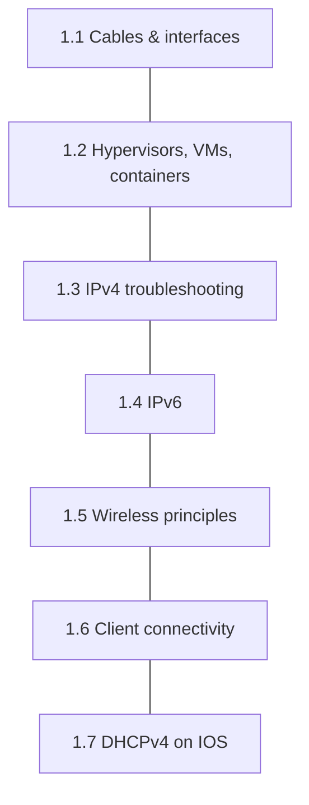

# Domain 1 — Network Infrastructure and Connectivity (25%)



## 1.1 Copper, fiber and interface issues

| Media | Reach | Notes |
|---|---|---|
| Cat5e/6 1000BASE-T | 100 m | Auto-MDIX removes straight/crossover issues |
| Cat6a 10GBASE-T | 100 m | Cat6: 55 m |
| MMF (OM3/OM4) 10GBASE-SR | 300/400 m | 850 nm, LED/VCSEL, 50 µm core |
| SMF (OS2) 10GBASE-LR | 10 km | 1310 nm laser, 9 µm core |

`show interfaces` status pairs: `up/up` OK · `down/down (notconnect)` L1 · `up/down` L2 (keepalive/encapsulation) · `administratively down` = shutdown · `err-disabled` = a feature shut it.

| Counter | Meaning |
|---|---|
| CRC / input errors | Bad cable/optic/EMI, or full-duplex side of a mismatch |
| Late collisions | Half-duplex side of a duplex mismatch, or cable too long |
| Runts / giants | < 64 B / > 1518 B frames |
| Output drops | Congestion |

**Fix duplex mismatch:** set both ends to auto (or both hard-coded the same).

## 1.2 Hypervisors, VMs, containers

- **Type 1** (bare metal: ESXi, KVM, Hyper-V) vs **Type 2** (hosted: VirtualBox, Workstation).
- VM = full guest OS + virtual hardware. Container = process isolation on a **shared kernel**, image with app + dependencies; lighter, faster start.
- Hypervisor **vSwitch** connects vNICs to uplinks; uplinks usually 802.1Q trunks.

## 1.3 IPv4

- Block size = 256 − interesting mask octet. Network = largest multiple ≤ address. Broadcast = next network − 1. Hosts = 2^h − 2.
- Same subnet? Compare network IDs under the same mask.
- **APIPA 169.254.0.0/16** = DHCP failed.
- Classic faults: wrong mask, gateway outside the subnet, duplicate IP, host given the network/broadcast address.

## 1.4 IPv6

| Type | Prefix |
|---|---|
| Global unicast | 2000::/3 |
| Unique local | fc00::/7 (fd00::/8) |
| Link-local | fe80::/10 |
| Multicast | ff00::/8 (ff02::1 all nodes, ff02::2 all routers, ff02::1:ffXX:XXXX solicited-node) |

- Compress: drop leading zeros; one `::` for the longest zero run.
- EUI-64: split MAC, insert `fffe`, flip bit 7 of the first byte.
- Sizing: LAN /64; P2P /127; loopback /128; site /48; AWS VPC /56.
- SLAAC: RS → RA (prefix, A flag). M flag = stateful DHCPv6; O flag = stateless DHCPv6 for DNS. Gateway = RA source link-local.
- IOS: `ipv6 unicast-routing`, `ipv6 address 2001:db8:1::1/64`, `ipv6 address 2001:db8:1::/64 eui-64`, `ipv6 address autoconfig`, `ipv6 address dhcp`.

## 1.5 Wireless principles

- 2.4 GHz non-overlapping: **1, 6, 11**. 5 GHz: many channels, DFS on some. 6 GHz: Wi-Fi 6E/7, WPA3 required.
- RF: reflection, refraction, absorption, scattering, free-space path loss. RSSI −67 dBm or better for voice; SNR ≥ 25 dB.
- +3 dB = 2× power, +10 dB = 10×.
- Interference: co-channel, adjacent-channel, non-Wi-Fi (microwave, Bluetooth, radar).
- Security: WEP/TKIP broken → WPA2 (AES-CCMP; PSK or 802.1X) → WPA3 (SAE, PMF mandatory, 192-bit Enterprise option), OWE for open networks.

## 1.6 Client connectivity

Order: link/SSID → association/auth → IP (DHCP) → gateway → DNS → application.
Commands: `ipconfig /all`, `ipconfig /release` `/renew`, `ping`, `tracert`, `nslookup` (Windows); `ip addr`, `ip route`, `resolvectl status`, `dig` (Linux); `netsh wlan show interfaces`.

## 1.7 DHCPv4 on IOS

```text
ip dhcp excluded-address 10.1.1.1 10.1.1.20
ip dhcp pool USERS
 network 10.1.1.0 255.255.255.0
 default-router 10.1.1.1
 dns-server 10.99.0.53
 lease 1
interface vlan 10
 ip helper-address 10.99.0.10      ! relay on the client-facing interface
interface g0/0
 ip address dhcp                   ! router as DHCP client
show ip dhcp binding | pool | conflict
debug ip dhcp server packet
```

DORA; UDP 67/68; relay sets **giaddr**; options 3 router, 6 DNS, 43 WLC, 82 relay info.

## Traps

- "Choose the mask with the fewest wasted addresses" → smallest subnet that still fits.
- `ip helper-address` goes on the interface **facing clients**, not toward the server.
- DHCPv6 never gives a default gateway.
- A ping to a /31 or /127 peer is normal; those are valid P2P prefixes.
- 6 GHz implies WPA3.
