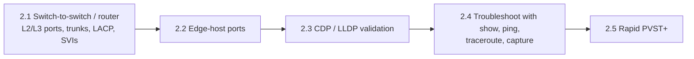

# Domain 2 — Switching and Network Access (25%)



## 2.1 Connectivity

```text
interface g1/0/1
 no switchport                       ! routed port
 ip address 10.0.0.1 255.255.255.252
interface g1/0/24
 switchport trunk encapsulation dot1q   ! only where ISL exists
 switchport mode trunk
 switchport trunk native vlan 99
 switchport trunk allowed vlan 10,20,99
 switchport nonegotiate
interface range g1/0/47-48
 channel-group 1 mode active          ! LACP
interface port-channel 1
 switchport mode trunk
ip routing
interface vlan 10
 ip address 10.1.10.1 255.255.255.0
```

- LACP: active/active or active/passive. PAgP: desirable/desirable or desirable/auto. Static: on/on.
- Members must match speed, duplex, mode, VLANs, native VLAN.
- L3 EtherChannel: `no switchport` on members and Po; IP on Po.
- SVI up/up needs: VLAN exists, not shutdown, ≥ 1 active port in the VLAN (access or trunk forwarding).
- Router on a stick: subinterface `encapsulation dot1Q 10` (+ `native`).

## 2.2 Edge-host ports

| Device | Port config |
|---|---|
| Desktop, printer, IoT | Access VLAN, PortFast, BPDU guard, port security (printer: max 1, sticky/static) |
| IP phone + PC | Access data VLAN + `switchport voice vlan X`, PortFast |
| AP (local mode) | Access, AP management VLAN |
| AP (FlexConnect) | Trunk: native = mgmt, client VLANs allowed |
| Virtualized host | Trunk with VM VLANs |
| Firewall/LB appliance | Trunk or routed port per design; no PortFast on links that run STP |

## 2.3 CDP / LLDP

| | CDP | LLDP |
|---|---|---|
| Standard | Cisco | IEEE 802.1AB |
| Default | On | Often off (`lldp run`) |
| Timers | 60/180 s | 30/120 s |
| Show | `show cdp neighbors [detail]` | `show lldp neighbors [detail]` |

Columns: **Local Intrfce** = your port; **Port ID** = their port. Use it to fix diagrams. Disable on untrusted ports (`no cdp enable`, `no lldp transmit`).

## 2.4 Troubleshooting L2/L3

| Check | Command |
|---|---|
| Port state/VLAN | `show interfaces status`, `show interfaces g0/1 switchport` |
| VLAN membership | `show vlan brief` (access only) |
| Trunks | `show interfaces trunk` (allowed, active, forwarding) |
| MAC location | `show mac address-table address <mac>` |
| STP | `show spanning-tree vlan X` |
| Err-disabled | `show interfaces status err-disabled`, `show errdisable recovery` |
| L3 | `ping`, `traceroute`, `show ip interface brief`, `show ip route` |
| Capture | `monitor session 1 source interface g0/5` / `destination interface g0/10` (SPAN) |

## 2.5 Rapid PVST+

- Root = lowest bridge ID (priority + VLAN ID + MAC). Priority in steps of 4096.
- `spanning-tree mode rapid-pvst`; `spanning-tree vlan 10 root primary` (24576) / `secondary` (28672).
- Root port = lowest cost to root → lowest sender BID → lowest sender port ID.
- Designated port per segment; root's ports are all designated.
- Costs (short): 10M 100, 100M 19, 1G 4, 10G 2.
- RSTP states: **discarding, learning, forwarding**. Roles: root, designated, **alternate** (backup to root via another switch), **backup** (same segment), disabled.
- PortFast = edge, immediate forwarding. BPDU guard = err-disable on BPDU. Root guard = root-inconsistent on superior BPDU. Loop guard = loop-inconsistent if BPDUs stop.

```text
spanning-tree portfast default
spanning-tree portfast bpduguard default
interface g1/0/48
 spanning-tree guard root
show spanning-tree vlan 10
show spanning-tree inconsistentports
```

## Traps

- `switchport trunk allowed vlan 30` **replaces** the list; use `add`.
- passive/passive and auto/auto never form a bundle; `on` does not negotiate with LACP/PAgP.
- Native VLAN mismatch: CDP warning, untagged traffic leaks between VLANs; tagged VLANs still work.
- `show vlan brief` does not list trunk ports.
- PortFast on a switch-to-switch link can cause loops; BPDU guard protects against that mistake.
