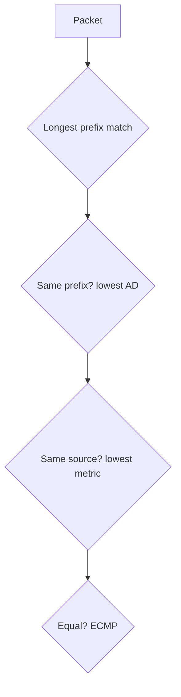

# Domain 3 — IP Routing (20%)



## 3.1 Reading the table

```text
Gateway of last resort is 203.0.113.1 to network 0.0.0.0
S*    0.0.0.0/0 [1/0] via 203.0.113.1
O     10.1.0.0/16 [110/20] via 10.0.12.2, 00:12:44, GigabitEthernet0/1
C     10.0.12.0/30 is directly connected, GigabitEthernet0/1
L     10.0.12.1/32 is directly connected, GigabitEthernet0/1
```

Codes: C connected, L local, S static, `*` candidate default, O OSPF intra-area, O IA inter-area, O E1/E2 external, D EIGRP, D EX EIGRP external, B BGP, R RIP.

AD: connected 0 · static 1 · eBGP 20 · EIGRP 90 · OSPF 110 · IS-IS 115 · RIP 120 · EIGRP ext 170 · iBGP 200 · 255 unusable.

## 3.2 Static routing

```text
ip route 10.2.0.0 255.255.0.0 10.0.12.2              ! network (recursive)
ip route 10.2.0.0 255.255.0.0 g0/1 10.0.12.2         ! fully specified
ip route 0.0.0.0 0.0.0.0 203.0.113.1                 ! default
ip route 10.9.9.9 255.255.255.255 10.0.12.2          ! host
ip route 0.0.0.0 0.0.0.0 198.51.100.1 250            ! floating
ipv6 route ::/0 2001:db8:ffff::2
ipv6 route ::/0 g0/1 fe80::2                         ! link-local needs interface
```

Troubleshoot: next hop unreachable → route not installed; wrong mask; missing return route; floating route never activates if the primary stays in the table (use IP SLA/track or a dynamic protocol).

## 3.3 OSPFv2 / OSPFv3 (single area)

```text
router ospf 1
 router-id 1.1.1.1
 auto-cost reference-bandwidth 100000
 passive-interface default
 no passive-interface g0/0
 network 10.0.12.0 0.0.0.3 area 0
interface g0/0
 ip ospf 1 area 0                       ! alternative to network
 ip ospf network point-to-point
 ip ospf priority 0
ipv6 router ospf 1
 router-id 1.1.1.1
interface g0/0
 ipv6 ospf 1 area 0
show ip ospf neighbor | interface [brief] | database
show ip protocols
clear ip ospf process
```

- States: Down → Init → 2-Way → ExStart → Exchange → Loading → Full.
- Must match: area, subnet/mask (broadcast), hello/dead (10/40), auth, stub flags, MTU (ExStart/Exchange stuck).
- RID: manual → highest up loopback → highest up interface; change needs process restart.
- DR/BDR: highest priority (0 = never), then highest RID; **non-preemptive**. DROTHER–DROTHER = 2-Way (normal).
- P2P network type: no DR, `FULL/ -`.
- Cost = ref BW / BW (default ref 100 Mbps ⇒ FE/GE/10GE all cost 1).
- OSPF multicast 224.0.0.5 (all), 224.0.0.6 (DR/BDR); IP protocol 89.

## 3.4 HSRP / VRRP status

```text
R1# show standby brief
Interface   Grp  Pri P State   Active          Standby         Virtual IP
Gi0/0       10   110 P Active  local           10.1.1.3        10.1.1.1
R1# show vrrp brief
Interface   Grp Pri Time  Own Pre State   Master addr     Group addr
Gi0/0       20  120 3531       Y  Master  10.1.2.2        10.1.2.1
```

| | HSRP | VRRP |
|---|---|---|
| Roles | Active/Standby | Master/Backup |
| Priority default | 100 | 100 (owner 255) |
| Preempt default | **Off** | **On** |
| vMAC | v1 0000.0c07.acXX · v2 0000.0c9f.fXXX | 0000.5e00.01XX |
| Multicast | 224.0.0.2 (v1) / .102 (v2) | 224.0.0.18 |

Higher priority wins (tie → higher IP). The `P` column means preempt configured.

## Traps

- LPM beats AD every time.
- A static route to an Ethernet interface without a next hop relies on proxy ARP.
- `network 10.0.12.0 0.0.0.3 area 0` uses a **wildcard**, not a mask.
- OSPF process IDs do not need to match; router IDs must be unique.
- A router with HSRP priority 120 but no preempt stays standby if another router was active first.
