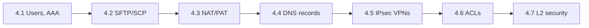

# Domain 4 — Network Services and Security (20%)



## 4.1 Local users and AAA

```text
username admin privilege 15 algorithm-type scrypt secret Str0ng!Pass
enable algorithm-type scrypt secret En4ble!Pass
aaa new-model
tacacs server ISE1
 address ipv4 10.99.0.30
 key T4cKey
radius server RAD1
 address ipv4 10.99.0.31 auth-port 1812 acct-port 1813
 key R4dKey
aaa authentication login default group tacacs+ local
aaa authorization exec default group tacacs+ local
aaa accounting commands 15 default start-stop group tacacs+
line vty 0 15
 transport input ssh
```

| | RADIUS | TACACS+ |
|---|---|---|
| Transport | UDP 1812/1813 | TCP 49 |
| Encryption | Password only | Whole body |
| AAA | Authn + authz combined | Separate |
| Use | Network access, 802.1X, VPN | Device admin, per-command authz |

`local` fallback is used only when the server **does not respond**.

## 4.2 SFTP / SCP file management

```text
ip domain name lab.local
crypto key generate rsa modulus 2048
ip ssh version 2
ip scp server enable
aaa authorization exec default local
copy running-config scp://admin@10.99.0.20/backups/r1.cfg
copy sftp://admin@10.99.0.20/images/c8000v.bin flash:
verify /md5 flash:c8000v.bin
```

Avoid TFTP/FTP for anything sensitive: clear text.

## 4.3 NAT/PAT (IOS XE)

```text
interface g0/1
 ip nat inside
interface g0/0
 ip nat outside
ip access-list standard NAT-IN
 permit 10.0.0.0 0.255.255.255
ip nat inside source list NAT-IN interface g0/0 overload          ! PAT
ip nat inside source static 10.1.1.80 203.0.113.80                ! static
ip nat inside source static tcp 10.1.1.80 443 203.0.113.5 443     ! port forward
ip nat pool PUB 203.0.113.10 203.0.113.20 prefix-length 24
ip nat inside source list NAT-IN pool PUB                          ! dynamic
show ip nat translations
show ip nat statistics
clear ip nat translation *
```

Terms: inside local (real private) · inside global (translated public) · outside global (real remote) · outside local (remote as seen inside).

## 4.4 DNS records

A (IPv4) · AAAA (IPv6) · CNAME (alias, not at apex) · MX (mail, lower preference first) · NS (delegation) · PTR (reverse, in-addr.arpa / ip6.arpa) · SOA · TXT (SPF/DKIM).
Diagnose with `nslookup -type=mx example.com`, `dig example.com MX`, `dig -x 203.0.113.25`.
Router: `ip name-server 10.99.0.53`, `ip domain lookup`, `ip host r2 10.0.12.2`.

## 4.5 IPsec VPNs (describe)

- Site-to-site: gateways at each site, tunnel mode, hosts unaware. Remote access: client (IPsec/IKEv2 or TLS) on each device.
- IKEv2 (UDP 500, NAT-T UDP 4500) builds SAs; **ESP** (IP 50) encrypts + authenticates; AH (IP 51) authenticates only, breaks with NAT.
- Policy-based (crypto ACL) vs route-based (VTI, works with routing protocols).
- TLS VPN on 443 traverses most firewalls.

## 4.6 ACLs

| Type | Numbers | Matches | Place |
|---|---|---|---|
| Standard | 1-99, 1300-1999 | Source | Near destination |
| Extended | 100-199, 2000-2699 | Proto, src, dst, ports | Near source |

```text
ip access-list extended WEB
 10 permit tcp 10.10.10.0 0.0.0.255 host 10.50.0.80 eq 443
 20 deny ip 10.10.10.0 0.0.0.255 10.50.0.0 0.0.255.255 log
 30 permit ip any any
interface g0/1
 ip access-group WEB in
line vty 0 15
 access-class MGMT in
```

Top-down, first match, implicit deny; one per interface/direction/protocol; `host` = 0.0.0.0 wildcard, `any`.

## 4.7 Layer 2 security

```text
ip dhcp snooping
ip dhcp snooping vlan 10
no ip dhcp snooping information option
interface g1/0/48
 ip dhcp snooping trust
 ip arp inspection trust
interface range g1/0/1-24
 ip dhcp snooping limit rate 15
 storm-control broadcast level 5.00
 storm-control action trap
 switchport port-security maximum 2
 switchport port-security violation restrict
ip arp inspection vlan 10
ipv6 nd raguard policy HOSTS
 device-role host
interface range g1/0/1-24
 ipv6 nd raguard attach-policy HOSTS
```

Port security modes: protect (drop, silent) · restrict (drop + log/count) · shutdown (err-disable, default).

## Traps

- PAT needs `overload`; NAT needs both inside and outside interfaces.
- DAI depends on DHCP snooping bindings; static hosts need ARP ACLs.
- Trust only uplinks toward real DHCP servers.
- A deny-only ACL blocks everything.
- `group tacacs+ local`: a wrong password at TACACS+ does **not** fall back to local.
