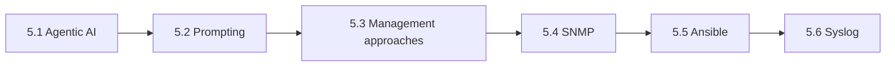

# Domain 5 — AI, and Network Operations and Management (10%)



## 5.1 Agentic AI in network operations

- An **agent** = an LLM that plans, calls **tools** (show commands, telemetry/flow queries, ticketing, config APIs), observes results and iterates toward a goal.
- Uses: incident triage, root-cause hypotheses, change pre-checks, documentation, compliance checks.
- Guardrails: least privilege; read-only by default; **human approval** for changes; scoped device lists; audit logging; rate limits; validate outputs in a lab/CI.

## 5.2 Selecting a generative AI prompt

| Element | Good practice |
|---|---|
| **Data classification** | Never paste secrets, credentials, customer data or full configs into an unapproved/public tool; mask or use an approved enterprise tool |
| **Persona** | "You are a senior network engineer…" |
| **Instructions** | Clear task, constraints ("do not invent commands"), context (platform, version) |
| **Output format** | Table, JSON, numbered steps, config snippet |

Example: "You are a CCNP-level engineer. Review this sanitized IOS XE ACL for shadowed entries. Do not assume other config. Return a table: sequence, issue, fix."

## 5.3 Management approaches

| Approach | Description |
|---|---|
| Device-based | CLI/GUI per device |
| Cloud-based | Cloud dashboard (Meraki); data plane local |
| Controller-based | Controller (Catalyst Center, ACI, SD-WAN Manager) with northbound REST API and southbound NETCONF/RESTCONF/SSH |
| Automation-based | Scripts/tools push config (Python, Ansible) |
| Infrastructure as code | Desired state in Git, CI validation, automated deploy, drift detection |

Planes: management (SSH/SNMP/API) · control (OSPF/STP/BGP) · data (forwarding).

## 5.4 SNMP

- Manager ↔ agent; MIB objects addressed by OID.
- Get/GetNext/GetBulk/Set from manager (UDP **161**); Trap (unacknowledged) / Inform (acknowledged) from agent (UDP **162**).
- v1/v2c: community strings (clear text). v3: users, noAuthNoPriv / authNoPriv / **authPriv** (SHA + AES).

```text
snmp-server group MON v3 priv
snmp-server user nms MON v3 auth sha AuthPass1 priv aes 128 PrivPass1
snmp-server host 10.99.0.20 version 3 priv nms
snmp-server enable traps
```

## 5.5 Ansible

- Agentless; control node pushes over SSH (`network_cli`), NETCONF or HTTP API.
- **Inventory** (hosts/groups/vars), **playbook** (plays → tasks → modules), **modules** (`cisco.ios.ios_command`, `ios_config`, resource modules like `ios_vlans`).
- Idempotent resource modules: `state: merged | replaced | overridden | deleted`.
- Dry run: `ansible-playbook site.yml --check --diff`.

```yaml
- hosts: routers
  gather_facts: false
  tasks:
    - cisco.ios.ios_command:
        commands: [show ip interface brief]
      register: out
    - ansible.builtin.debug: var=out.stdout_lines
```

## 5.6 Syslog

`seq: timestamp: %FACILITY-SEVERITY-MNEMONIC: text` → e.g. `%OSPF-5-ADJCHG`.

| 0 | 1 | 2 | 3 | 4 | 5 | 6 | 7 |
|---|---|---|---|---|---|---|---|
| Emergency | Alert | Critical | Error | Warning | Notification | Informational | Debugging |

`logging trap 4` → sends 0-4. `logging buffered 6`, `logging console 3`, `service timestamps log datetime msec`, `logging host 10.99.0.14`. Mnemonic: Every Awesome Cisco Engineer Will Need Ice cream Daily.

## Traps

- Informs are acknowledged; traps are not.
- Ansible needs no agent on the network device.
- Lower syslog number = more severe.
- A good prompt considers data classification first.
