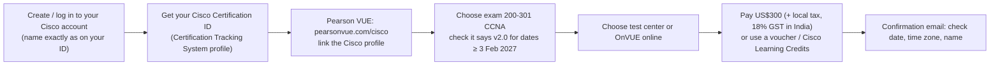

# CCNA Exam Day Guide

Policies change. Re-check every item on the official Cisco and Pearson VUE pages (links in [resources.md](resources.md)) when you book.

## 1. Registration steps

| Item | Detail |
|---|---|
| Exam | 200-301 CCNA, Implementing and Administering Cisco Solutions **v2.0** (first test date 3 Feb 2027) |
| Duration | 120 minutes (plus NDA/tutorial time) |
| Price | US$300 list (≈ ₹26,400 at ₹88/USD, plus 18% GST); Pearson VUE charges in USD, so your bank sets the rate |
| Delivery | Pearson VUE test center (Pune has several) or OnVUE online proctoring |
| Result | Pass/fail shown at the end; score report with per-domain results in your Pearson VUE/Cisco account |
| Validity | 3 years. Recertify by passing an exam again or by earning Continuing Education credits (check the current CE requirement for CCNA) |
| Retake | If you fail, you must wait before retaking (Cisco's policy has been 5 calendar days for the same exam; confirm the current rule) |
| Reschedule/cancel | Do it well in advance through Pearson VUE (late changes forfeit the fee; check the exact cutoff in your booking) |

## 2. Test center vs online (OnVUE)

| | Test center | OnVUE |
|---|---|---|
| Environment | Controlled, quiet, locker for belongings | Your room: clean desk, no second monitor, nobody enters |
| Tech risk | Low | Webcam, mic, bandwidth, corporate laptop restrictions; run the system test days before |
| ID | Government-issued photo ID with signature, name must match the booking (passport is safest) | Same, shown on webcam |
| Breaks | Not during the exam | Not allowed; leaving the camera ends the exam |
| Recommendation | **Prefer a test center** for your first attempt | Only if you control the room and network |

## 3. Time management

- 120 minutes. If the exam has around 100 items, that is about 70 seconds per item, but sims take longer. Budget: **sims 5-8 minutes each**, MCQs 45-60 seconds.
- **Cisco exams do not let you go back** to a previous question. Answer every item before moving on. Never leave an item blank; there is no penalty for guessing.
- Read the last line of the question first ("Which TWO…", "What is the next hop…"). Count required answers.
- For subnetting, write your powers-of-2 table on the whiteboard/erasable sheet in the first minute.
- In sims: read all tasks first; do exactly what is asked; check with `show` commands; save the config only if the task says so; do not change things not mentioned.
- Checkpoint: by minute 60 you should be at or past the halfway point.

## 4. Final 7-day revision plan

| Day | Focus | Activity |
|---|---|---|
| D-7 | Weakest domain from practice exams | Re-read domain notes; redo its labs/sims |
| D-6 | Subnetting + IPv6 | 40 random drills (`subnet_calc.py practice --count 40`), EUI-64, compression |
| D-5 | Switching | Sim 04 from memory in < 20 minutes; STP election on paper for 3 topologies |
| D-4 | Routing | Sim 05; read 10 routing tables and pick next hops; OSPF neighbor fault list |
| D-3 | Services + security | Sims 03, 07, 08; NAT terms; ACL placement; L2 security trust rules |
| D-2 | Domain 5 + flashcards | Agentic AI, prompting, SNMP, Ansible, syslog; Anki: all due + "exam" tag |
| D-1 | Light review | Traps sections of all domain notes; check ID, route, booking; sleep 8 hours |
| D-0 | Exam | Arrive 30 minutes early; water; breathe; first-minute whiteboard table |

## 5. Checklist (night before)

- [ ] Booking confirmation, time and address (or OnVUE system test passed).
- [ ] Valid ID; name matches the booking exactly.
- [ ] Route and travel time to the center; leave a buffer.
- [ ] No new topics. Flashcards and traps only.
- [ ] Phone off and in the locker at the center.

## 6. After the exam

- **Pass:** your badge arrives via Credly in a few days. Update LinkedIn and your resume. Plan CCNA Automation (200-901) next.
- **Fail:** download the score report, list domains below 70%, redo those modules and sims for 2-3 weeks, then rebook. Many good engineers pass on the second attempt.
