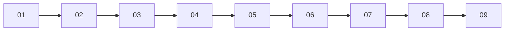

# CCNA v2.0 Exam-Style Simulations

Each sim is like an exam simulation: a short scenario, a fixed topology, specific tasks, and a strict check. Build each topology in **Packet Tracer** (IOS syntax). Sim 09 uses Ansible against Containerlab or any IOS device. Give yourself the time limit shown; the real exam is 120 minutes for everything.

| # | Sim | Domain topics | Time |
|---|---|---|---|
| 01 | [Interface and cable diagnosis](sim01-interfaces.md) | 1.1 | 10 min |
| 02 | [IPv4/IPv6 addressing faults](sim02-addressing.md) | 1.3, 1.4 | 15 min |
| 03 | [DHCP relay and PAT](sim03-dhcp-nat.md) | 1.7, 4.3 | 15 min |
| 04 | [Trunks, LACP, Rapid PVST+, edge ports, CDP](sim04-switching.md) | 2.1, 2.2, 2.3, 2.5 | 20 min |
| 05 | [Static routes, OSPF and FHRP status](sim05-routing.md) | 3.1-3.4 | 20 min |
| 06 | [L2/L3 troubleshooting ticket](sim06-troubleshoot.md) | 2.4 | 15 min |
| 07 | [AAA, SSH, SCP, ACLs, syslog](sim07-device-security.md) | 4.1, 4.2, 4.6, 5.6 | 20 min |
| 08 | [DHCP snooping, DAI, storm control, port security](sim08-l2-security.md) | 4.7 | 15 min |
| 09 | [Ansible: execute commands on IOS](sim09-ansible.md) | 5.5 | 15 min |

## Scoring

- **Pass:** every check in the "Verify" section succeeds within the time limit.
- Save your `.pkt` files as `simNN-<date>.pkt` and redo failed sims after 3 days.
- Exam tip: in real sims, unanswered tasks score zero. Do the quick tasks first, save the configuration when the instructions say so, and do not change things the task did not ask you to change.
