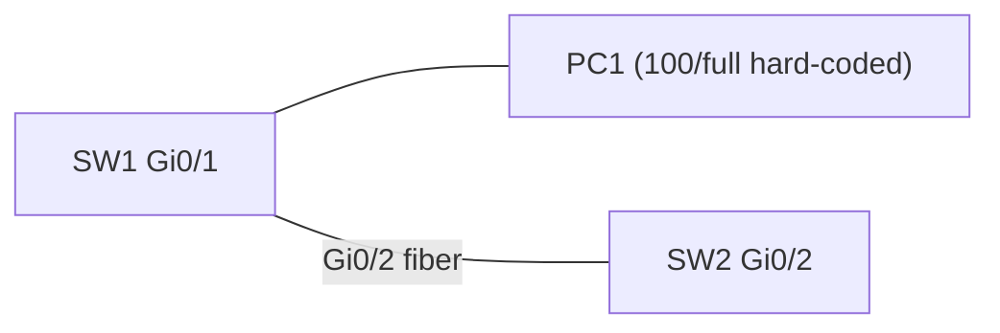

# Sim 01 — Interface and Cable Diagnosis (10 min)

## Scenario

Users on PC1 report slow file copies. The SW1-SW2 fiber uplink logs errors. You may only use `show` commands first, then fix the issues.

Build: SW1 Gi0/1 to PC1 (set PC1 to 100 Mbps full duplex). On SW1 Gi0/1 configure `speed 100` and leave duplex auto (this creates the mismatch). Connect SW1-SW2 Gi0/2 with any fiber.

## Tasks

1. Identify the duplex/speed state of SW1 Gi0/1 and explain the symptom.
2. Fix the PC1 port so both ends agree.
3. Name the counters you would watch on the fiber link to confirm a dirty connector or failing optic, and the command that shows optical levels on real hardware.

## Verify

- `show interfaces g0/1` shows `Full-duplex, 100Mb/s` and late collisions stop increasing (`clear counters g0/1` first).
- You can name: CRC, input errors, `show interfaces transceiver` (Tx/Rx dBm).

Solution

1. With speed forced to 100 and duplex auto on one side, and the PC hard-coded, the switch cannot negotiate duplex and falls back to **half duplex** at 100 Mbps. Half side: late collisions; full side: CRC/runts.
2. Either `duplex full` on SW1 Gi0/1 (matching the PC) or set both ends to auto (best practice): `interface g0/1` → `speed auto` → `duplex auto`, and set PC1 to auto.
3. Rising **CRC** and **input errors** on the fiber with matching duplex point to the physical layer; `show interfaces transceiver [detail]` shows Rx power below threshold for a dirty/failing optic.

