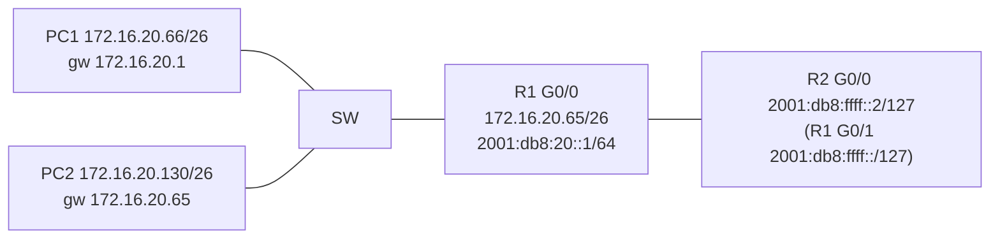

# Sim 02 — IPv4/IPv6 Addressing Faults (15 min)

## Scenario

Two PCs in the same VLAN cannot reach other networks. IPv6 between R1 and R2 does not work. Fix only what is wrong.

## Tasks

1. PC1 cannot reach anything off-subnet. Find and fix the fault.
2. PC2 cannot reach R1 at all. The VLAN uses 172.16.20.64/26. Fix PC2's settings.
3. R1 has `ipv6 address 2001:db8:20::1/64` on G0/0, but PCs get no IPv6 address by SLAAC. Fix it.
4. R1 G0/1 and R2 G0/0 use the /127 shown. R1 cannot ping 2001:db8:ffff::2. R2 has the address `2001:db8:ffff::2/127`. Find the fault.

## Verify

- PC1 and PC2 ping R1 and a loopback on R2.
- PCs show a 2001:db8:20::/64 SLAAC address and a default route via R1's link-local.
- `ping 2001:db8:ffff::1` from R2 works.

Solution

1. PC1 is in 172.16.20.64/26 (.65-.126). Its gateway 172.16.20.1 is outside the subnet. Set gateway **172.16.20.65**.
2. PC2 172.16.20.130/26 is in 172.16.20.128/26, a different subnet from the VLAN (172.16.20.64/26, hosts .65-.126). Readdress PC2 to a free address in that range, for example 172.16.20.67/26, gateway 172.16.20.65.
3. Missing `ipv6 unicast-routing` on R1, so it does not send RAs.
4. 2001:db8:ffff::/127 contains ::0 and ::1. R2 has **::2**, which is in the next /127. Change R2 to `2001:db8:ffff::1/127`.

