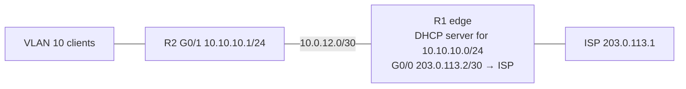

# Sim 03 — DHCP Relay and PAT (15 min)



## Tasks

1. On R1, create DHCP pool `VLAN10`: network 10.10.10.0/24, gateway 10.10.10.1, DNS 8.8.8.8, exclude .1-.20.
2. Make clients behind R2 receive addresses from R1.
3. Configure PAT on R1 for 10.0.0.0/8 using the G0/0 address. R1 G0/1 (toward R2) is inside.
4. Add a static route on R1 for 10.10.10.0/24 and a default route on R2 so traffic flows.

## Verify

- `show ip dhcp binding` on R1 lists clients from 10.10.10.21 upward.
- A client pings 203.0.113.1; `show ip nat translations` shows `icmp 203.0.113.2:<id>` entries.

<details><summary>Solution</summary>

```text
R1(config)# ip dhcp excluded-address 10.10.10.1 10.10.10.20
R1(config)# ip dhcp pool VLAN10
R1(dhcp-config)# network 10.10.10.0 255.255.255.0
R1(dhcp-config)# default-router 10.10.10.1
R1(dhcp-config)# dns-server 8.8.8.8
R2(config)# interface g0/1
R2(config-if)# ip helper-address 10.0.12.1
R1(config)# interface g0/1
R1(config-if)# ip nat inside
R1(config)# interface g0/0
R1(config-if)# ip nat outside
R1(config)# access-list 1 permit 10.0.0.0 0.255.255.255
R1(config)# ip nat inside source list 1 interface g0/0 overload
R1(config)# ip route 10.10.10.0 255.255.255.0 10.0.12.2
R1(config)# ip route 0.0.0.0 0.0.0.0 203.0.113.1
R2(config)# ip route 0.0.0.0 0.0.0.0 10.0.12.1
```

</details>
