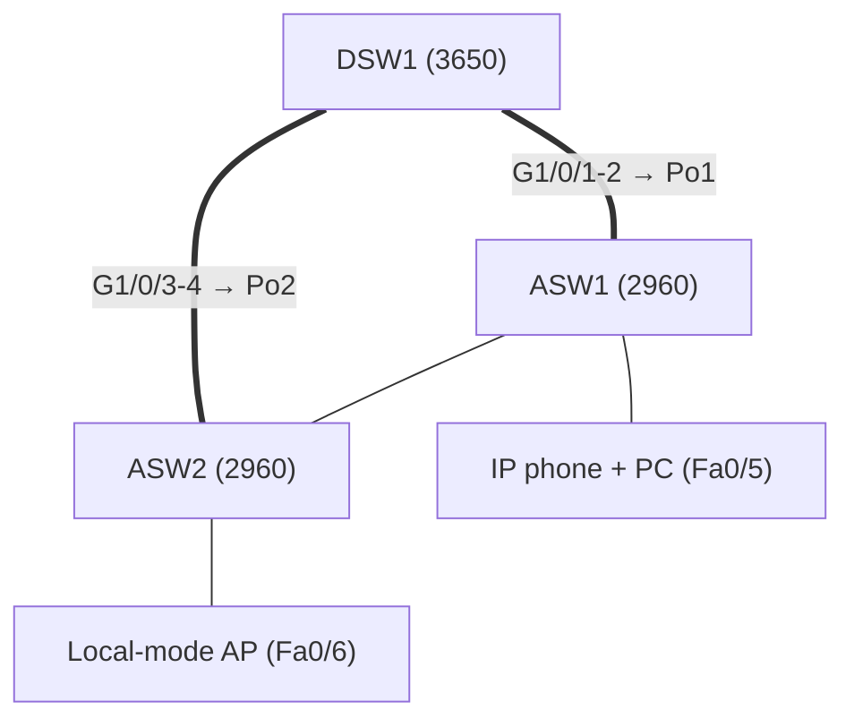

# Sim 04 — Trunks, LACP, Rapid PVST+, Edge Ports and CDP (20 min)



## Tasks

1. Create VLANs 10 (DATA), 150 (VOICE), 99 (MGMT) on all switches.
2. Build LACP EtherChannels Po1 and Po2 (DSW1 active, access switches passive). Make them 802.1Q trunks, native VLAN 99, allowed 10,99,150.
3. Use Rapid PVST+ everywhere. DSW1 must be root for all VLANs; ASW1 must be secondary root.
4. ASW1 Fa0/5: phone with PC. ASW2 Fa0/6: local-mode AP in VLAN 99. Both edge ports must go forwarding at once and shut down if a switch is connected.
5. Using CDP only, write down which DSW1 interfaces connect to which access switch ports. Disable CDP on Fa0/5.

## Verify

- `show etherchannel summary`: Po1(SU), Po2(SU), members (P).
- `show spanning-tree root`: DSW1 is root (priority 24576+VLAN) for 10, 99, 150.
- `show interfaces trunk`: native 99, allowed 10,99,150 on both Po.
- `show interfaces fa0/5 switchport`: access VLAN 10, voice VLAN 150.

<details><summary>Solution</summary>

```text
! all switches
vlan 10
 name DATA
vlan 150
 name VOICE
vlan 99
 name MGMT
spanning-tree mode rapid-pvst
! DSW1
interface range g1/0/1-2
 channel-group 1 mode active
interface range g1/0/3-4
 channel-group 2 mode active
interface range port-channel 1-2
 switchport trunk encapsulation dot1q
 switchport mode trunk
 switchport trunk native vlan 99
 switchport trunk allowed vlan 10,99,150
spanning-tree vlan 10,99,150 root primary
! ASW1 (ASW2 similar with Po2)
interface range g0/1-2
 channel-group 1 mode passive
interface port-channel 1
 switchport mode trunk
 switchport trunk native vlan 99
 switchport trunk allowed vlan 10,99,150
spanning-tree vlan 10,99,150 root secondary
interface fa0/5
 switchport mode access
 switchport access vlan 10
 switchport voice vlan 150
 spanning-tree portfast
 spanning-tree bpduguard enable
 no cdp enable
! ASW2
interface fa0/6
 switchport mode access
 switchport access vlan 99
 spanning-tree portfast
 spanning-tree bpduguard enable
DSW1# show cdp neighbors
```

</details>
