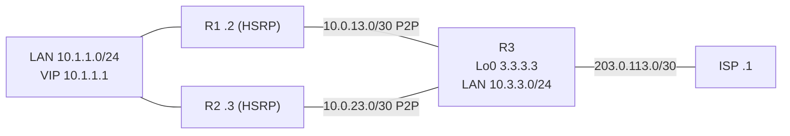

# Sim 05 — Static Routes, Single-Area OSPF and FHRP Status (20 min)



## Tasks

1. OSPFv2 process 10, area 0, on all router links and LANs. Router IDs 1.1.1.1, 2.2.2.2, 3.3.3.3. Use P2P network type on R1-R3 and R2-R3 links. LAN interfaces passive except the shared 10.1.1.0/24 segment (R1 and R2 must be neighbors there).
2. On the shared LAN, R1 must never be DR.
3. R3: default static route to the ISP, and advertise it into OSPF. Add a floating static default via 203.0.113.5 (backup ISP) that is used only if the primary is removed.
4. HSRPv2 group 1 on 10.1.1.0/24 with VIP 10.1.1.1. R2 should be active (priority 110, preempt). Read the status and identify the virtual MAC.
5. On R1, which next hop and route source are used for 10.3.3.50? For 8.8.8.8?

## Verify

- `show ip ospf neighbor` on R3: two neighbors `FULL/ -`.
- `show ip ospf neighbor` on R2: R1 as `FULL/DROTHER` (R2 is DR on the LAN).
- `show ip route` on R1: `O*E2 0.0.0.0/0`, `O 10.3.3.0/24`.
- `show standby brief` on R2: Active, VIP 10.1.1.1; vMAC 0000.0c9f.f001.

<details><summary>Solution</summary>

```text
R1(config)# router ospf 10
R1(config-router)# router-id 1.1.1.1
R1(config)# interface g0/0
R1(config-if)# ip ospf 10 area 0
R1(config-if)# ip ospf priority 0
R1(config-if)# standby version 2
R1(config-if)# standby 1 ip 10.1.1.1
R1(config)# interface g0/1
R1(config-if)# ip ospf 10 area 0
R1(config-if)# ip ospf network point-to-point
R2: same, router-id 2.2.2.2, plus: standby 1 priority 110 / standby 1 preempt
R3(config)# router ospf 10
R3(config-router)# router-id 3.3.3.3
R3(config-router)# passive-interface g0/2
R3(config-router)# default-information originate
R3(config)# ip route 0.0.0.0 0.0.0.0 203.0.113.1
R3(config)# ip route 0.0.0.0 0.0.0.0 203.0.113.5 250
(interfaces: ip ospf 10 area 0; ip ospf network point-to-point on P2P links)
```

Task 5: 10.3.3.50 → `O 10.3.3.0/24 [110/x] via 10.0.13.2` (OSPF, longest match). 8.8.8.8 → `O*E2 0.0.0.0/0 via 10.0.13.2` (default learned from R3).

</details>
