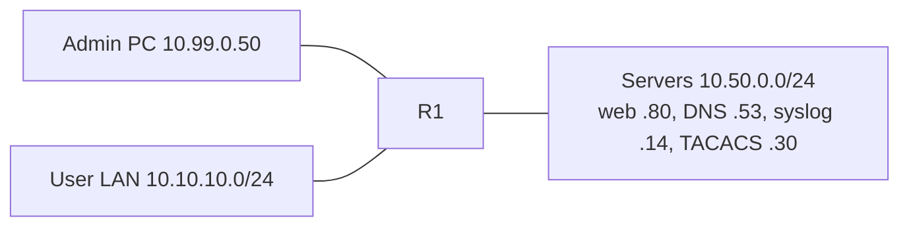

# Sim 07 — AAA, SSH, SCP, ACLs and Syslog (20 min)



## Tasks

1. Hostname R1, domain `lab.local`, RSA 2048 keys, SSHv2 only on VTY 0-15.
2. Local user `admin` privilege 15 with a **scrypt** secret. AAA: login via TACACS+ server 10.50.0.30 (key `T4c!`), falling back to local only if the server is unreachable.
3. Only 10.99.0.0/24 may open VTY sessions (named standard ACL `MGMT`).
4. Users may reach the web server on TCP 443 and the DNS server on UDP 53; all other traffic from users to 10.50.0.0/24 is denied and logged; everything else is permitted. Use named extended ACL `USERS-IN` in the correct place and direction.
5. Enable the SCP server and back up the running config to the admin PC by SCP (describe the command).
6. Send warnings and worse to syslog 10.50.0.14 with millisecond timestamps. Then read: `%SEC_LOGIN-4-LOGIN_FAILED` — what facility and severity?

## Verify

- SSH from 10.99.0.50 works; Telnet fails; SSH from 10.10.10.x fails.
- `show access-lists USERS-IN` counters match tests (HTTPS ok, ping to .80 denied).
- `show logging` shows the trap level `warnings`.

<details><summary>Solution</summary>

```text
hostname R1
ip domain name lab.local
crypto key generate rsa modulus 2048
ip ssh version 2
username admin privilege 15 algorithm-type scrypt secret Adm1n!Pass
aaa new-model
tacacs server TAC1
 address ipv4 10.50.0.30
 key T4c!
aaa authentication login default group tacacs+ local
ip access-list standard MGMT
 permit 10.99.0.0 0.0.0.255
line vty 0 15
 access-class MGMT in
 transport input ssh
ip access-list extended USERS-IN
 10 permit tcp 10.10.10.0 0.0.0.255 host 10.50.0.80 eq 443
 20 permit udp 10.10.10.0 0.0.0.255 host 10.50.0.53 eq 53
 30 deny ip 10.10.10.0 0.0.0.255 10.50.0.0 0.0.0.255 log
 40 permit ip any any
interface g0/1
 description USERS
 ip access-group USERS-IN in
ip scp server enable
! from R1: copy running-config scp://admin@10.99.0.50/r1.cfg
service timestamps log datetime msec
logging host 10.50.0.14
logging trap warnings
```

`%SEC_LOGIN-4-LOGIN_FAILED`: facility SEC_LOGIN, severity 4 (warning), mnemonic LOGIN_FAILED.

</details>
