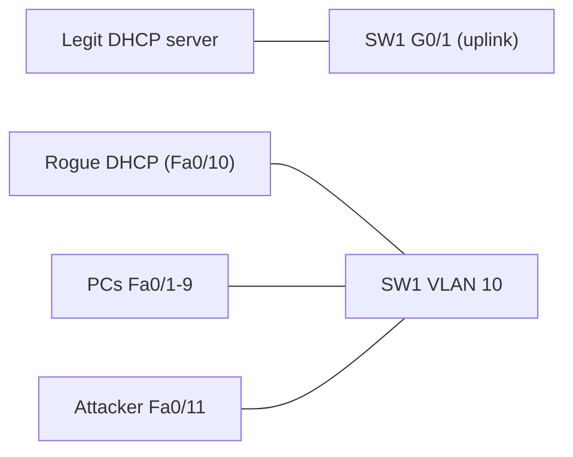

# Sim 08 — DHCP Snooping, DAI, Storm Control and Port Security (15 min)



## Tasks

1. Enable DHCP snooping for VLAN 10. Trust only the uplink G0/1. Rate-limit DHCP to 10 pps on Fa0/1-24. Disable option 82 insertion if the server rejects it.
2. Enable Dynamic ARP Inspection on VLAN 10; trust G0/1.
3. Storm control: broadcast 5% on Fa0/1-24; send a trap when exceeded.
4. Port security on Fa0/1-9: max 2 MACs, sticky, violation restrict.
5. (IPv6) Block RAs from host ports with RA guard (describe the commands; Packet Tracer may not support them).

## Verify

- PCs get addresses from the legit server only; `show ip dhcp snooping binding` lists them.
- A static-IP attacker sending gratuitous ARP for the gateway is dropped (`show ip arp inspection statistics` drops increase).
- `show port-security interface fa0/1` shows max 2, sticky MACs, Restrict.

<details><summary>Solution</summary>

```text
ip dhcp snooping
ip dhcp snooping vlan 10
no ip dhcp snooping information option
interface g0/1
 ip dhcp snooping trust
 ip arp inspection trust
interface range fa0/1-24
 ip dhcp snooping limit rate 10
 storm-control broadcast level 5.00
 storm-control action trap
ip arp inspection vlan 10
interface range fa0/1-9
 switchport mode access
 switchport port-security
 switchport port-security maximum 2
 switchport port-security mac-address sticky
 switchport port-security violation restrict
ipv6 nd raguard policy HOSTS
 device-role host
interface range fa0/1-24
 ipv6 nd raguard attach-policy HOSTS
```

</details>
