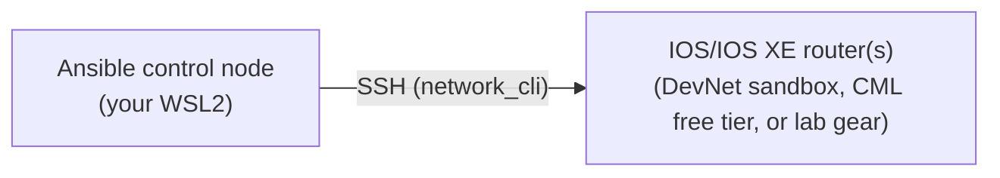

# Sim 09 — Ansible: Execute Commands on IOS (15 min)



Packet Tracer does not support Ansible. Use a free Cisco DevNet always-on IOS XE sandbox, Cisco Modeling Labs free tier, or any lab router with SSH. (Module 16 shows the same idea with SR Linux.)

## Tasks

1. Write `inventory.yml` with group `routers` (one host), `ansible_network_os: cisco.ios.ios`, `ansible_connection: ansible.netcommon.network_cli`, and credentials from environment variables.
2. Write `show.yml` that runs `show version` and `show ip interface brief` with `cisco.ios.ios_command` and prints the output.
3. Write `vlan_desc.yml` that sets the description of Loopback100 using `cisco.ios.ios_interfaces` with `state: merged`. Run it twice. The second run must report `changed=0`.
4. Run `vlan_desc.yml` with `--check --diff` after changing the description. Explain what you see.

## Verify

- `ansible-playbook -i inventory.yml show.yml` prints both outputs.
- Second run of `vlan_desc.yml`: `changed=0`.

<details><summary>Solution</summary>

```yaml
# inventory.yml
all:
  children:
    routers:
      hosts:
        r1: { ansible_host: 10.10.20.48 }
      vars:
        ansible_network_os: cisco.ios.ios
        ansible_connection: ansible.netcommon.network_cli
        ansible_user: "{{ lookup('env', 'IOS_USER') }}"
        ansible_password: "{{ lookup('env', 'IOS_PASS') }}"
```

```yaml
# show.yml
- hosts: routers
  gather_facts: false
  tasks:
    - name: Run show commands
      cisco.ios.ios_command:
        commands:
          - show version
          - show ip interface brief
      register: out
    - ansible.builtin.debug:
        var: out.stdout_lines
```

```yaml
# vlan_desc.yml
- hosts: routers
  gather_facts: false
  tasks:
    - cisco.ios.ios_interfaces:
        config:
          - name: Loopback100
            description: managed-by-ansible
            enabled: true
        state: merged
```

`--check --diff` shows the commands Ansible would send (`interface Loopback100` / `description ...`) without applying them.

</details>
