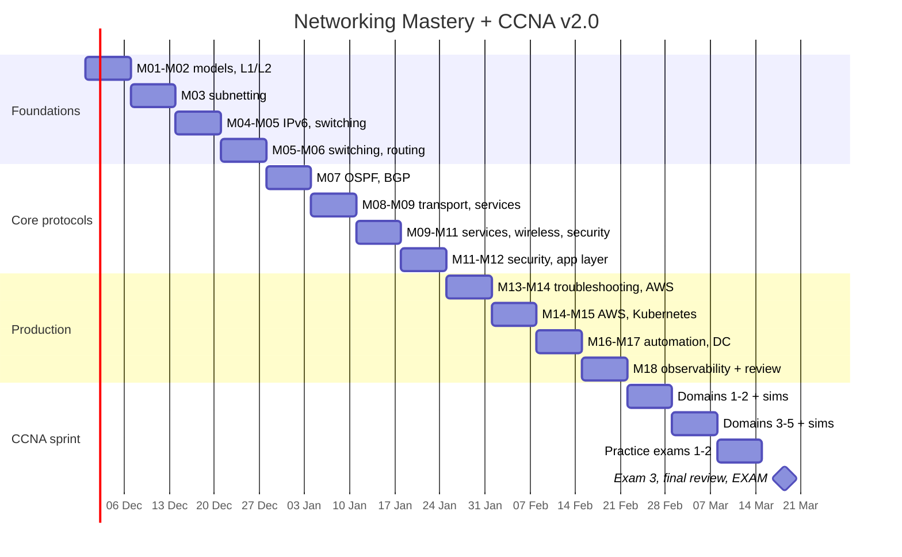

# 16-Week Study Plan: Curriculum + CCNA v2.0

**Daily budget:** about 1.5 hours on weekdays, 3 hours on one weekend day. **Start:** Monday 30 Nov 2026 (adjust dates to your start). **Target exam:** week 16 (around 20 March 2027), after v2.0 launches on 3 Feb 2027.

## Daily routine (every week)

| Block | Time | Task |
|---|---|---|
| Warm-up | 10 min | Anki: 20 new + all due cards from `flashcards.csv` |
| Learn | 40 min | Module README section(s) for the day |
| Do | 30 min | Lab steps or a sim |
| Drill | 10 min | `python3 tools/subnet_calc.py practice --count 5` (weeks 2-16) |

## Weeks 1-12: curriculum with exam focus

| Week | Mon | Tue | Wed | Thu | Fri | Weekend (3 h) | Milestone |
|---|---|---|---|---|---|---|---|
| 1 | M01 README §1-2 | M01 §3-5, lab 1-4 | M01 lab 5-7, quiz | M02 §1 | M02 §2, lab 1-4 | M02 lab 5-7 + quiz; Packet Tracer install | Quizzes 01-02 ≥ 13/15 |
| 2 | M03 §1 + powers of 2 | M03 magic number | Problems 1-15 | Problems 16-35 | Problems 36-50 | M03 lab + quiz; 30 random drills | 45/50 problems in < 40 min |
| 3 | M04 §1 | M04 §2 (NDP/SLAAC) | M04 lab | M04 quiz; M05 §1 | M05 §2 trunks | M05 lab steps 1-3 (PT) | Quiz 04 ≥ 13 |
| 4 | M05 STP | M05 EtherChannel, port security | M05 lab 4-6 + break/fix | M06 §1-2 | M06 FHRP + lab | M05/M06 quizzes; sim 04 | Explain STP election on paper |
| 5 | M07 OSPF §1 | OSPF neighbor states, DR | OSPF lab 1-4 | EIGRP overview; BGP basics | BGP lab 5-6 | M07 break/fix + quiz; sim 05 | Fix all 5 OSPF faults |
| 6 | M08 §1-2 | M08 lab 1-5 | M08 quiz; M09 DHCP | M09 DNS | M09 NAT | M09 lab A (PT) + B; sim 03 | Quiz 08 ≥ 13 |
| 7 | M09 NTP/SNMP/syslog | M09 quiz | M10 §1-2 | M10 lab (PT) + quiz | M11 ACLs | M11 lab A + C | Quizzes 09-10 ≥ 13 |
| 8 | M11 VPN/AAA | M11 L2 security | M11 lab B + quiz; sims 07-08 | M12 §1-2 | M12 lab | M12 quiz; **domain notes d4** | Sims 07-08 done |
| 9 | M13 method | M13 tools | M13 tickets 1-5 | M13 tickets 6-10 | M14 §1-2 | M14 lab (AWS, destroy after) | 8/10 tickets solved |
| 10 | M14 §3-4 + quiz | M15 §1-2 | M15 §3-5 | M15 lab 1-5 | M15 lab 6-7 + quiz | Capstone 4 | Capstone 4 done |
| 11 | M16 §1-3 | M16 §4-6 (Ansible, AI) | M16 lab | M17 §1-3 | M17 lab | M16-M17 quizzes; sim 09 | Ansible changed=0 on 2nd run |
| 12 | M18 §1-3 | M18 lab | M18 quiz | Capstone 1 (start) | Capstone 1 | Capstone 1 finish; **all module quizzes ≥ 85%** | Curriculum complete |

Capstones 2, 3 and 5 are scheduled after the exam (weeks 17-19), or on extra weekends if you are ahead.

## Weeks 13-16: CCNA v2.0 sprint

| Week | Mon | Tue | Wed | Thu | Fri | Weekend | Milestone |
|---|---|---|---|---|---|---|---|
| 13 | [d1 notes](domain-notes/d1-infrastructure.md) | Sims 01-03 | [d2 notes](domain-notes/d2-switching-access.md) | Sim 04 | Sim 06 | Redo labs 05 and 09 from memory | Sims 01-04, 06 pass |
| 14 | [d3 notes](domain-notes/d3-ip-routing.md) | Sim 05 | [d4 notes](domain-notes/d4-services-security.md) | Sims 07-08 | [d5 notes](domain-notes/d5-ai-operations.md) + sim 09 | `python3 tools/quiz_runner.py modules --all --limit 60` | Mixed quiz ≥ 85% |
| 15 | **Practice exam 1** (timed) | Review every wrong answer, re-read notes | Weak-domain labs | **Practice exam 2** (timed) | Review | Weak areas; book the exam if both ≥ 85% | Exams 1-2 ≥ 85% |
| 16 | **Practice exam 3** | Review | Final 7-day plan in [exam-day.md](exam-day.md) | Light review | Rest | **Exam** | CCNA |

## Rules for practice exams

1. Timed: 120 minutes, no notes, no pausing.
2. Score: ≥ 85% = ready. 75-84% = one more week on weak domains. < 75% = repeat the weak modules.
3. For every miss, write one line: "I chose X because …; the answer is Y because …".
4. Track scores per domain in [progress-tracker.md](../../progress-tracker.md).

## If you fall behind

- Drop Modules 08, 12, 14, 15, 17 and 18 to "read only" until after the exam; they are not on the blueprint.
- Never drop Modules 03, 05, 06, 07, 09 and 11. They are about 70% of the exam.
