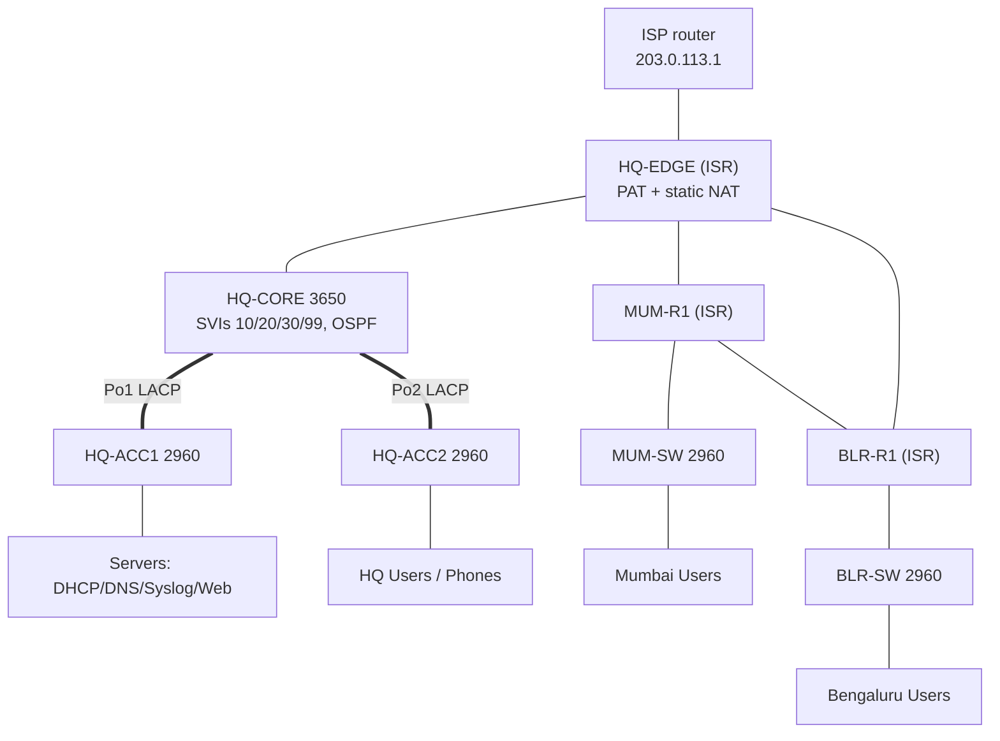

# Capstone 1 — 3-Site Enterprise Network (VLANs, OSPF, NAT, DHCP, ACLs)

## Scenario

"Acme Logistics" has a headquarters (HQ) in Pune and two branches (Mumbai, Bengaluru). You must design and build the network in Packet Tracer. HQ hosts the servers and the single internet connection.

## Requirements

| # | Requirement |
|---|---|
| R1 | Use **10.10.0.0/16** for the company. Plan subnets with VLSM (write the plan first). |
| R2 | HQ: VLAN 10 Users (100 hosts), VLAN 20 Servers (20 hosts), VLAN 30 Voice (50 phones), VLAN 99 Management. Branches: VLAN 10 Users (50 hosts), VLAN 99 Management. |
| R3 | HQ uses a 3650 L3 switch for inter-VLAN routing (SVIs) and two 2960 access switches with LACP uplinks and Rapid PVST+ (L3 switch is root). |
| R4 | WAN: point-to-point /30 links HQ-Mumbai, HQ-Bengaluru, Mumbai-Bengaluru (triangle for redundancy). |
| R5 | **OSPF** area 0 on the WAN and HQ core; each branch LAN is a passive interface. Router IDs set manually; reference bandwidth 100000. |
| R6 | DHCP: one server at HQ (Servers VLAN) serves all user VLANs at all sites through `ip helper-address`. |
| R7 | Internet: HQ edge router has 203.0.113.2/30 to the ISP (203.0.113.1). PAT for all internal users. A static NAT maps the web server 10.10.x.80 to 203.0.113.80 (use a /29 public block 203.0.113.80/29 routed by the ISP, or the interface IP for a port forward). |
| R8 | Default route from the edge router injected into OSPF (`default-information originate`). |
| R9 | ACLs: (a) only Management VLANs may SSH to network devices; (b) branch Users may reach HQ Servers on TCP 80/443 and UDP 53 only, plus DHCP; (c) block Users VLANs from the Management VLANs. |
| R10 | Security: SSHv2 only, local users with scrypt secrets, `login block-for`, banner, unused ports shutdown in VLAN 999, PortFast + BPDU guard on access ports, DHCP snooping on access switches. |
| R11 | NTP from the edge router to all devices; syslog to the server at HQ. |

## Topology



Note: you may connect the branch WAN links to HQ-CORE instead of HQ-EDGE. Document your choice.

## Deliverables

1. `ip-plan.md`: VLSM table (subnet, prefix, gateway, DHCP range).
2. The `.pkt` file.
3. `configs/`: `show running-config` of every device.
4. `tests.md`: output of every acceptance test.

## Acceptance tests

| # | Test | Expected |
|---|---|---|
| T1 | A Mumbai PC renews DHCP | Gets an address in the Mumbai Users subnet with the correct gateway |
| T2 | `show ip ospf neighbor` on every router | All neighbors FULL |
| T3 | `show ip route` on BLR-R1 | `O*E2 0.0.0.0/0` and routes to every subnet |
| T4 | Shut the HQ-Mumbai WAN link | Mumbai still reaches HQ through Bengaluru within ~40 s |
| T5 | A Bengaluru PC browses `http://203.0.113.80` from "outside" (ISP side PC) and an internal PC browses the internet server | Both work; `show ip nat translations` shows static and PAT entries |
| T6 | A branch PC pings an HQ server | Fails (ACL); HTTP to the web server works |
| T7 | SSH to HQ-CORE from a Users PC | Refused; from a Management PC works |
| T8 | Connect a rogue switch to an access port | Port goes err-disabled (BPDU guard) |
| T9 | `show ntp status` on a branch router | Synchronized |
| T10 | `show spanning-tree vlan 10` on HQ-ACC1 | Root port toward HQ-CORE |

## Reference solution (try first)

<details><summary>IP plan (one valid answer)</summary>

| Site / VLAN | Hosts | Subnet | Gateway |
|---|---|---|---|
| HQ Users (10) | 100 | 10.10.0.0/25 | 10.10.0.1 |
| HQ Voice (30) | 50 | 10.10.0.128/26 | 10.10.0.129 |
| HQ Servers (20) | 20 | 10.10.0.192/27 | 10.10.0.193 |
| HQ Mgmt (99) | 10 | 10.10.0.224/28 | 10.10.0.225 |
| Mumbai Users | 50 | 10.10.1.0/26 | 10.10.1.1 |
| Mumbai Mgmt | 10 | 10.10.1.64/28 | 10.10.1.65 |
| Bengaluru Users | 50 | 10.10.2.0/26 | 10.10.2.1 |
| Bengaluru Mgmt | 10 | 10.10.2.64/28 | 10.10.2.65 |
| WAN HQ-MUM | 2 | 10.10.255.0/30 | — |
| WAN HQ-BLR | 2 | 10.10.255.4/30 | — |
| WAN MUM-BLR | 2 | 10.10.255.8/30 | — |
| HQ-EDGE ↔ HQ-CORE | 2 | 10.10.255.12/30 | — |
| Loopbacks | — | 10.10.254.x/32 | — |

Check with `python3 tools/subnet_calc.py vlsm 10.10.0.0/24 --hosts 100 50 20 10`.

</details>

<details><summary>Key configuration snippets</summary>

```text
! HQ-EDGE
interface g0/0
 description ISP
 ip address 203.0.113.2 255.255.255.252
 ip nat outside
interface g0/1
 description HQ-CORE
 ip address 10.10.255.13 255.255.255.252
 ip nat inside
interface g0/2
 ip address 10.10.255.1 255.255.255.252
 ip nat inside
interface g0/3
 ip address 10.10.255.5 255.255.255.252
 ip nat inside
ip route 0.0.0.0 0.0.0.0 203.0.113.1
ip access-list standard NAT-INSIDE
 permit 10.10.0.0 0.0.255.255
ip nat inside source list NAT-INSIDE interface g0/0 overload
ip nat inside source static 10.10.0.200 203.0.113.80
router ospf 1
 router-id 10.10.254.1
 auto-cost reference-bandwidth 100000
 network 10.10.255.0 0.0.0.15 area 0
 default-information originate
ntp master 3

! HQ-CORE
ip routing
spanning-tree mode rapid-pvst
spanning-tree vlan 10,20,30,99 root primary
interface vlan 10
 ip address 10.10.0.1 255.255.255.128
 ip helper-address 10.10.0.194
interface vlan 99
 ip address 10.10.0.225 255.255.255.240
router ospf 1
 router-id 10.10.254.2
 auto-cost reference-bandwidth 100000
 passive-interface default
 no passive-interface g1/0/24
 network 10.10.0.0 0.0.0.255 area 0
 network 10.10.255.12 0.0.0.3 area 0

! Branch ACL (applied inbound on MUM-R1 LAN interface)
ip access-list extended MUM-USERS-IN
 permit udp any any eq bootps
 permit tcp 10.10.1.0 0.0.0.63 host 10.10.0.200 eq 80
 permit tcp 10.10.1.0 0.0.0.63 host 10.10.0.200 eq 443
 permit udp 10.10.1.0 0.0.0.63 host 10.10.0.194 eq 53
 deny   ip 10.10.1.0 0.0.0.63 10.10.0.192 0.0.0.31
 deny   ip 10.10.1.0 0.0.0.63 10.10.0.224 0.0.0.15
 deny   ip 10.10.1.0 0.0.0.63 10.10.1.64 0.0.0.15
 deny   ip 10.10.1.0 0.0.0.63 10.10.2.64 0.0.0.15
 permit ip 10.10.1.0 0.0.0.63 any

! VTY (all devices)
ip access-list standard MGMT-ONLY
 permit 10.10.0.224 0.0.0.15
 permit 10.10.1.64 0.0.0.15
 permit 10.10.2.64 0.0.0.15
line vty 0 15
 access-class MGMT-ONLY in
 transport input ssh
 login local
```

The server addresses in this solution: DHCP/DNS 10.10.0.194, web 10.10.0.200, syslog 10.10.0.195.

</details>
