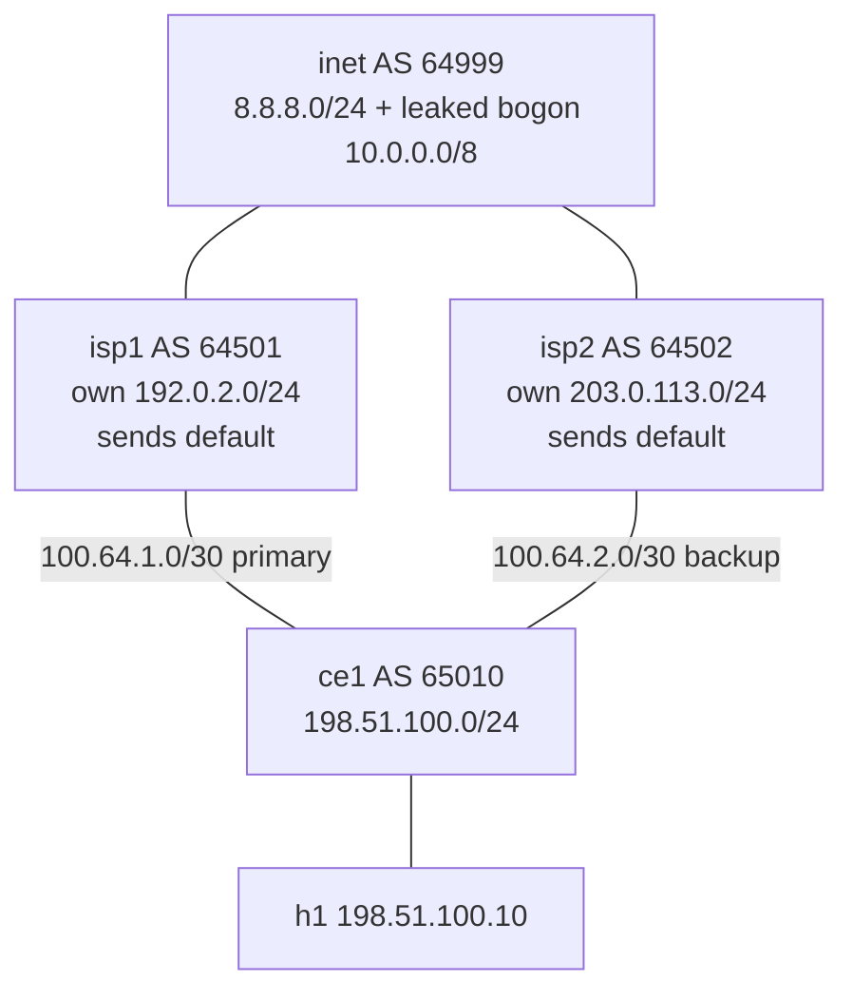

# Capstone 2 — BGP Multi-Homed Internet Edge with Route Filtering

## Scenario

Acme owns **198.51.100.0/24** and **AS 65010**. It buys internet from two providers. ISP1 is the primary (faster, cheaper). ISP2 is the backup. The starting configuration on `ce1` has two working eBGP sessions but **no policy at all**. Your job is to make it safe and predictable.

## Topology

Files: [`capstone2.clab.yml`](capstone2.clab.yml), [`ce1.conf`](ce1.conf) (starter), ISP and internet configs.



## Requirements

| # | Requirement |
|---|---|
| R1 | **No transit:** advertise only 198.51.100.0/24 to each ISP. |
| R2 | **Inbound filter:** accept only prefixes /24 or shorter (including the default), and drop RFC 1918, 100.64.0.0/10, 127.0.0.0/8 and your own prefix. |
| R3 | **Outbound traffic** prefers ISP1 (LOCAL_PREF 200 vs 100). |
| R4 | **Inbound traffic** prefers ISP1: prepend your AS three times toward ISP2. |
| R5 | `maximum-prefix 100` on both sessions. |
| R6 | **BFD** on both sessions for sub-second failure detection. |
| R7 | Failover: if ISP1 fails, h1 still reaches 8.8.8.8 through ISP2 in under 3 seconds of BFD detection; when ISP1 returns, traffic goes back. |

## Steps

1. Deploy and observe the problems **before** you fix anything:

   ```bash
   cd labs/capstones/02-bgp-multihomed-edge
   sudo containerlab deploy -t capstone2.clab.yml
   docker exec clab-cap2-isp2 vtysh -c "show bgp ipv4 unicast 192.0.2.0/24"
   docker exec clab-cap2-ce1 vtysh -c "show bgp ipv4 unicast"
   ```

   Look for: (a) isp2 learning ISP1's customer prefix **through you** (path `65010 64501`) — a transit leak; (b) ce1 accepting the bogon 10.0.0.0/8.

2. Write the policy on ce1 (in `vtysh` or by editing `ce1.conf` and redeploying).
3. Run the acceptance tests. Save the outputs in `tests.md`.

## Acceptance tests

| # | Command | Expected |
|---|---|---|
| T1 | `docker exec clab-cap2-isp1 vtysh -c "show bgp ipv4 unicast neighbors 100.64.1.2 routes"` | Only 198.51.100.0/24 |
| T2 | `docker exec clab-cap2-isp2 vtysh -c "show bgp ipv4 unicast 198.51.100.0/24"` | The path from ce1 shows `65010 65010 65010 65010` and is **not** best; the best path is via inet (`64999 64501 65010`) |
| T3 | `docker exec clab-cap2-ce1 vtysh -c "show bgp ipv4 unicast"` | No 10.0.0.0/8; default and public prefixes with LocPrf 200 via ISP1 marked best (`>`) |
| T4 | `docker exec clab-cap2-inet vtysh -c "show bgp ipv4 unicast 198.51.100.0/24"` | Best path via ISP1 (`64501 65010`) |
| T5 | `docker exec clab-cap2-h1 traceroute -n 8.8.8.8` | Through 100.64.1.1 (ISP1) |
| T6 | `docker exec clab-cap2-ce1 vtysh -c "show bfd peers brief"` | Two peers `up` |
| T7 | `docker exec clab-cap2-ce1 ip link set eth1 down` while `ping 8.8.8.8` runs on h1 | A few lost packets, then replies through ISP2. Bring eth1 up: traffic returns to ISP1 |
| T8 | `docker exec clab-cap2-isp2 vtysh -c "show bgp ipv4 unicast 192.0.2.0/24"` | Only via inet (`64999 64501`); never via 65010 |

## Reference solution

The full answer is in [`solution/ce1.conf`](solution/ce1.conf). To test it: change the ce1 bind in `capstone2.clab.yml` to `solution/ce1.conf` and redeploy with `--reconfigure`.

<details><summary>Why each piece matters</summary>

- **Transit leaks** are a real cause of internet outages (route leaks). RFC 8212 makes eBGP "deny by default" without policy. FRR enforces it unless you add `no bgp ebgp-requires-policy` (the starter file disables it to show the leak).
- **Inbound bogon filtering** protects you from a provider's mistakes and from hijacks.
- **LOCAL_PREF** controls your outbound choice for the whole AS. **AS-path prepending** influences how others send traffic to you (inbound), but it is only a hint. Some ISPs also accept communities to set local preference in their network.
- **maximum-prefix** shuts down a session that suddenly sends a full table you cannot handle.
- **BFD** detects failure in milliseconds instead of waiting for the 180-second BGP hold timer.

</details>

## Clean up

```bash
sudo containerlab destroy -t capstone2.clab.yml --cleanup
```
