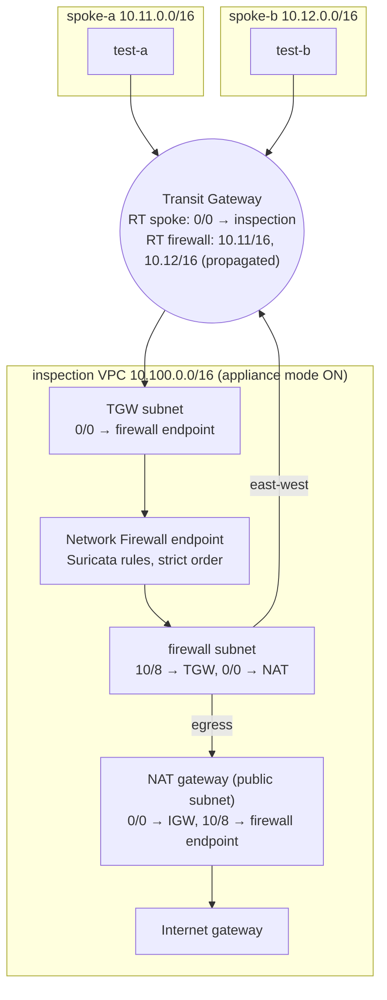

# Capstone 3 — Hub-and-Spoke AWS Network with Terraform (TGW + Inspection VPC)

## Scenario

Your company wants every packet between VPCs and every packet to the internet to pass a central firewall. Build the AWS reference pattern "centralized inspection with egress" with Terraform.

## Cost warning

AWS Network Firewall costs about **US$0.40 per endpoint-hour** plus data processing, and NAT gateways cost about US$0.05-0.06 per hour each. With `az_count = 1` the whole capstone costs roughly **US$0.70-0.80 per hour**. Deploy, test, and **destroy in the same session**. Set a budget alarm first.

## Architecture

Files: [`terraform/`](terraform/main.tf)



## Requirements

| # | Requirement |
|---|---|
| R1 | Spoke VPCs have **no** IGW or NAT; their only route is `0.0.0.0/0 → TGW`. |
| R2 | TGW uses two route tables: spokes are associated with `spoke` (default route to inspection); inspection is associated with `firewall` (spoke routes propagated). Spokes cannot reach each other without passing the firewall. |
| R3 | The inspection attachment has **appliance mode** enabled. |
| R4 | Inspection VPC route tables are **per AZ** so traffic uses the firewall endpoint in its own AZ (both directions). |
| R5 | Firewall policy (strict order): allow east-west ICMP; **block TCP 22 from spoke-a to spoke-b**; allow other east-west TCP; allow TLS egress only to `*.amazonaws.com` and `github.com`; drop all other TLS and plain HTTP egress. |
| R6 | Firewall alert logs go to CloudWatch Logs. |
| R7 | Access to test instances is through EC2 Instance Connect Endpoints (no public IPs, no bastion). |

## Steps

```bash
cd labs/capstones/03-aws-hub-spoke-inspection/terraform
terraform init
terraform apply            # about 10-15 minutes (the firewall takes the longest)
terraform output
$(terraform output -json connect_commands | jq -r .a)
```

## Acceptance tests (run on test-a)

| # | Command | Expected |
|---|---|---|
| T1 | `ping -c 3 <test-b IP>` | Replies (east-west ICMP allowed through the firewall) |
| T2 | `nc -zv -w 3 <test-b IP> 22` | Timeout (dropped by rule sid 1000002) |
| T3 | `curl -sI https://s3.ap-south-1.amazonaws.com \| head -1` | `HTTP/1.1 ...` response (allowed SNI) |
| T4 | `curl -sI https://github.com \| head -1` | `HTTP/2 200` (allowed SNI) |
| T5 | `curl -sI -m 5 https://www.google.com` | Timeout or reset (dropped TLS) |
| T6 | `curl -sI -m 5 http://example.com` | Timeout (plain HTTP dropped) |
| T7 | `curl -s https://checkip.amazonaws.com` | Shows the NAT gateway EIP from `terraform output nat_public_ips` |
| T8 | CloudWatch Logs `/cap3/network-firewall/alert` | Alert entries for the drops in T2, T5, T6 |
| T9 | `aws ec2 search-transit-gateway-routes` for both TGW route tables (from your laptop) | `spoke` RT has one static `0.0.0.0/0` → inspection; `firewall` RT has the two spoke CIDRs (propagated). Explain how a packet from a to b uses both tables. |

## Stretch goals

1. Set `az_count = 2`, apply, and prove symmetric routing: run a long `ping` while you check the firewall's per-AZ flow logs. Then disable appliance mode on the inspection attachment and observe broken stateful flows for cross-AZ traffic.
2. Add a third spoke `dev` that may reach the internet but not `a` or `b` (hint: a separate TGW route table, or firewall rules by CIDR).
3. Add Route 53 Resolver DNS Firewall to block a domain list at the DNS layer.
4. Replace the domain allow-list with an AWS managed threat signature rule group and compare.

## Reference answers

<details><summary>Why per-AZ route tables and appliance mode?</summary>

A Network Firewall endpoint is stateful and lives in one AZ. Without appliance mode, TGW picks the attachment ENI in the **source** AZ for each direction. A flow from spoke-a (AZ-a) to spoke-b (AZ-b) would be inspected by the AZ-a endpoint going out and the AZ-b endpoint coming back. Each endpoint sees half a flow and drops it. Appliance mode makes TGW pin both directions of a flow to one AZ. Per-AZ route tables inside the inspection VPC keep each AZ's traffic on its own endpoint and NAT gateway.

</details>

## Clean up

```bash
terraform destroy
```

Check the console afterwards: NAT gateways, Elastic IPs, the firewall and TGW attachments must be gone.
