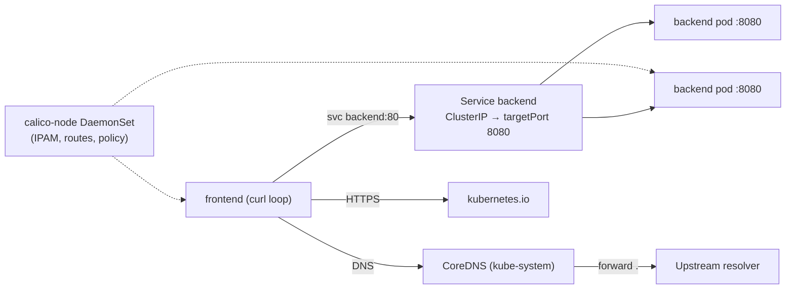

# Capstone 4 — Debug a Broken Kubernetes Cluster Network (CNI, DNS, NetworkPolicy)

## Scenario

You are the on-call platform engineer. The `shop` frontend calls the `backend` Service and an external site every 5 seconds. A helper script injects one of seven realistic faults. For each, find the root cause with evidence, fix it, and write a short incident note.

## Setup

Files: [`kind-config.yaml`](kind-config.yaml), [`app.yaml`](app.yaml), [`cap4.sh`](cap4.sh)



```bash
cd labs/capstones/04-k8s-network-debug
chmod +x cap4.sh
./cap4.sh up
kubectl -n shop logs deploy/frontend -f      # healthy: "backend ok" and "external 200"
```

## Workflow per fault

```bash
./cap4.sh break <n>         # or: ./cap4.sh break random
# diagnose and fix (do not just run reset)
./cap4.sh reset             # only after you have written your note
```

## Toolkit

| Question | Command |
|---|---|
| What does the app see? | `kubectl -n shop logs deploy/frontend --tail 20` |
| Are pods running and where? | `kubectl -n shop get pods -o wide` |
| Why is a pod not starting? | `kubectl -n shop describe pod <pod>` (Events) |
| Does the Service have endpoints? | `kubectl -n shop get svc,endpointslices -o wide` |
| Does DNS work? | `kubectl -n shop exec toolbox -- dig +search backend` and `dig kubernetes.io` |
| Is CoreDNS healthy? | `kubectl -n kube-system get pods -l k8s-app=kube-dns`, `kubectl -n kube-system logs -l k8s-app=kube-dns` |
| CoreDNS config? | `kubectl -n kube-system get cm coredns -o yaml` |
| Is the CNI healthy? | `kubectl -n kube-system get ds calico-node`, `kubectl -n kube-system get pods -l k8s-app=calico-node -o wide` |
| Which policies apply? | `kubectl -n shop get netpol`, `kubectl -n shop describe netpol <name>` |
| Bypass the Service | `kubectl -n shop exec toolbox -- curl -s <backend-pod-ip>:8080` |

## Tickets (one per fault)

Write: symptom → evidence → root cause → fix → prevention.

## Answer key

<details><summary>Open after you finish all seven</summary>

| # | Symptom in frontend logs | Key evidence | Root cause | Fix | Prevention |
|---|---|---|---|---|---|
| 1 | `backend ok` but `EXTERNAL-FAIL` | `dig kubernetes.io` → SERVFAIL/timeout; `dig backend.shop.svc.cluster.local` works; ConfigMap `forward . 192.0.2.53` | CoreDNS upstream unreachable | Restore `forward . /etc/resolv.conf` | Review CoreDNS changes; synthetic external DNS probe |
| 2 | Both fail | `dig` times out; CoreDNS 0 pods | CoreDNS scaled to zero | Scale to 2 | PodDisruptionBudget; alert on kube-dns endpoints = 0 |
| 3 | Both fail | From frontend, `curl <backend-pod-ip>:8080` works but `nslookup backend` times out; `default-deny` exists with no DNS egress (and no external egress) | NetworkPolicy blocks DNS | Add allow-dns egress to kube-system/kube-dns:53 | Policy templates always include DNS; policy tests in CI |
| 4 | `BACKEND-FAIL`, external OK | EndpointSlice empty; selector `app: backnd` | Service selector typo | Fix selector | `kubectl` dry-run checks / kubeconform + custom rule that every Service has endpoints |
| 5 | `BACKEND-FAIL` (connection refused) | Endpoints exist with port 8081; direct pod curl on 8080 works | Wrong `targetPort` | Set 8080 (better: named port `http`) | Use named ports |
| 6 | Logs stop after restart; new backend pods `ContainerCreating` | Events: `failed to setup network for sandbox ... calico`; DaemonSet desired 0 (nodeSelector `broken: "true"`) | CNI agent not scheduled | Remove the bad nodeSelector | Alert on DaemonSet `numberUnavailable`; protect kube-system with admission policies |
| 7 | `BACKEND-FAIL` | Policy allows port 80 on backend pods; pods listen on 8080 | NetworkPolicy ports are **pod ports** (after DNAT), not Service ports | Use 8080 or the named port | Explain in code review; test with a policy simulator (e.g. Cilium/Calico tooling) |

</details>

## Clean up

```bash
./cap4.sh down
```
