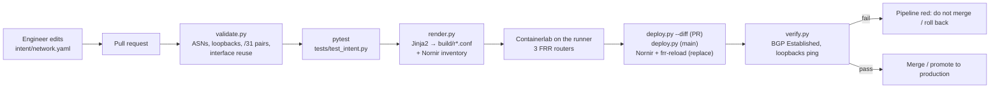

# Capstone 5 — Network Automation Pipeline (Nornir + GitHub Actions + Config Validation)

## Scenario

Your team will stop configuring routers by hand. Every change to the network must come from a pull request against a YAML **source of truth**, pass automated validation, show a config diff, deploy automatically to a test lab, and prove that BGP is up afterwards.

## Architecture



Files:

| File | Purpose |
|---|---|
| [`intent/network.yaml`](intent/network.yaml) | Source of truth: routers (ASN, loopback) and links (/31 per link) |
| [`netintent.py`](netintent.py) | Load, validate and render (shared library) |
| [`validate.py`](validate.py) | CI gate: exit 1 on invalid intent |
| [`render.py`](render.py) | Render FRR configs and the Nornir inventory into `build/` |
| [`deploy.py`](deploy.py) | Nornir task: copy config, `frr-reload.py --test` (diff) / `--reload` (apply) |
| [`verify.py`](verify.py) | Nornir task: BGP peers Established, loopback-to-loopback ping |
| [`tests/test_intent.py`](tests/test_intent.py) | Unit tests for the validator and renderer |
| [`capstone5.clab.yml`](capstone5.clab.yml) | Test lab: 3 FRR routers in a triangle |
| [`github-workflow.yml`](github-workflow.yml) | GitHub Actions pipeline to copy into your fork |

## Steps

### 1. Run locally

```bash
cd labs/capstones/05-automation-pipeline
python3 -m venv .venv && . .venv/bin/activate
pip install pyyaml jinja2 pytest nornir nornir-utils
python3 validate.py
python3 -m pytest -q tests
python3 render.py
sudo containerlab deploy -t capstone5.clab.yml
python3 deploy.py --diff
python3 deploy.py
python3 verify.py
```

Expected:

```text
3 routers, 3 links, 0 errors
7 passed
rendered build/r1.conf (29 lines) ...
frr_replace ** changed : True ...
check ** changed : False
vvvv check ** changed : False vvvvvvvvvvvvvvvvvvvvvvvvvvvvvvvvvvvvvvvvvvvvvvv INFO
OK
```

### 2. Put it in CI

1. Fork this repo (or copy the folder to a new repo).
2. Copy `github-workflow.yml` to `.github/workflows/network-pipeline.yml`.
3. Open a PR that adds a fourth router `r4` (AS 65004, loopback 10.255.0.4) with a link to r3. You need a new link in `network.yaml` **and** in `capstone5.clab.yml`.
4. Watch the PR run validation, tests and the diff. Merge. Watch `main` deploy and verify.

### 3. Prove the gates work

Open PRs that should **fail**, and confirm that the pipeline blocks them:

| Bad change | Gate that must fail |
|---|---|
| r2 link IP `10.0.12.3` | validate.py (`not in the same /31`) |
| r3 ASN `65001` (duplicate) | validate.py |
| r1 ASN `16509` (public ASN) | validate.py |
| Template typo: `neighbour` instead of `neighbor` | deploy.py `--test` (frr-reload parse error) or verify.py |
| Remove the r2-r3 link from intent only | verify.py (peer missing / loopback reachable only via r1; adjust the checks and discuss) |

## Requirements checklist

- [ ] All changes come from `intent/network.yaml`; nobody edits device configs by hand.
- [ ] Validation and unit tests run on every PR.
- [ ] The PR shows the config diff before merge.
- [ ] Deployment uses **replace** semantics (the device ends up exactly like the rendered file).
- [ ] Post-deploy verification fails the pipeline when BGP is not Established.
- [ ] Secrets (none needed for this lab) would come from GitHub Actions secrets, never from the repo.

## Extensions

1. Add **Batfish** to the PR job: load `build/*.conf` and assert that every loopback can reach every other loopback.
2. Add a **drift detection** scheduled workflow: render, then run `deploy.py --diff` against the lab; fail if any diff exists.
3. Replace YAML with **NetBox** as the source of truth (pynetbox), and render from its API.
4. Add **BFD** and **route-maps** to the template, with tests.
5. Swap FRR for SR Linux and use `nornir_scrapli` or gNMI Set for deployment.

## Why frr-reload?

FRR has no NAPALM driver in core NAPALM, but `frr-reload.py` gives the same safe workflow: compare the running config with a candidate file, print the exact commands needed (`--test`), and apply only those (`--reload`). It is the FRR equivalent of `load_replace_candidate` + `compare_config` + `commit_config`.
