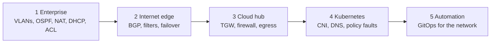

# Capstone Projects

Do the capstones after Module 18, or each one after the modules it depends on. Each has requirements, acceptance tests and a reference solution in a collapsed section. Try it yourself first.

| # | Capstone | Builds on | Tools | Time |
|---|---|---|---|---|
| 1 | [3-site enterprise network](01-enterprise-3-site/README.md) | Modules 03, 05, 06, 07, 09, 11 | Packet Tracer | 6-8 h |
| 2 | [BGP multi-homed edge with route filtering](02-bgp-multihomed-edge/README.md) | Modules 06, 07, 11 | Containerlab + FRR | 4-6 h |
| 3 | [Hub-and-spoke AWS network with TGW + inspection VPC](03-aws-hub-spoke-inspection/README.md) | Modules 14, 11 | Terraform + AWS | 4-6 h |
| 4 | [Debug a broken Kubernetes cluster network](04-k8s-network-debug/README.md) | Modules 13, 15 | kind + Calico | 3-4 h |
| 5 | [Network automation pipeline](05-automation-pipeline/README.md) | Modules 16, 07 | Nornir + GitHub Actions + Containerlab | 6-8 h |

## How to grade yourself

- Every acceptance test passes.
- You can draw the topology and explain every route without notes.
- You wrote a short `NOTES.md` in your fork: design decisions, one problem you hit and how you fixed it.
- Put the results on your GitHub profile. These projects are good interview material for DevOps, cloud and SRE roles.
