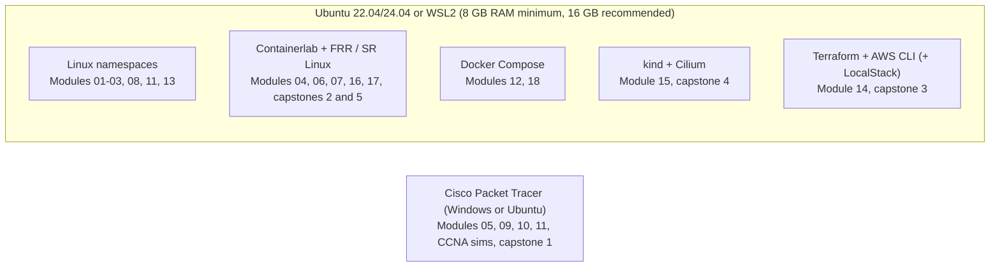

# Lab Environment Setup (Ubuntu or WSL2)

All labs use free tools. This page installs and checks them.



## 1. Prerequisites

| Item | Minimum |
|---|---|
| OS | Ubuntu 22.04 or 24.04 (native, VM, or WSL2 on Windows 11) |
| CPU / RAM / disk | 4 cores / 8 GB (16 GB for EVPN and kind labs) / 40 GB free |
| Accounts | Cisco NetAcad (free), AWS sandbox account with a budget alarm, GitHub |

### WSL2 notes

1. Install WSL2 with Ubuntu: `wsl --install -d Ubuntu-24.04` (PowerShell as admin).
2. Enable systemd: add the following to `/etc/wsl.conf`, then run `wsl --shutdown` from Windows.

   ```ini
   [boot]
   systemd=true
   ```

3. Use Docker Engine **inside** WSL2 (the script installs it). Docker Desktop also works, but Containerlab is most reliable with native Docker Engine.
4. Install Packet Tracer on **Windows**, not inside WSL2.
5. If `modprobe vxlan` fails, update WSL (`wsl --update`); recent WSL kernels include VXLAN and WireGuard modules.

## 2. Install

```bash
git clone https://github.com/gvarun17/networking-mastery.git
cd networking-mastery
bash labs/setup/install.sh            # options: --no-docker --no-k8s --no-cloud
newgrp docker                         # or log out and in again
bash labs/setup/verify.sh
```

Expected end of `verify.sh`:

```text
All tools present. Start with modules/01-osi-tcpip/README.md.
```

## 3. Packet Tracer

See [packet-tracer.md](packet-tracer.md).

## 4. Images used

| Image | Use | Source |
|---|---|---|
| `quay.io/frrouting/frr:10.2.1` | Routers (OSPF, BGP, EVPN) | Public |
| `ghcr.io/nokia/srlinux:24.10` | Automation targets (NETCONF, gNMI, JSON-RPC) | Public |
| `nicolaka/netshoot` | Hosts with every network tool | Public |
| Arista cEOS | Optional; import with `docker import cEOS-lab-<ver>.tar.xz ceos:<ver>` after free registration at arista.com | Manual |

## 5. AWS safety

- Use a **sandbox account**, not production.
- Create a budget alarm (for example US$10/month) before Module 14.
- Every Terraform lab ends with `terraform destroy`. Check the console afterwards for leftover NAT gateways, TGW attachments and endpoints.

## 6. LocalStack (optional)

LocalStack Community can emulate basic VPC, subnet, security group, EC2 and Route 53 API calls. It does **not** emulate Transit Gateway routing, PrivateLink data paths, Network Firewall or Direct Connect. Use it to practise Terraform syntax and plans:

```bash
source ~/.venvs/localstack/bin/activate
localstack start -d
cd modules/14-cloud-networking/terraform
tflocal init && tflocal plan
```

## 7. Topologies

All Containerlab and Compose files are in [`labs/topologies/`](../topologies/README.md).
