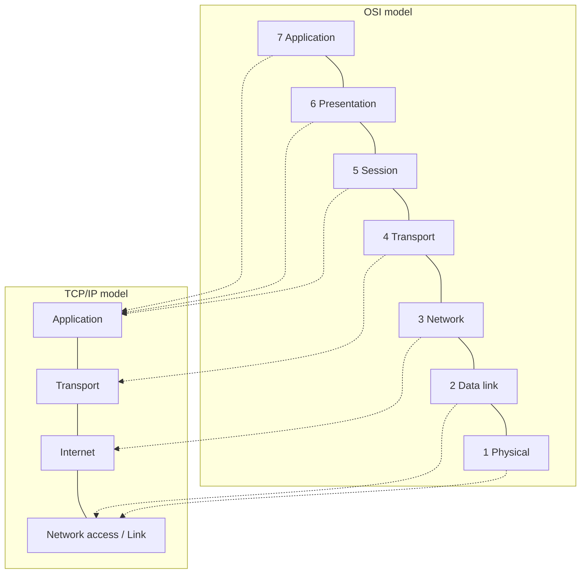
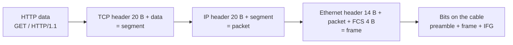
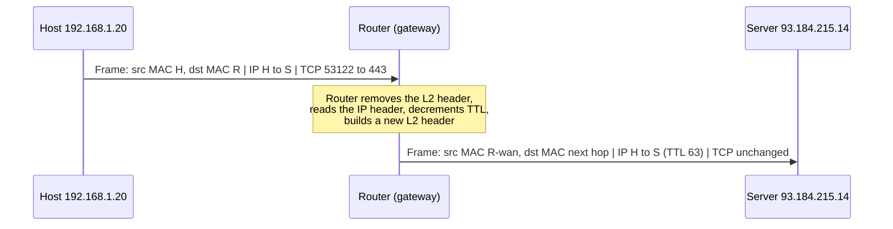

# Module 01 — Network Models: OSI, TCP/IP, Encapsulation, PDUs

**Time:** 3 sessions of 1.5 hours. **Prerequisites:** none.

## Learning objectives

After this module, you can:

1. Name the 7 OSI layers and the 4 TCP/IP layers, and map one to the other.
2. Name the PDU at each layer: bits, frame, packet, segment or datagram, data.
3. Explain encapsulation and decapsulation, header by header.
4. Read a packet capture and say which layer each field belongs to.
5. Use the layer model to start troubleshooting from the bottom or the top.

## 1. First principles

A network moves data between two programs on two machines. The problem is too big to solve in one piece. So engineers split it into **layers**. Each layer solves one problem and gives a service to the layer above it.

- The **physical layer** answers: how do I send a 1 or a 0 on this medium?
- The **data link layer** answers: how do I send a frame to the next device on this link?
- The **network layer** answers: how do I send a packet to any host in the world?
- The **transport layer** answers: how do I send data to the correct program, and how do I make it reliable?
- The **upper layers** answer: what does the data mean?

Each layer talks to the **same layer** on the remote machine. It does this by adding a **header**. The header is a set of fields that only that layer reads.



| OSI layer | TCP/IP layer | PDU | Address used | Example protocols | Example devices |
|---|---|---|---|---|---|
| 7 Application | Application | Data | Hostname, URL | HTTP, DNS, SSH, SMTP | Proxy, L7 load balancer |
| 6 Presentation | Application | Data | — | TLS (often placed here), JPEG, UTF-8 | — |
| 5 Session | Application | Data | — | RPC, NetBIOS, TLS session resumption | — |
| 4 Transport | Transport | Segment (TCP) / Datagram (UDP) | Port | TCP, UDP, QUIC | Firewall, L4 load balancer |
| 3 Network | Internet | Packet | IP address | IPv4, IPv6, ICMP, OSPF | Router, L3 switch |
| 2 Data link | Link | Frame | MAC address | Ethernet, 802.11, ARP, PPP | Switch, access point |
| 1 Physical | Link | Bits | — | 1000BASE-T, 10GBASE-SR | Cable, transceiver, hub |

**Exam tip:** The CCNA uses the TCP/IP model in most questions, but it uses OSI layer numbers ("a Layer 2 switch", "a Layer 4 port"). Know both. Some books show TCP/IP with 5 layers (they split "Link" into Data link and Physical). Cisco uses that 5-layer version.

## 2. How it works on the wire

### Encapsulation

When your laptop sends `GET /` to a web server, each layer adds its header in front of the data from the layer above. The data link layer also adds a trailer (the FCS, a CRC-32 checksum).



The receiver does the reverse. This is **decapsulation**. Each layer reads its header, does its job, removes the header and gives the payload to the layer above. A field called the **"next protocol" field** tells it which layer to give the payload to:

| Header | Field | Example value | Meaning |
|---|---|---|---|
| Ethernet | EtherType | `0x0800` | Payload is IPv4 |
| Ethernet | EtherType | `0x86DD` | Payload is IPv6 |
| Ethernet | EtherType | `0x0806` | Payload is ARP |
| IPv4 | Protocol | `6` / `17` / `1` | TCP / UDP / ICMP |
| IPv6 | Next Header | `6` / `17` / `58` | TCP / UDP / ICMPv6 |
| TCP/UDP | Destination port | `443` | Payload goes to the HTTPS server process |

### A real capture, layer by layer

This is a real `tcpdump -e -vv -c 1` output of one TCP SYN to port 443:

```text
10:41:07.112233 3c:22:fb:11:22:33 > 00:1c:73:aa:bb:cc, ethertype IPv4 (0x0800), length 74:
    (tos 0x0, ttl 64, id 51234, offset 0, flags [DF], proto TCP (6), length 60)
    192.168.1.20.53122 > 93.184.215.14.443: Flags [S], cksum 0x9f1a (correct),
    seq 2840192214, win 64240, options [mss 1460,sackOK,TS val 1 ecr 0,nop,wscale 7], length 0
```

| Field in the output | Layer | What it tells you |
|---|---|---|
| `3c:22:fb:11:22:33 > 00:1c:73:aa:bb:cc` | 2 | Source MAC is the laptop. Destination MAC is the **default gateway**, not the server. |
| `ethertype IPv4 (0x0800)` | 2 | The payload is an IPv4 packet. |
| `ttl 64`, `flags [DF]` | 3 | Linux sets TTL 64. DF means "do not fragment" (used by path MTU discovery). |
| `192.168.1.20 > 93.184.215.14` | 3 | Source and destination IP. These stay the same end to end (unless NAT changes them). |
| `proto TCP (6)` | 3 | The payload is TCP. |
| `.53122 > .443` | 4 | Ephemeral source port to the HTTPS port. |
| `Flags [S]`, `seq`, `win`, `mss 1460` | 4 | TCP handshake step 1. MSS 1460 = 1500 MTU − 20 IP − 20 TCP. |
| `length 74` | 2 | 14 Ethernet + 20 IP + 40 TCP (20 base + 20 options). tcpdump does not show the 4-byte FCS. |

**Key idea:** MAC addresses change at every router hop. IP addresses stay the same from end to end. Ports identify the process.



### Same-layer communication

Each layer has a **peer** on the other side. Devices in the middle work only up to their own layer:

- A **switch** reads up to Layer 2. It forwards frames by destination MAC.
- A **router** reads up to Layer 3. It forwards packets by destination IP.
- A **stateful firewall** or **L4 load balancer** reads up to Layer 4.
- A **proxy** or **L7 load balancer** ends the TCP connection and reads Layer 7.

## 3. Production example

A team reports: "The app is slow only for users in the Pune office." A layered approach finds the cause fast:

1. **L1/L2:** Interface counters on the office uplink show no CRC errors and no drops.
2. **L3:** `mtr` from Pune shows 0% loss but 180 ms extra latency at one ISP hop.
3. **L4:** `ss -ti` on the client shows many retransmits and a small congestion window.
4. **L7:** The app makes 40 sequential API calls per page. Each call pays the full round trip.

The root cause is at two layers. L3 path latency is high, and the L7 design multiplies it. The fix is HTTP/2 multiplexing at L7 and a routing change at L3.

**Production note:** Write incident tickets with the layer in the title ("L3: asymmetric route after TGW change"). It tells the next engineer where to look first.

## 4. Cloud equivalent (AWS)

| Layer | What AWS manages for you | What you still control |
|---|---|---|
| L1 | Cabling, optics, physical hosts | Nothing (except Direct Connect cross-connects) |
| L2 | The VPC fabric is not a real L2 broadcast domain. AWS answers ARP for you. There is no broadcast and no multicast (except with TGW multicast). | Nothing. You cannot sniff other ENIs. |
| L3 | VPC router at subnet base + 1 | Route tables, subnets, CIDRs, TGW routes |
| L4 | Security groups (stateful) and NACLs (stateless) work on L3/L4 | Rules, ports, NLB listeners |
| L7 | ALB, CloudFront, API Gateway, WAF | Listener rules, host and path routing, TLS policies |

**Production note:** VPC Traffic Mirroring gives you a copy of ENI traffic (with a VXLAN header) for packet-level debugging at L2-L7. It is the cloud version of a SPAN port.

## 5. Common failures

| Symptom | Likely layer | First check |
|---|---|---|
| Link light off, interface `down/down` | L1 | Cable, transceiver, `ethtool eth0` |
| Interface `up/down` on Cisco | L2 | Encapsulation, keepalives, the other side |
| Ping to gateway fails, ARP is `incomplete` | L2 | VLAN, MAC table, ARP |
| Ping to gateway works, internet fails | L3 | Default route, NAT, return route |
| Ping works, `curl` hangs | L4 | Security group, firewall, port, MTU |
| TCP connects, HTTP 502 | L7 | Upstream health, TLS, headers |

## Summary

- Layers split one hard problem into small problems.
- Each layer adds a header. The receiver removes it. "Next protocol" fields chain the layers.
- MAC changes per hop. IP is end to end. Port picks the process.
- Use the model as a troubleshooting checklist.

## Next

Do the [lab](lab.md), then the [quiz](quiz.md). Keep the [cheatsheet](cheatsheet.md) open. Then go to [Module 02](../02-physical-datalink/README.md).
