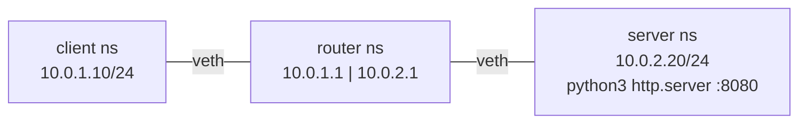

# Lab 01 — See Encapsulation in a Real Capture

## Objective

Capture one HTTP request and one DNS query. Label every header by layer. Prove that MAC addresses change per hop and IP addresses do not.

## Topology

Two Linux network namespaces connected through a router namespace. No extra software is needed beyond `iproute2`, `tcpdump`, `curl` and `python3`.



## Steps

### 1. Build the namespaces

```bash
sudo ip netns add client
sudo ip netns add router
sudo ip netns add server
sudo ip link add c-eth0 type veth peer name r-eth0
sudo ip link add s-eth0 type veth peer name r-eth1
sudo ip link set c-eth0 netns client
sudo ip link set r-eth0 netns router
sudo ip link set r-eth1 netns router
sudo ip link set s-eth0 netns server
```

### 2. Add addresses, routes and forwarding

```bash
sudo ip -n client addr add 10.0.1.10/24 dev c-eth0
sudo ip -n router addr add 10.0.1.1/24 dev r-eth0
sudo ip -n router addr add 10.0.2.1/24 dev r-eth1
sudo ip -n server addr add 10.0.2.20/24 dev s-eth0
for ns in client router server; do sudo ip -n $ns link set lo up; done
sudo ip -n client link set c-eth0 up
sudo ip -n router link set r-eth0 up
sudo ip -n router link set r-eth1 up
sudo ip -n server link set s-eth0 up
sudo ip -n client route add default via 10.0.1.1
sudo ip -n server route add default via 10.0.2.1
sudo ip netns exec router sysctl -w net.ipv4.ip_forward=1
```

### 3. Start a web server

```bash
sudo ip netns exec server python3 -m http.server 8080 --bind 10.0.2.20 &
```

### 4. Capture on both router interfaces

Open two terminals:

```bash
# terminal A: client side of the router
sudo ip netns exec router tcpdump -i r-eth0 -e -nn -vv -w /tmp/r-eth0.pcap
# terminal B: server side of the router
sudo ip netns exec router tcpdump -i r-eth1 -e -nn -vv -w /tmp/r-eth1.pcap
```

In a third terminal, send one request:

```bash
sudo ip netns exec client curl -s -o /dev/null -w "%{http_code}\n" http://10.0.2.20:8080/
```

Expected output:

```text
200
```

Stop both captures with Ctrl+C.

### 5. Read the captures

```bash
tcpdump -r /tmp/r-eth0.pcap -e -nn -c 3
tcpdump -r /tmp/r-eth1.pcap -e -nn -c 3
```

Expected output (MACs differ on your machine):

```text
# r-eth0 (client side)
a2:11:..:01 > 6e:4c:..:02, ethertype IPv4 (0x0800), length 74: 10.0.1.10.40112 > 10.0.2.20.8080: Flags [S], ...
# r-eth1 (server side)
f6:7d:..:03 > 1a:2b:..:04, ethertype IPv4 (0x0800), length 74: 10.0.1.10.40112 > 10.0.2.20.8080: Flags [S], ...
```

### 6. Fill in the table

Open the pcap in Wireshark (or use `tcpdump -X`). Fill in this table for the first SYN on each side.

| Field | r-eth0 value | r-eth1 value | Layer | Changed? |
|---|---|---|---|---|
| Source MAC | | | 2 | |
| Destination MAC | | | 2 | |
| EtherType | | | 2 | |
| Source IP | | | 3 | |
| Destination IP | | | 3 | |
| TTL | | | 3 | |
| IP header checksum | | | 3 | |
| Source port | | | 4 | |
| Destination port | | | 4 | |

### 7. Capture a DNS query (UDP)

```bash
sudo ip netns exec server python3 - <<'EOF' &
import socket
s = socket.socket(socket.AF_INET, socket.SOCK_DGRAM)
s.bind(("10.0.2.20", 5353))
data, addr = s.recvfrom(512)
s.sendto(data, addr)  # echo back; enough to see the UDP header
EOF
sudo ip netns exec router tcpdump -i r-eth1 -nn -vv -c 2 udp port 5353 &
sudo ip netns exec client dig @10.0.2.20 -p 5353 example.com +tries=1 +time=1
```

Compare the UDP header (8 bytes) with the TCP header (20+ bytes).

## Verification

You pass this lab when:

- [ ] The MAC addresses on r-eth0 and r-eth1 are different.
- [ ] The IP addresses and ports are the same on both sides.
- [ ] The TTL on r-eth1 is one less than on r-eth0 (64 → 63).
- [ ] The IP header checksum changed (because the TTL changed).
- [ ] You can explain why the TCP checksum did not change.

## Break it and fix it

Run each fault. Find the broken layer with the tools from this lab. Fix it.

| # | Break command | Hint |
|---|---|---|
| 1 | `sudo ip netns exec router sysctl -w net.ipv4.ip_forward=0` | The client's SYN reaches r-eth0 but not r-eth1. Which layer stops? |
| 2 | `sudo ip -n server route del default` | The SYN arrives at the server. The SYN-ACK does not leave. Why? |
| 3 | `sudo ip -n client link set c-eth0 down` | `ip -n client link` shows the state. |
| 4 | `sudo ip -n server link set s-eth0 mtu 576` and then download a 100 KB file | Use `tcpdump` to compare the MSS in the SYN and SYN-ACK. |

<details><summary>Answers</summary>

1. **Layer 3.** The router does not forward packets. Fix: set `ip_forward=1`.
2. **Layer 3, return path.** The server has no route back to 10.0.1.0/24. Fix: add the default route again. This is the most common cause of "SYN sent, no reply" in production.
3. **Layer 1/2.** The link is administratively down. Fix: `ip link set c-eth0 up`.
4. **Layer 3/4.** The server advertises MSS 536. TCP adapts, so the download still works but uses more packets. Restore with `mtu 1500`.

</details>

## Clean up

```bash
sudo ip netns del client; sudo ip netns del router; sudo ip netns del server
```
