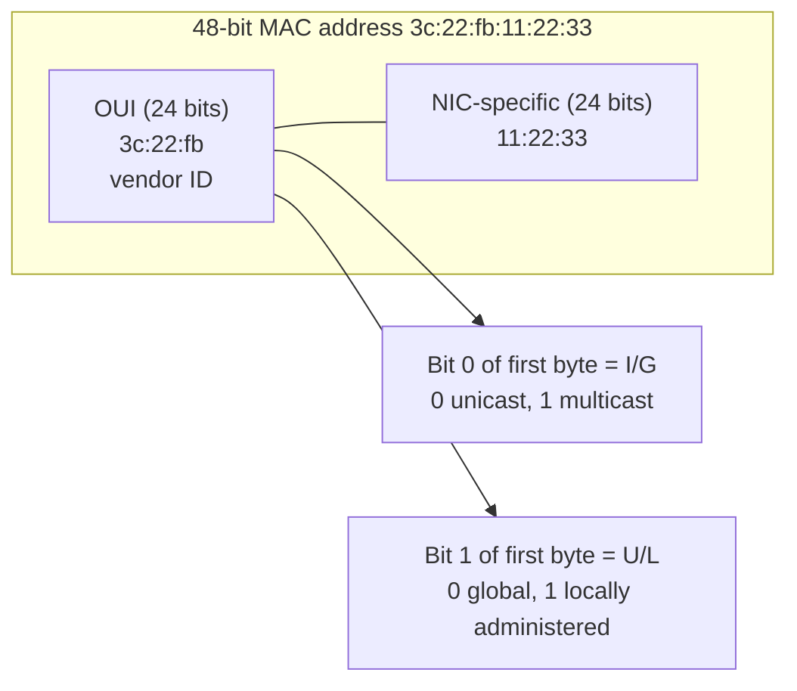
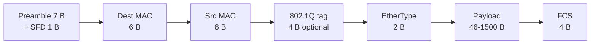
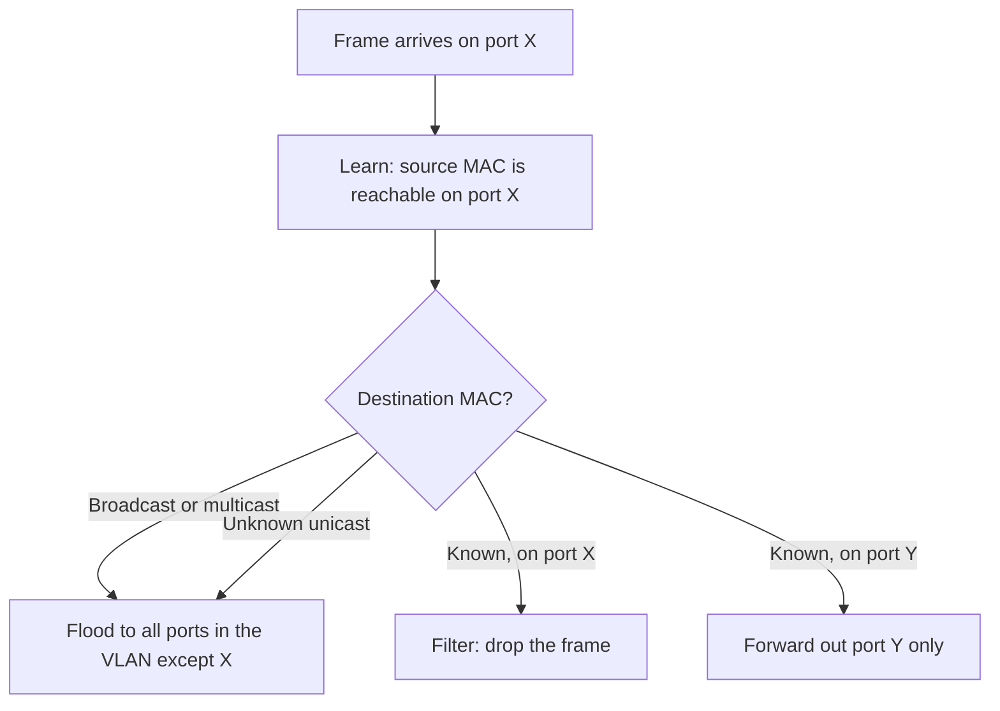
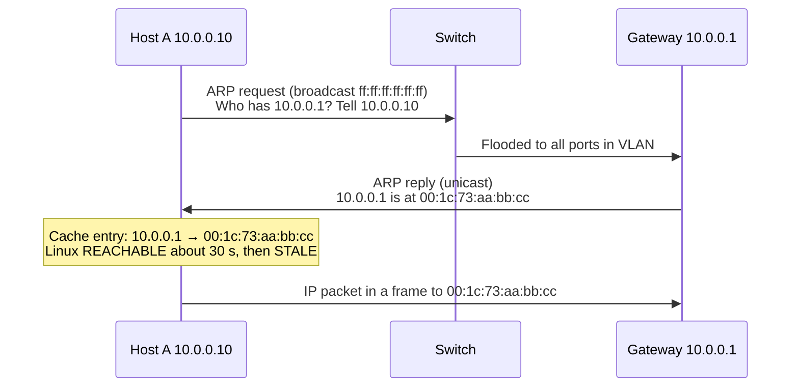
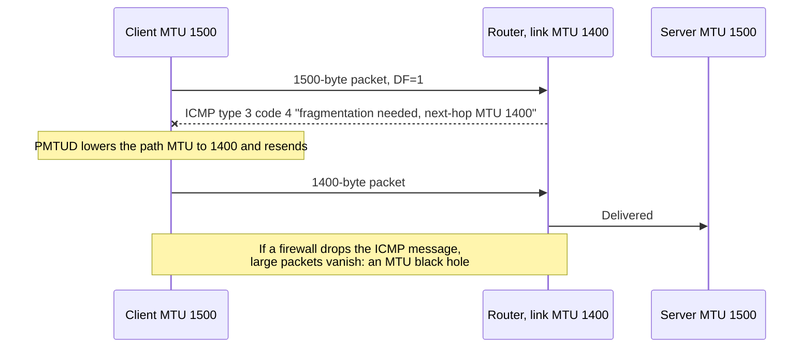

# Module 02 — Physical and Data Link: Ethernet, MAC, ARP, Frames, Cabling, Duplex, MTU

**Time:** 3 sessions. **Prerequisites:** Module 01.

## Learning objectives

1. Describe the Ethernet II frame field by field.
2. Explain MAC addresses (OUI, unicast/multicast bit, local/global bit).
3. Explain how a switch learns, floods, forwards and filters.
4. Explain ARP request/reply, gratuitous ARP and the ARP cache.
5. Choose copper or fiber, and explain duplex, autonegotiation and duplex mismatch.
6. Explain MTU, jumbo frames and why MTU mismatches cause "black holes".

## 1. First principles

### Layer 1: signals on a medium

Layer 1 turns bits into a signal: voltage on copper, light in fiber, radio in the air. It defines connectors, cable types, speeds and distances. It has no addresses.

| Standard | Medium | Max distance | Notes |
|---|---|---|---|
| 1000BASE-T | Cat5e/Cat6 copper, 4 pairs | 100 m | Most common access link |
| 10GBASE-T | Cat6a copper | 100 m (55 m on Cat6) | High power, more heat |
| 1000BASE-SX | Multimode fiber (OM2-OM4) | 220-550 m | 850 nm, short reach |
| 1000BASE-LX | Single-mode fiber | 5-10 km | 1310 nm |
| 10GBASE-SR | Multimode (OM3/OM4) | 300 / 400 m | Data center standard |
| 10GBASE-LR | Single-mode | 10 km | Campus and metro |
| 100GBASE-SR4 / LR4 | MMF / SMF | 100 m / 10 km | Spine-leaf uplinks |

**Exam tip:** Multimode fiber has a wider core (50 or 62.5 µm), uses cheaper LED/VCSEL light and is for short runs. Single-mode fiber has a 9 µm core, uses lasers and goes much farther. Copper Ethernet is limited to 100 m.

**Exam tip (v2.0 topic 1.1):** Diagnose cable issues from interface counters. Rising **CRC/input errors** usually mean a bad cable, bad optic or EMI. **Late collisions** usually mean a duplex mismatch. **Runts** and **giants** mean frames that are too small or too big.

### Duplex and autonegotiation

- **Half duplex:** a device sends or receives, not both. It uses CSMA/CD to handle collisions. Hubs force half duplex.
- **Full duplex:** a device sends and receives at the same time. No collisions are possible. Switch ports use full duplex.
- **Autonegotiation** (IEEE 802.3) lets both ends agree on speed and duplex. If one side is hard-coded and the other side autonegotiates, the auto side can detect the speed but not the duplex. At 10/100 Mbps it falls back to **half duplex**. The result is a **duplex mismatch**: the link works but is slow, with late collisions on the half side and CRC errors on the full side.

### Layer 2: frames on one link

Ethernet gives each NIC a 48-bit **MAC address**, written as `3c:22:fb:11:22:33` (Linux) or `3c22.fb11.2233` (Cisco).



- `ff:ff:ff:ff:ff:ff` is broadcast.
- `01:00:5e:xx:xx:xx` is IPv4 multicast. `33:33:xx:xx:xx:xx` is IPv6 multicast.
- Random MACs on phones and VMs set the U/L bit (for example, `02:42:ac:11:00:02` for Docker).

### The Ethernet II frame



- The minimum frame is 64 bytes (header + payload + FCS). Short payloads are padded.
- The standard maximum payload is 1500 bytes. This is the **MTU**. A frame without a tag is 1518 bytes max (1522 with a VLAN tag).
- The destination MAC comes first so a switch can start a forwarding decision early (cut-through switching).

## 2. How it works on the wire

### How a switch forwards

A switch keeps a **MAC address table** (CAM table): MAC → port, per VLAN. It ages out entries after 300 seconds by default.



### ARP: from IP to MAC

A host knows the destination IP. To build a frame, it needs a MAC. If the destination is on the same subnet, it needs the destination's MAC. If not, it needs the **default gateway's** MAC.



Real output:

```text
$ sudo tcpdump -i eth0 -nn -e arp
10:52:01.001 3c:22:fb:11:22:33 > ff:ff:ff:ff:ff:ff, ethertype ARP (0x0806), length 42: Request who-has 10.0.0.1 tell 10.0.0.10, length 28
10:52:01.002 00:1c:73:aa:bb:cc > 3c:22:fb:11:22:33, ethertype ARP (0x0806), length 60: Reply 10.0.0.1 is-at 00:1c:73:aa:bb:cc, length 46

$ ip neigh show dev eth0
10.0.0.1 lladdr 00:1c:73:aa:bb:cc REACHABLE
```

- **Gratuitous ARP (GARP):** a host announces its own IP-to-MAC mapping. It is used for duplicate address detection and for failover (VRRP, keepalived, a moving VIP).
- **Proxy ARP:** a router answers ARP for an address on another network. AWS VPC answers all ARP for you, which is a kind of proxy ARP.
- Cisco routers keep ARP entries for 4 hours by default. Linux keeps them for a much shorter time.

### MTU

MTU is the largest Layer 3 packet that a link can carry without fragmentation. Ethernet default is 1500 bytes. Jumbo frames are usually 9000 bytes (9001 in AWS).



Find the path MTU from Linux:

```text
$ ping -M do -s 1472 10.0.2.20     # 1472 + 8 ICMP + 20 IP = 1500
PING 10.0.2.20 1472(1500) bytes of data.
From 10.0.1.1 icmp_seq=1 Frag needed and DF set (mtu = 1400)
$ ping -M do -s 1372 10.0.2.20     # 1372 + 28 = 1400
1380 bytes from 10.0.2.20: icmp_seq=1 ttl=63 time=0.31 ms
```

**Production note:** Symptoms of an MTU black hole: SSH login works but `ls` of a big directory hangs; small API calls work but large responses time out; TLS handshakes stall at the certificate. Fix it by allowing ICMP type 3 code 4 (IPv6: ICMPv6 type 2 "Packet Too Big"), or by clamping TCP MSS on the tunnel interface.

## 3. Production example

A new VPN between an on-prem data center and AWS used IPsec. Health checks worked, but large database queries timed out. The IPsec overhead (about 50-80 bytes) reduced the tunnel MTU to about 1420. The on-prem firewall blocked all ICMP, so PMTUD failed. The fix was `ip tcp adjust-mss 1360` on the tunnel interface and a firewall rule to permit ICMP "fragmentation needed".

## 4. Cloud equivalent (AWS)

| Concept | AWS behaviour |
|---|---|
| MAC table, flooding | None visible. The Nitro hypervisor delivers packets straight to the ENI. |
| ARP | The VPC answers ARP for every IP. You cannot do ARP spoofing. |
| Broadcast | Not supported. DHCP is handled by the VPC itself. |
| Gratuitous ARP for VIP failover | Does not work. Use a secondary IP move API call, an NLB or a route table change. |
| MTU | 9001 inside a VPC. 1500 through an internet gateway, inter-Region VPC peering and Site-to-Site VPN (lower after IPsec overhead). 8500 through Transit Gateway. Direct Connect: 1500 by default; jumbo is 9001 on a private VIF and 8500 on a transit VIF. Check the current AWS "Network MTU" page before you design. |
| Duplex/speed | Fixed by instance type ("Up to 25 Gbps"). |

**Production note:** Keepalived with GARP works on-prem but fails in AWS. Use the EC2 API (move the secondary private IP or the Elastic IP) in the keepalived notify script.

## 5. Common failures

| Symptom | Cause | Check |
|---|---|---|
| Link slow, late collisions | Duplex mismatch | `show interfaces` on both ends; set both to auto |
| CRC errors rising | Bad cable/optic, EMI, duplex mismatch | Replace the cable; check optic light levels (`show interfaces transceiver`) |
| `ip neigh` shows `FAILED`/`INCOMPLETE` | Host down, wrong VLAN, ACL drops ARP | Capture ARP on both sides |
| Intermittent loss after VM migration | Stale ARP/MAC entries | Send GARP; clear ARP |
| Small packets work, big ones hang | MTU black hole | `ping -M do -s` sweep; permit ICMP 3/4 |
| MAC flapping log messages | Layer 2 loop or duplicate MAC | Check STP (Module 05) |

## Summary

- Layer 1 is the medium: copper to 100 m, multimode for short fiber, single-mode for long fiber.
- Use autonegotiation on both ends. A mismatch creates late collisions and CRC errors.
- A switch learns source MACs and forwards on destination MACs. Unknown, broadcast and multicast frames flood.
- ARP maps an IP to a MAC on the local link. Off-subnet traffic goes to the gateway's MAC.
- MTU problems are silent. Test with `ping -M do -s`.

## Next

[Lab](lab.md) · [Quiz](quiz.md) · [Cheatsheet](cheatsheet.md) · [Module 03](../03-ipv4-subnetting/README.md)
