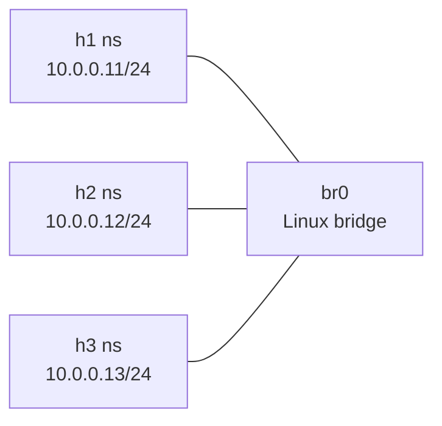

# Lab 02 — MAC Learning, ARP and an MTU Black Hole

## Objective

Build a Linux bridge (a software switch). Watch it learn MAC addresses. Watch ARP in action. Then create and fix an MTU black hole.

## Topology



## Steps

### 1. Build the bridge and three hosts

```bash
sudo ip link add br0 type bridge
sudo ip link set br0 up
for i in 1 2 3; do
  sudo ip netns add h$i
  sudo ip link add h$i-eth0 type veth peer name br-h$i
  sudo ip link set h$i-eth0 netns h$i
  sudo ip link set br-h$i master br0
  sudo ip link set br-h$i up
  sudo ip -n h$i addr add 10.0.0.1$i/24 dev h$i-eth0
  sudo ip -n h$i link set h$i-eth0 up
  sudo ip -n h$i link set lo up
done
```

### 2. View the empty MAC table

```bash
bridge fdb show br br0 | grep -v permanent
```

Expected output: no dynamic entries yet (only `permanent` entries for the bridge's own ports, which we filter out).

### 3. Watch ARP and MAC learning

Terminal A:

```bash
sudo ip netns exec h3 tcpdump -i h3-eth0 -e -nn arp or icmp
```

Terminal B:

```bash
sudo ip netns exec h1 ping -c 2 10.0.0.12
bridge fdb show br br0 | grep -v permanent
```

Expected output in terminal A (h3 sees only the broadcast):

```text
... aa:..:01 > ff:ff:ff:ff:ff:ff, ethertype ARP (0x0806), length 42: Request who-has 10.0.0.12 tell 10.0.0.11, length 28
```

Expected FDB output:

```text
aa:..:01 dev br-h1 master br0
bb:..:02 dev br-h2 master br0
```

h3 does not see the ICMP echo. The bridge learned both MACs, so it forwards the unicast frames only to the correct port.

### 4. Inspect the ARP cache

```bash
sudo ip -n h1 neigh show
sudo ip -n h1 neigh flush all
sudo ip -n h1 neigh show
```

### 5. Send a gratuitous ARP

```bash
sudo ip netns exec h2 arping -U -c 1 -I h2-eth0 10.0.0.12
```

Watch terminal A. You see `Request who-has 10.0.0.12 tell 10.0.0.12`. That is a GARP.

### 6. Create an MTU black hole

Set h2 to MTU 1400 and drop the ICMP "too big" messages:

```bash
sudo ip -n h2 link set h2-eth0 mtu 1400
sudo ip -n h1 link set h1-eth0 mtu 1500
sudo ip netns exec h1 ping -M do -s 1472 -c 2 10.0.0.12
sudo ip netns exec h1 ping -M do -s 1372 -c 2 10.0.0.12
```

Expected output: the 1472-byte ping fails (h2 drops the oversized frame silently on a bridge). The 1372-byte ping works.

```text
--- 10.0.0.12 ping statistics ---
2 packets transmitted, 0 received, 100% packet loss
...
1380 bytes from 10.0.0.12: icmp_seq=1 ttl=64 time=0.05 ms
```

On one Layer 2 segment, no router exists to send "fragmentation needed". The frame is dropped. This is why every device in one VLAN must use the same MTU.

### 7. Fix it

```bash
sudo ip -n h2 link set h2-eth0 mtu 1500
sudo ip netns exec h1 ping -M do -s 1472 -c 2 10.0.0.12
```

## Verification

- [ ] The FDB has one entry per host after the pings.
- [ ] h3 saw the ARP broadcast but not the ICMP unicast.
- [ ] You captured a gratuitous ARP.
- [ ] You can explain why the MTU mismatch dropped frames without any ICMP error.

## Break it and fix it

| # | Break | Your task |
|---|---|---|
| 1 | `sudo ip -n h2 addr del 10.0.0.12/24 dev h2-eth0; sudo ip -n h2 addr add 10.0.0.12/25 dev h2-eth0` and ping h3 (10.0.0.13) from h2 | Does it still work? Why? |
| 2 | `sudo ip link set br-h3 down` | What does `ip neigh` show on h1 after `ping 10.0.0.13`? |
| 3 | `sudo ip -n h1 neigh replace 10.0.0.12 lladdr 02:00:00:00:00:99 dev h1-eth0 nud permanent` | Ping h2 from h1. Find the fault with tcpdump on h2. |
| 4 | Give h3 the same IP as h2 (10.0.0.12) | Ping 10.0.0.12 from h1 several times while you flush the ARP cache. What do you see? |

<details><summary>Answers</summary>

1. **It works.** 10.0.0.13 is inside 10.0.0.0/25 (0-127), so h2 still thinks h3 is local. If you pinged 10.0.0.200 it would fail, because h2 would look for a gateway.
2. `INCOMPLETE` then `FAILED`. ARP requests get no reply because the port is down.
3. A static wrong ARP entry. h1 sends frames to 02:00:00:00:00:99. The bridge floods them (unknown unicast), but h2's NIC drops them because the destination MAC is not its own. Fix: `ip neigh del 10.0.0.12 dev h1-eth0`.
4. Duplicate IP. The ARP reply from h2 or h3 wins at random, so replies come from different MACs. Linux logs nothing, but `arping -D` detects the duplicate.

</details>

## Clean up

```bash
for i in 1 2 3; do sudo ip netns del h$i; done; sudo ip link del br0
```
