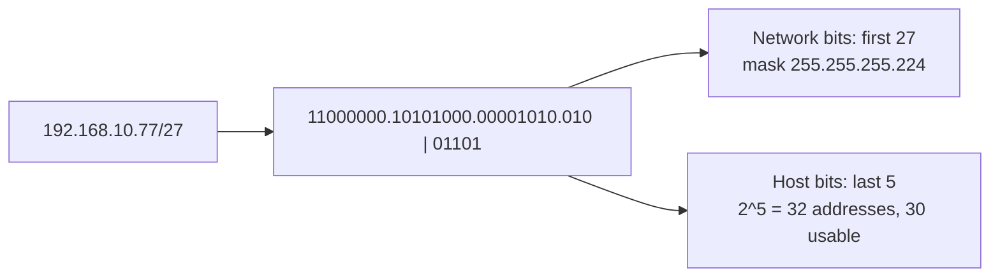
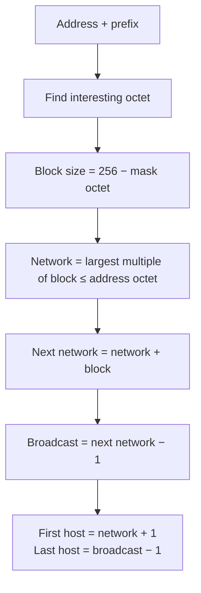
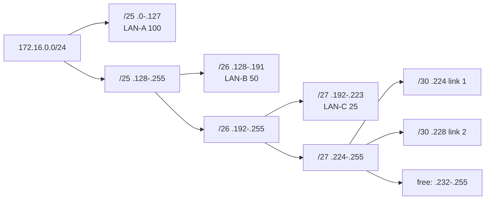
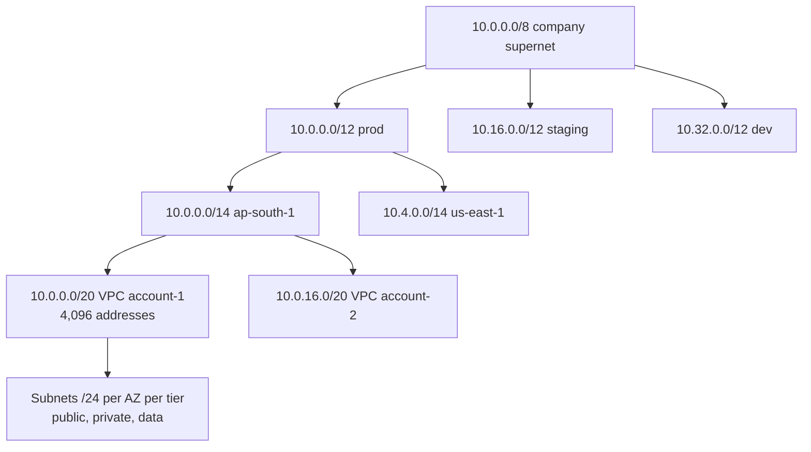

# Module 03 — IPv4 Addressing and Subnetting

**Time:** 5 sessions (this is the most tested skill on the CCNA). **Prerequisites:** Modules 01-02.

## Learning objectives

1. Convert between binary, decimal, dotted-decimal masks and CIDR prefixes.
2. Find the network, broadcast, first/last host and host count for any address/prefix in under 30 seconds.
3. Design a VLSM plan from host requirements.
4. Summarize routes and know when a summary over-reaches.
5. Know the special ranges: RFC 1918, loopback, link-local, CGNAT, multicast, documentation.
6. Plan VPC CIDRs that do not overlap.

## 1. First principles

An IPv4 address is 32 bits. The **prefix length** (or mask) splits it into a **network part** and a **host part**.



Rules:

- All host bits 0 = **network address**. It identifies the subnet.
- All host bits 1 = **broadcast address**.
- Usable hosts = 2^h − 2, where h = host bits. Exceptions: /31 has 2 usable addresses on point-to-point links (RFC 3021), and /32 is one host route.
- Two hosts are on the same subnet only if their network parts are equal under the same mask.

### Powers of 2 and mask values (learn these by heart)

| Bits borrowed in octet | 1 | 2 | 3 | 4 | 5 | 6 | 7 | 8 |
|---|---|---|---|---|---|---|---|---|
| Mask octet value | 128 | 192 | 224 | 240 | 248 | 252 | 254 | 255 |
| Block size (256 − value) | 128 | 64 | 32 | 16 | 8 | 4 | 2 | 1 |

| Prefix | Mask | Addresses | Usable |
|---|---|---|---|
| /24 | 255.255.255.0 | 256 | 254 |
| /25 | 255.255.255.128 | 128 | 126 |
| /26 | 255.255.255.192 | 64 | 62 |
| /27 | 255.255.255.224 | 32 | 30 |
| /28 | 255.255.255.240 | 16 | 14 |
| /29 | 255.255.255.248 | 8 | 6 |
| /30 | 255.255.255.252 | 4 | 2 |
| /22 | 255.255.252.0 | 1024 | 1022 |
| /20 | 255.255.240.0 | 4096 | 4094 |
| /16 | 255.255.0.0 | 65,536 | 65,534 |

## 2. The fast method (the "magic number")

To subnet `172.16.45.130/21` in your head:

1. Find the **interesting octet**: the octet where the mask is not 255 or 0. /21 → mask 255.255.**248**.0 → third octet.
2. **Block size** = 256 − 248 = **8**.
3. **Network:** largest multiple of 8 that is ≤ 45 → **40**. Network = 172.16.40.0.
4. **Next network** = 40 + 8 = 48 → 172.16.48.0. **Broadcast** = one less = 172.16.47.255.
5. **Host range:** 172.16.40.1 to 172.16.47.254. **Hosts:** 2^11 − 2 = 2046.



Check yourself with the repo tool:

```text
$ python3 tools/subnet_calc.py info 172.16.45.130/21
Address         : 172.16.45.130
Network         : 172.16.40.0/21
Netmask         : 255.255.248.0
Wildcard        : 0.0.7.255
Broadcast       : 172.16.47.255
First host      : 172.16.40.1
Last host       : 172.16.47.254
Usable hosts    : 2,046
Total addresses : 2,048
Class           : B
Private         : yes
```

**Exam tip:** On the CCNA, subnetting is not a topic alone. It hides inside other questions: "Which host cannot reach the server?" (wrong subnet), "Which route is used?" (longest prefix match), "Which ACL wildcard matches?". Practice until it takes under 30 seconds.

### VLSM (Variable Length Subnet Masking)

Allocate **largest subnet first**, so each block starts on its own boundary.

Requirement: 172.16.0.0/24 for LAN-A 100 hosts, LAN-B 50, LAN-C 25, and two point-to-point links.

```text
$ python3 tools/subnet_calc.py vlsm 172.16.0.0/24 --hosts 100 50 25 2 2
   100 hosts -> 172.16.0.0/25      hosts 172.16.0.1-172.16.0.126 bcast 172.16.0.127
    50 hosts -> 172.16.0.128/26    hosts 172.16.0.129-172.16.0.190 bcast 172.16.0.191
    25 hosts -> 172.16.0.192/27    hosts 172.16.0.193-172.16.0.222 bcast 172.16.0.223
     2 hosts -> 172.16.0.224/30    hosts 172.16.0.225-172.16.0.226 bcast 172.16.0.227
     2 hosts -> 172.16.0.228/30    hosts 172.16.0.229-172.16.0.230 bcast 172.16.0.231
```



### Route summarization

Four networks 10.1.4.0/24 to 10.1.7.0/24 share the first 22 bits, so they summarize to **10.1.4.0/22**. A summary is exact only if the block is fully used and aligned.

```text
$ python3 tools/subnet_calc.py summarize 10.1.4.0/24 10.1.5.0/24 10.1.6.0/24 10.1.7.0/24
Exact summary : 10.1.4.0/22
Supernet      : 10.1.4.0/22
$ python3 tools/subnet_calc.py summarize 10.1.5.0/24 10.1.6.0/24
Exact summary : 10.1.5.0/24, 10.1.6.0/24
Supernet      : 10.1.4.0/22
```

The second example shows **over-summarization**: 10.1.4.0/22 also covers 10.1.4.0 and 10.1.7.0, which you may not own. That can black-hole traffic.

### Special IPv4 ranges

| Range | Purpose | RFC |
|---|---|---|
| 10.0.0.0/8, 172.16.0.0/12, 192.168.0.0/16 | Private | 1918 |
| 100.64.0.0/10 | Carrier-grade NAT (shared address space) | 6598 |
| 127.0.0.0/8 | Loopback | 1122 |
| 169.254.0.0/16 | Link-local (APIPA). AWS metadata is 169.254.169.254 | 3927 |
| 192.0.2.0/24, 198.51.100.0/24, 203.0.113.0/24 | Documentation | 5737 |
| 224.0.0.0/4 | Multicast (Class D) | 5771 |
| 240.0.0.0/4 | Reserved (Class E) | 1112 |
| 0.0.0.0/0 | Default route | — |

Classful ranges (legacy, still tested): A 1-126 (/8), B 128-191 (/16), C 192-223 (/24).

## 3. Production example: VPC IP planning

A company has 3 environments, 4 Regions and plans for 20 accounts per environment. They need to connect everything with Transit Gateway, so CIDRs must never overlap.



**Production notes:**

- AWS reserves **5 addresses per subnet**: network, +1 VPC router, +2 DNS, +3 future, broadcast. A /24 has 251 usable addresses in AWS, not 254.
- Use **AWS VPC IPAM** to allocate CIDRs from pools so no team picks an overlapping range.
- EKS with the VPC CNI gives every pod a VPC IP. Size pod subnets large (/19 or bigger), or use secondary CIDRs from 100.64.0.0/10.
- Avoid 172.17.0.0/16 for VPCs; Docker uses it by default on hosts, which can break routing on build agents.

## 4. Cloud equivalent (AWS)

| Concept | AWS |
|---|---|
| Subnet | Lives in one AZ. Size /16 to /28. |
| Reserved IPs | 5 per subnet |
| Secondary CIDR | Up to 5 IPv4 CIDRs per VPC by default (quota can increase) |
| Overlap check | VPC peering and TGW reject or misroute overlapping CIDRs |
| Planning tool | VPC IPAM pools |

## 5. Common failures

| Symptom | Cause |
|---|---|
| Host can reach some peers but not others in "the same LAN" | Wrong mask on one host |
| `Error: The CIDR '10.0.0.0/16' conflicts with another subnet` | Overlapping subnet in Terraform |
| TGW attachment works but traffic goes to the wrong VPC | Overlapping VPC CIDRs, more specific route wins |
| A /27 subnet runs out of IPs in EKS | Pod IPs use the subnet; size for pods, not nodes |
| Router rejects `ip address 10.1.1.0 255.255.255.0` | You used the network address as a host address |

## Practice

- [50 practice problems with answers](practice-problems.md) (generated and checked by `tools/gen_subnet_problems.py`).
- Unlimited random drills: `python3 tools/subnet_calc.py practice --count 20`.

## Next

[Lab](lab.md) · [Quiz](quiz.md) · [Cheatsheet](cheatsheet.md) · [Module 04](../04-ipv6/README.md)
