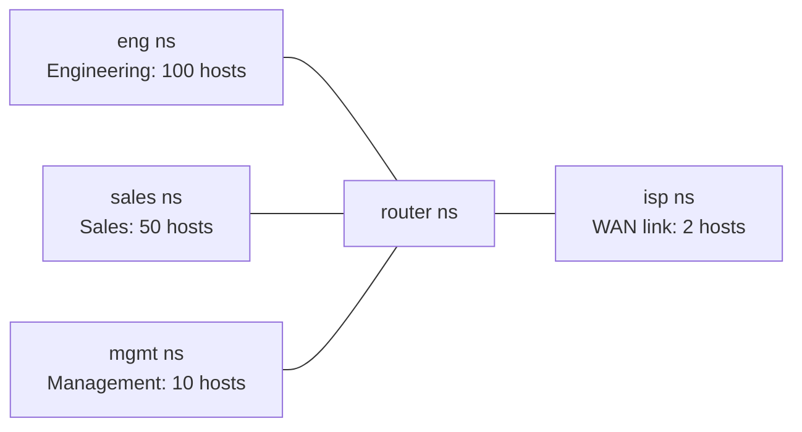

# Lab 03 — Design a VLSM Plan, Build It, and Extend the Subnet Calculator

## Objective

1. Design a VLSM plan for a small office from host counts.
2. Build it with Linux namespaces and one router. Prove every subnet works.
3. Use and extend the Python subnet calculator in `tools/subnet_calc.py`.

## Topology



Address block: **10.40.0.0/24**.

## Part A — Design (paper first)

1. Sort by size: Engineering 100, Sales 50, Management 10, WAN 2.
2. Pick the prefix for each: 100 → /25, 50 → /26, 10 → /28, 2 → /30.
3. Allocate from the bottom of the block, largest first.
4. Fill this table before you look at the tool output.

| Subnet | Hosts needed | Prefix | Network | Router IP (first host) | Broadcast |
|---|---|---|---|---|---|
| Engineering | 100 | | | | |
| Sales | 50 | | | | |
| Management | 10 | | | | |
| WAN | 2 | | | | |

5. Check your answers:

```bash
python3 tools/subnet_calc.py vlsm 10.40.0.0/24 --hosts 100 50 10 2
```

Expected output:

```text
   100 hosts -> 10.40.0.0/25       hosts 10.40.0.1-10.40.0.126 bcast 10.40.0.127
    50 hosts -> 10.40.0.128/26     hosts 10.40.0.129-10.40.0.190 bcast 10.40.0.191
    10 hosts -> 10.40.0.192/28     hosts 10.40.0.193-10.40.0.206 bcast 10.40.0.207
     2 hosts -> 10.40.0.208/30     hosts 10.40.0.209-10.40.0.210 bcast 10.40.0.211
```

## Part B — Build

```bash
sudo ip netns add router
for n in eng sales mgmt isp; do
  sudo ip netns add $n
  sudo ip link add $n-eth0 type veth peer name r-$n
  sudo ip link set $n-eth0 netns $n
  sudo ip link set r-$n netns router
  sudo ip -n $n link set $n-eth0 up
  sudo ip -n $n link set lo up
  sudo ip -n router link set r-$n up
done
sudo ip netns exec router sysctl -qw net.ipv4.ip_forward=1

# Router side: first usable host in each subnet
sudo ip -n router addr add 10.40.0.1/25   dev r-eng
sudo ip -n router addr add 10.40.0.129/26 dev r-sales
sudo ip -n router addr add 10.40.0.193/28 dev r-mgmt
sudo ip -n router addr add 10.40.0.209/30 dev r-isp

# Hosts: last usable host, default route to the router
sudo ip -n eng   addr add 10.40.0.126/25 dev eng-eth0;   sudo ip -n eng   route add default via 10.40.0.1
sudo ip -n sales addr add 10.40.0.190/26 dev sales-eth0; sudo ip -n sales route add default via 10.40.0.129
sudo ip -n mgmt  addr add 10.40.0.206/28 dev mgmt-eth0;  sudo ip -n mgmt  route add default via 10.40.0.193
sudo ip -n isp   addr add 10.40.0.210/30 dev isp-eth0;   sudo ip -n isp   route add default via 10.40.0.209
```

### Verify

```bash
sudo ip -n router route
for dst in 10.40.0.190 10.40.0.206 10.40.0.210; do sudo ip netns exec eng ping -c1 -W1 $dst | tail -1; done
```

Expected output:

```text
10.40.0.0/25 dev r-eng proto kernel scope link src 10.40.0.1
10.40.0.128/26 dev r-sales proto kernel scope link src 10.40.0.129
10.40.0.192/28 dev r-mgmt proto kernel scope link src 10.40.0.193
10.40.0.208/30 dev r-isp proto kernel scope link src 10.40.0.209
rtt min/avg/max/mdev = 0.041/0.041/0.041/0.000 ms
rtt min/avg/max/mdev = 0.039/0.039/0.039/0.000 ms
rtt min/avg/max/mdev = 0.040/0.040/0.040/0.000 ms
```

Note how the kernel creates one **connected route** per interface prefix. You will see the same with `show ip route connected` on Cisco.

## Part C — Use and extend the calculator

1. Run the unit tests:

   ```bash
   python3 -m pytest tests/test_subnet_calc.py -q
   ```

2. Generate 10 drills and solve them on paper:

   ```bash
   python3 tools/subnet_calc.py practice --count 10 --seed 42
   ```

3. **Extension task:** add an `overlap` command that takes two CIDRs and prints `overlap` or `no overlap`. Use `ipaddress.ip_network(a).overlaps(ipaddress.ip_network(b))`. Add a test in `tests/test_subnet_calc.py`. This is the exact check you need before you peer two VPCs.

## Break it and fix it

| # | Break | Symptom to explain |
|---|---|---|
| 1 | `sudo ip -n sales addr flush dev sales-eth0; sudo ip -n sales addr add 10.40.0.190/25 dev sales-eth0` | Can sales reach the router (10.40.0.129)? Why or why not? |
| 2 | `sudo ip -n mgmt addr flush dev mgmt-eth0; sudo ip -n mgmt addr add 10.40.0.207/28 dev mgmt-eth0` | What address did you assign? |
| 3 | `sudo ip -n router addr add 10.40.0.100/26 dev r-sales` | What does the router routing table show now? Which subnet overlaps? |

<details><summary>Answers</summary>

1. The host thinks its subnet is 10.40.0.128/25, which still contains 10.40.0.129, so it can ARP the router. Replies work because the router's /26 contains .190. It "works by luck". But sales now treats 10.40.0.193 (mgmt) as local and ARPs for it on its own link, so sales → mgmt fails. Fix the mask to /26.
2. 10.40.0.207 is the **broadcast address** of 10.40.0.192/28. Linux accepts it, but traffic breaks. Cisco IOS rejects it with "Bad mask /28 for address". Use .194-.206.
3. 10.40.0.64/26 overlaps Engineering 10.40.0.0/25. The router now has two connected routes; the longer /26 wins for .64-.127, so part of Engineering becomes unreachable. Remove it.

</details>

## Clean up

```bash
for n in router eng sales mgmt isp; do sudo ip netns del $n; done
```
