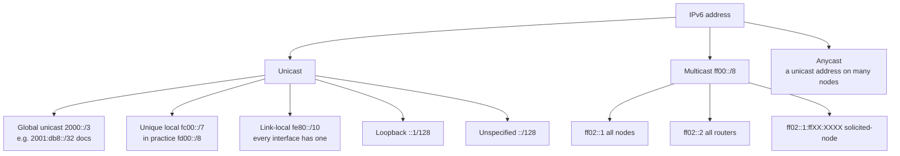
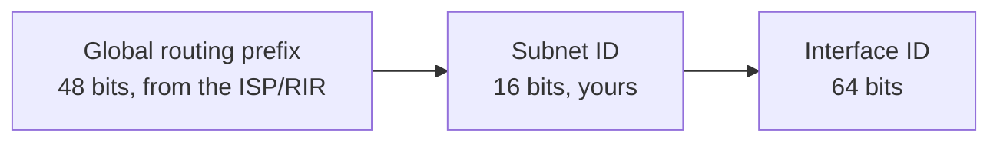
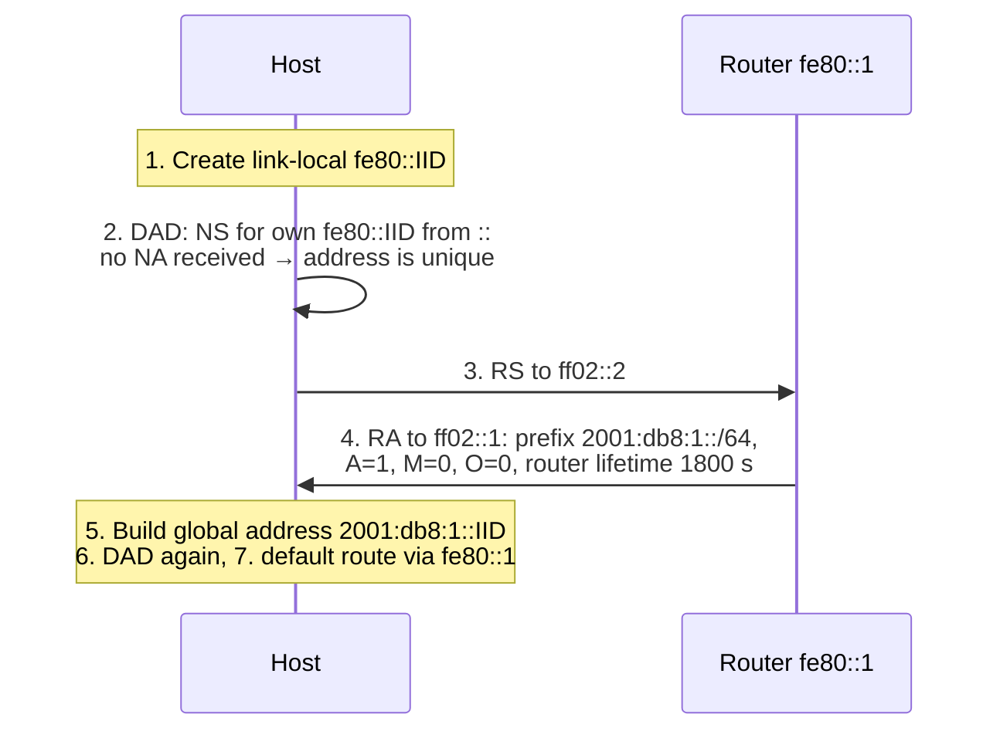
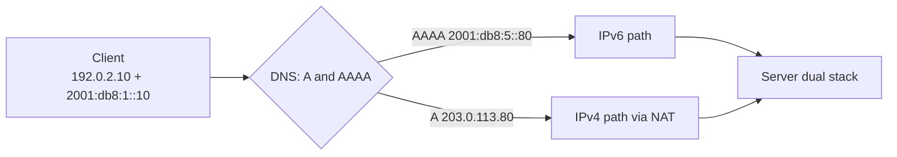

# Module 04 — IPv6: Addressing, SLAAC, NDP, Dual Stack

**Time:** 3 sessions. **Prerequisites:** Module 03.

## Learning objectives

1. Write and shorten IPv6 addresses correctly.
2. Identify address types: global unicast, unique local, link-local, multicast, anycast.
3. Explain how a host gets an address: SLAAC, stateless DHCPv6, stateful DHCPv6.
4. Explain NDP: RS, RA, NS, NA, redirect and DAD.
5. Build EUI-64 interface IDs by hand.
6. Plan IPv6 for a VPC and run dual stack.

## 1. First principles

IPv4 has about 4.3 billion addresses. That is not enough, so the internet uses NAT everywhere. IPv6 uses **128-bit** addresses. A single **/64 subnet** has 2^64 addresses. The design goal is simple end-to-end addressing with no NAT.

Key differences from IPv4:

| Topic | IPv4 | IPv6 |
|---|---|---|
| Address size | 32 bits | 128 bits |
| Header | 20-60 B, has checksum | 40 B fixed, no checksum, extension headers |
| Broadcast | Yes | **No.** Uses multicast instead |
| ARP | ARP (EtherType 0x0806) | **NDP** inside ICMPv6 |
| Fragmentation | Routers can fragment | **Only the source** fragments. Routers send "Packet Too Big" |
| Address config | DHCP or static | SLAAC, DHCPv6 or static |
| Minimum MTU | 68 B | 1280 B |

### Writing an address

Full: `2001:0db8:00a1:0000:0000:0000:0000:0010`

1. Remove leading zeros in each 16-bit group (hextet): `2001:db8:a1:0:0:0:0:10`
2. Replace **one** longest run of all-zero groups with `::` : `2001:db8:a1::10`

**Exam tip:** You may use `::` only once. If two zero runs have equal length, RFC 5952 says to compress the first one.

### Address types



### Structure of a global unicast address



A /48 site gives you 65,536 /64 subnets. Always use **/64** for LAN subnets. SLAAC needs exactly 64 bits for the interface ID.

### EUI-64

Build a 64-bit interface ID from a 48-bit MAC:

1. MAC `00:1c:73:aa:bb:cc`.
2. Split and insert `ff:fe` in the middle: `00:1c:73:ff:fe:aa:bb:cc`.
3. Flip bit 7 (the U/L bit) of the first byte: `00` → `02`.
4. Result: `021c:73ff:feaa:bbcc`. With prefix 2001:db8:1::/64 → `2001:db8:1:0:21c:73ff:feaa:bbcc`.

**Production note:** Modern OSes use random **privacy addresses** (RFC 8981) or stable-privacy IDs (RFC 7217) instead of EUI-64 for hosts. Routers often still use EUI-64 for link-local addresses.

## 2. How it works on the wire

### NDP: the five ICMPv6 messages

| Message | ICMPv6 type | Purpose |
|---|---|---|
| Router Solicitation (RS) | 133 | Host asks routers to send an RA now |
| Router Advertisement (RA) | 134 | Router announces prefix, default gateway, flags M/O |
| Neighbor Solicitation (NS) | 135 | "Who has this IPv6 address?" (like an ARP request), and DAD |
| Neighbor Advertisement (NA) | 136 | "I have it, here is my MAC" (like an ARP reply) |
| Redirect | 137 | Tells a host about a better first hop |

NS goes to the **solicited-node multicast** address: `ff02::1:ff` + the last 24 bits of the target. So only a few hosts receive it, not every host (unlike ARP broadcast).

### SLAAC sequence



The RA flags pick the method:

| M flag | O flag | A flag (in prefix) | Method | Who gives DNS? |
|---|---|---|---|---|
| 0 | 0 | 1 | SLAAC only | RDNSS option in the RA (RFC 8106) |
| 0 | 1 | 1 | SLAAC + stateless DHCPv6 | DHCPv6 server |
| 1 | x | 0 | Stateful DHCPv6 | DHCPv6 server (address too) |

**Exam tip:** In IPv6 the default gateway is learned from the RA and is always the router's **link-local** address. DHCPv6 never gives a default gateway.

Real Linux output:

```text
$ ip -6 addr show dev eth1
    inet6 2001:db8:1:0:a8c1:abff:fe12:3456/64 scope global dynamic mngtmpaddr
       valid_lft 2591998sec preferred_lft 604798sec
    inet6 fe80::a8c1:abff:fe12:3456/64 scope link
$ ip -6 route
2001:db8:1::/64 dev eth1 proto ra metric 1024 expires 2591998sec
default via fe80::a8c1:abff:fe00:1 dev eth1 proto ra metric 1024 expires 1798sec
$ ip -6 neigh
fe80::a8c1:abff:fe00:1 dev eth1 lladdr aa:c1:ab:00:00:01 router REACHABLE
```

### Cisco IOS configuration

```text
R1(config)# ipv6 unicast-routing
R1(config)# interface g0/0
R1(config-if)# ipv6 address 2001:db8:1::1/64
R1(config-if)# ipv6 address fe80::1 link-local
R1(config-if)# no shutdown
R1(config)# ipv6 route ::/0 2001:db8:ffff::2
R1# show ipv6 interface brief
GigabitEthernet0/0     [up/up]
    FE80::1
    2001:DB8:1::1
```

`ipv6 unicast-routing` makes the router send RAs and forward IPv6. Without it, the router acts as a host.

### Dual stack

Both IPv4 and IPv6 run on the same interfaces. Applications use **Happy Eyeballs** (RFC 8305): try IPv6 and IPv4 in parallel, use whichever connects first.



## 3. Production example

A company enabled IPv6 on its public ALB and Route 53 (AAAA records). A week later, some mobile users saw timeouts. The ALB security group allowed `0.0.0.0/0` on 443 but not `::/0`. Clients with IPv6 tried IPv6 first. Happy Eyeballs hid most failures, but a few old clients did not fall back fast. Fix: mirror every IPv4 rule with an IPv6 rule. Add a CI check that fails on security groups with IPv4-only ingress for public endpoints.

## 4. Cloud equivalent (AWS)

| Feature | AWS behaviour |
|---|---|
| VPC IPv6 block | /56 from Amazon (or BYOIP / IPAM). Subnets are /64. |
| Address assignment | DHCPv6 from the VPC (not SLAAC). Default gateway is the VPC router link-local. |
| Internet access | Internet gateway, no NAT needed; all IPv6 addresses are global |
| Outbound-only internet | **Egress-only internet gateway** (stateful, like NAT without translation) |
| IPv6-only subnets | Supported. Use **DNS64 + NAT64** on the NAT gateway to reach IPv4-only services |
| EKS | IPv6 clusters give pods IPv6 addresses and solve pod IP exhaustion |
| Security groups | Need separate `::/0` rules |

## 5. Common failures

| Symptom | Cause | Check |
|---|---|---|
| Host has only fe80:: address | No RA received, or RA filtered | `tcpdump -i eth0 icmp6 and 'ip6[40] == 134'` |
| Global address but no internet | No default route; RA router lifetime 0 | `ip -6 route` |
| Large packets fail | ICMPv6 "Packet Too Big" (type 2) filtered | Permit ICMPv6 types 1, 2, 3, 4, 133-137 |
| Duplicate address | DAD disabled or failed | `ip -6 addr` shows `dadfailed` |
| Rogue RAs give a wrong gateway | A misconfigured host sends RAs | Enable RA Guard on switches |
| Sites slow for some users | Broken IPv6 path, slow fallback | `curl -6 -v` and `curl -4 -v` |

**Production note:** Never block all ICMPv6. IPv6 does not work without NDP and Packet Too Big messages.

## Next

[Lab](lab.md) · [Quiz](quiz.md) · [Cheatsheet](cheatsheet.md) · [Module 05](../05-switching/README.md)
