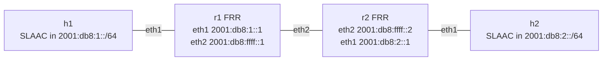

# Lab 04 — SLAAC, NDP and Static IPv6 Routing

## Objective

Watch hosts configure themselves with SLAAC. Capture every NDP message type. Route IPv6 between two subnets. Then break RAs and NDP and fix them.

## Topology

File: [`labs/topologies/m04-ipv6/m04-ipv6.clab.yml`](../../labs/topologies/m04-ipv6/m04-ipv6.clab.yml)



## Steps

### 1. Deploy

```bash
cd labs/topologies/m04-ipv6
sudo containerlab deploy -t m04-ipv6.clab.yml
```

Expected output: a table with 4 nodes in state `running`.

### 2. Check the router configuration

```bash
docker exec -it clab-m04-ipv6-r1 vtysh -c "show interface brief" -c "show ipv6 route"
```

Expected output (abridged):

```text
Interface       Status  VRF             Addresses
eth1            up      default         2001:db8:1::1/64
                                        fe80::a8c1:abff:fe..../64
eth2            up      default         2001:db8:ffff::1/64
C>* 2001:db8:1::/64 is directly connected, eth1
S>* 2001:db8:2::/64 [1/0] via 2001:db8:ffff::2, eth2
C>* 2001:db8:ffff::/64 is directly connected, eth2
```

### 3. Watch SLAAC happen

Start a capture on h1, then bounce the interface:

```bash
docker exec -it clab-m04-ipv6-h1 tcpdump -i eth1 -vv -nn icmp6 &
docker exec clab-m04-ipv6-h1 sh -c "ip link set eth1 down; sleep 1; ip link set eth1 up"
```

You should see, in order:

```text
:: > ff02::1:ffXX:XXXX: ICMP6, neighbor solicitation, who has fe80::...      # DAD for link-local
fe80::... > ff02::2: ICMP6, router solicitation                               # RS
fe80::... > ff02::1: ICMP6, router advertisement, length 64                   # RA from r1
    prefix info option (3), length 32: 2001:db8:1::/64, Flags [onlink, auto], valid time 2592000s
    rdnss option (25), length 24: lifetime 1800s, addr: 2001:4860:4860::8888
:: > ff02::1:ffXX:XXXX: ICMP6, neighbor solicitation, who has 2001:db8:1::... # DAD for global
```

### 4. Inspect the host

```bash
docker exec clab-m04-ipv6-h1 ip -6 addr show dev eth1
docker exec clab-m04-ipv6-h1 ip -6 route
```

Confirm three things:

- A global address in 2001:db8:1::/64 with `scope global dynamic`.
- A link-local address in fe80::/64.
- A default route **via r1's link-local address**, `proto ra`.

### 5. Test end to end

```bash
H2=$(docker exec clab-m04-ipv6-h2 ip -6 -o addr show dev eth1 scope global | awk '{print $4}' | cut -d/ -f1)
docker exec clab-m04-ipv6-h1 ping -6 -c 3 $H2
docker exec clab-m04-ipv6-h1 traceroute -6 -n $H2
```

Expected output: 3 replies and a traceroute with 3 hops (2001:db8:1::1, 2001:db8:ffff::2, then h2).

### 6. See NS/NA (the IPv6 ARP)

```bash
docker exec clab-m04-ipv6-h1 ip -6 neigh flush dev eth1
docker exec clab-m04-ipv6-h1 ping -6 -c 1 2001:db8:1::1
docker exec clab-m04-ipv6-h1 ip -6 neigh
```

In the capture, the NS goes to `ff02::1:ff00:1`, the solicited-node address of 2001:db8:1::1.

### 7. Compute an EUI-64 address by hand

```bash
docker exec clab-m04-ipv6-r1 ip link show eth1 | awk '/ether/ {print $2}'
docker exec clab-m04-ipv6-r1 ip -6 addr show dev eth1 scope link
```

Write the EUI-64 interface ID from the MAC by hand. Compare it with the link-local address.

## Verification

- [ ] h1 and h2 each have a SLAAC global address.
- [ ] Both default routes point to a link-local address.
- [ ] h1 pings h2 over IPv6.
- [ ] You captured RS, RA, NS and NA (types 133-136).
- [ ] Your hand-built EUI-64 matches the router's link-local.

## Break it and fix it

| # | Break | Find and fix |
|---|---|---|
| 1 | `docker exec clab-m04-ipv6-r1 vtysh -c "conf t" -c "int eth1" -c "ipv6 nd suppress-ra"` then bounce h1's eth1 | What address does h1 have now? |
| 2 | `docker exec clab-m04-ipv6-r2 vtysh -c "conf t" -c "no ipv6 route 2001:db8:1::/64 2001:db8:ffff::1"` | Ping h2 from h1. Where does it fail? Use `traceroute -6`. |
| 3 | `docker exec clab-m04-ipv6-r1 sysctl -w net.ipv6.conf.all.forwarding=0` | What changes on h1's default route? |
| 4 | `docker exec clab-m04-ipv6-h1 ip6tables -A INPUT -p icmpv6 -j DROP` | What breaks, and why can't you block ICMPv6? |

<details><summary>Answers</summary>

1. Only a link-local address (the global address stays until its lifetime ends if you do not bounce). No RA means no prefix and no default route. Fix: `no ipv6 nd suppress-ra`.
2. r2 has no route back to 2001:db8:1::/64. The echo request reaches h2, but the reply dies at r2. This is the IPv6 version of the "return route" fault.
3. A Linux node with forwarding off is a host. It sends RAs with router lifetime 0 (or none), so h1 loses its default route. Restore forwarding.
4. NDP stops working. h1 cannot resolve r1's MAC (no NA accepted), so all traffic fails. Remove the rule: `ip6tables -F`.

</details>

## Clean up

```bash
sudo containerlab destroy -t m04-ipv6.clab.yml --cleanup
```
