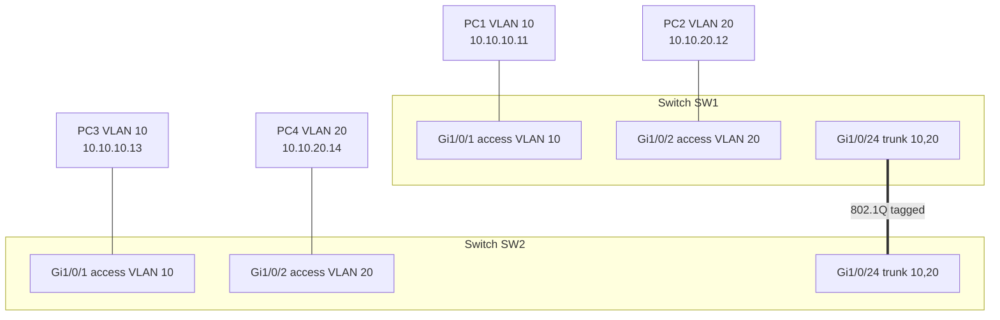
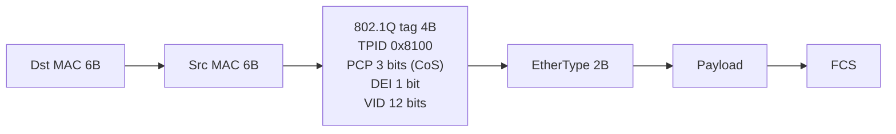
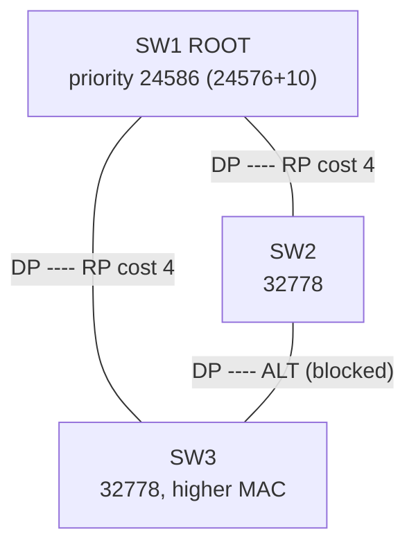

# Module 05 — Switching: VLANs, 802.1Q Trunking, STP/RSTP, EtherChannel, Port Security

**Time:** 5 sessions. **Prerequisites:** Module 02.

## Learning objectives

1. Create VLANs, access ports and 802.1Q trunks on Cisco IOS.
2. Explain the native VLAN and why mismatches are dangerous.
3. Explain how STP elects a root bridge, root ports and designated ports, and how RSTP converges fast.
4. Configure PortFast, BPDU guard, root guard and loop guard.
5. Bundle links with LACP EtherChannel and check that they match.
6. Configure port security and recover err-disabled ports.
7. Validate topology with CDP and LLDP.

## 1. First principles

### Why VLANs

A switch floods broadcasts to every port. On a large flat network, broadcasts and unknown unicasts reach every host. That wastes bandwidth and puts every device in one security zone. A **VLAN** splits one physical switch into many logical switches. Each VLAN is a separate **broadcast domain** and usually maps to one IP subnet.



- **Access port:** carries one VLAN, untagged. Connects end hosts.
- **Trunk port:** carries many VLANs. Each frame gets a 4-byte **802.1Q tag** with a 12-bit VLAN ID (1-4094).
- **Native VLAN:** the one VLAN sent **untagged** on a trunk (VLAN 1 by default). Both ends must match.
- **Voice VLAN:** an access port can carry one data VLAN (untagged) and one voice VLAN (tagged, learned by the IP phone through CDP/LLDP).

### The 802.1Q tag



### Inter-VLAN routing

Hosts in different VLANs need a Layer 3 device. Three ways:

1. **Router on a stick:** one router interface, many subinterfaces (`encapsulation dot1q 10`).
2. **Layer 3 switch with SVIs:** `interface vlan 10` with an IP address and `ip routing`. This is the normal enterprise design.
3. **Routed ports** (`no switchport`) between L3 switches.

## 2. How it works on the wire

### Spanning Tree Protocol

Redundant links create **loops**. Ethernet has no TTL, so a broadcast circles forever: a **broadcast storm**. MAC tables flap and the network goes down in seconds. STP (802.1D) and RSTP (802.1w) block redundant ports to make a loop-free tree.

Election steps:

1. **Root bridge:** lowest **bridge ID** = priority (default 32768 + VLAN ID with PVST+ extended system ID) + MAC. Lowest wins.
2. **Root port** on every non-root switch: the port with the lowest **cost** to the root. Ties: lowest neighbour bridge ID, then lowest neighbour port ID.
3. **Designated port** on every segment: the port with the lowest cost to the root on that segment. All root bridge ports are designated.
4. All other ports: **blocking** (STP) / **alternate or backup** (RSTP).

| Speed | STP short cost (802.1D-1998) | RSTP long cost |
|---|---|---|
| 10 Mbps | 100 | 2,000,000 |
| 100 Mbps | 19 | 200,000 |
| 1 Gbps | 4 | 20,000 |
| 10 Gbps | 2 | 2,000 |



SW2 and SW3 tie on cost to root on their shared link (both 4). SW2 has the lower bridge ID, so SW2's port is designated and SW3's port becomes alternate (blocked).

### RSTP

| Topic | 802.1D STP | 802.1w RSTP (Rapid PVST+) |
|---|---|---|
| Port states | Blocking, listening, learning, forwarding, disabled | **Discarding**, learning, forwarding |
| Port roles | Root, designated, blocked | Root, designated, **alternate**, **backup** |
| Convergence | 30-50 s (timers) | Under 1 s on point-to-point links (proposal/agreement handshake) |
| Edge ports | PortFast (Cisco add-on) | Edge port is part of the standard |

**Exam tip (v2.0 topic 2.5):** Know Rapid PVST+ port names, states and roles. Know what PortFast, BPDU guard, root guard and loop guard do. Cisco default on modern IOS is still PVST+ on some platforms. Configure `spanning-tree mode rapid-pvst`.

| Feature | Where | What it does |
|---|---|---|
| PortFast | Access ports | Goes to forwarding at once. Skips listening/learning. |
| BPDU guard | PortFast ports | If a BPDU arrives, put the port in **err-disabled**. Stops rogue switches. |
| Root guard | Ports toward downstream switches | If a superior BPDU arrives, put the port in **root-inconsistent** (blocks). Protects root placement. |
| Loop guard | Root/alternate ports | If BPDUs stop arriving (unidirectional link), go to **loop-inconsistent** instead of forwarding. |

### EtherChannel (LACP)

Bundle 2-8 physical links into one logical **Port-channel**. STP sees one link, so nothing is blocked. Traffic is load-balanced per flow by a hash (src/dst MAC, IP or port).

| Protocol | Modes that form a bundle |
|---|---|
| LACP (802.3ad, open) | active-active, active-passive |
| PAgP (Cisco) | desirable-desirable, desirable-auto |
| Static | on-on |

All member ports must match: speed, duplex, access VLAN or trunk allowed VLANs, native VLAN, and mode.

```text
SW1(config)# interface range g1/0/23-24
SW1(config-if-range)# channel-group 1 mode active
SW1(config)# interface port-channel 1
SW1(config-if)# switchport mode trunk
SW1# show etherchannel summary
Flags:  D - down        P - bundled in port-channel
        S - Layer2      U - in use
Group  Port-channel  Protocol    Ports
------+-------------+-----------+------------------------
1      Po1(SU)         LACP      Gi1/0/23(P) Gi1/0/24(P)
```

### Port security

Limits which MACs may use an access port.

```text
SW1(config)# interface g1/0/5
SW1(config-if)# switchport mode access
SW1(config-if)# switchport port-security
SW1(config-if)# switchport port-security maximum 2
SW1(config-if)# switchport port-security mac-address sticky
SW1(config-if)# switchport port-security violation restrict
```

| Violation mode | Drops traffic | Logs/counts | Shuts the port |
|---|---|---|---|
| protect | Yes | No | No |
| restrict | Yes | Yes | No |
| shutdown (default) | Yes | Yes | Yes (err-disabled) |

Recover an err-disabled port: `shutdown` then `no shutdown`, or `errdisable recovery cause psecure-violation`.

### CDP and LLDP

| | CDP | LLDP |
|---|---|---|
| Standard | Cisco proprietary | IEEE 802.1AB |
| Default on IOS | Enabled | Disabled (`lldp run`) |
| Timer / hold | 60 s / 180 s | 30 s / 120 s |
| Command | `show cdp neighbors detail` | `show lldp neighbors detail` |

**Exam tip (v2.0 topic 2.3):** Use CDP/LLDP output to **validate documentation**. If the diagram says Gi1/0/1 connects to SW2 Gi0/1 and `show cdp neighbors` disagrees, the diagram is wrong.

## 3. Production example

A data center had a broadcast storm when a contractor connected a small unmanaged switch to two wall ports. Both ports were access ports with PortFast but no BPDU guard. The cheap switch forwarded BPDUs, created a loop, and the storm took down a VLAN with 400 servers for 12 minutes. The fix: `spanning-tree portfast bpduguard default` globally, storm control on access ports, and root guard on distribution downlinks.

**Production note:** Always set the root bridge on purpose: `spanning-tree vlan 1-4094 root primary` on the core/distribution switch. Never let the oldest switch with the lowest MAC become root by accident.

## 4. Cloud equivalent (AWS)

| On-prem | AWS |
|---|---|
| VLAN / broadcast domain | Subnet (but no broadcast) |
| Trunk to a hypervisor | ENI per subnet, or VLAN-tagged ENIs on Outposts |
| STP | Not needed. The VPC fabric has no Layer 2 loops |
| EtherChannel | ENA bonding is not used; bandwidth comes from the instance type. Direct Connect uses **LAG** (LACP) for multiple physical connections |
| Port security | Security groups and source/destination check on the ENI |

## 5. Common failures

| Symptom | Cause | Command |
|---|---|---|
| Hosts in same VLAN on two switches cannot talk | VLAN not allowed on the trunk, or VLAN not created on one switch | `show interfaces trunk`, `show vlan brief` |
| `%CDP-4-NATIVE_VLAN_MISMATCH` | Native VLAN differs on two trunk ends | `show interfaces g0/1 switchport` |
| Port is `err-disabled` | BPDU guard, port security, UDLD | `show interfaces status err-disabled` |
| Port-channel shows `(SD)` and members `(s)` or `(I)` | Members do not match or LACP mode mismatch (passive-passive) | `show etherchannel summary` |
| Whole VLAN slow, CPU 100%, MAC flapping logs | Layer 2 loop | `show spanning-tree`, check BPDU guard |
| Wrong switch is root | No priority set | `show spanning-tree root` |

## Next

[Lab](lab.md) · [Quiz](quiz.md) · [Cheatsheet](cheatsheet.md) · [Module 06](../06-routing-basics/README.md)
