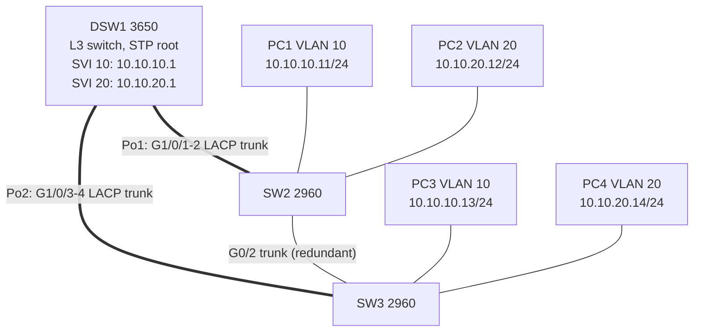

# Lab 05 — VLANs, Trunks, Rapid PVST+, LACP and Port Security (Packet Tracer)

## Objective

Build a 3-switch campus block in Cisco Packet Tracer. Configure VLANs, trunks, a deliberate STP root, LACP EtherChannel, PortFast with BPDU guard, port security and inter-VLAN routing on a Layer 3 switch.

## Topology

Use three 2960 switches (SW2, SW3 as access) and one 3650 (DSW1 as distribution).



| Device | Port | Connects to |
|---|---|---|
| DSW1 | G1/0/1-2 | SW2 G0/1, Fa0/24 (use two links) |
| DSW1 | G1/0/3-4 | SW3 G0/1, Fa0/24 |
| SW2 | G0/2 | SW3 G0/2 |
| SW2 | Fa0/1, Fa0/2 | PC1, PC2 |
| SW3 | Fa0/1, Fa0/2 | PC3, PC4 |

Packet Tracer tip: If your 2960 has only 2 gigabit ports, bundle Fa0/23-24 instead. All members must have the same speed.

## Steps

### 1. VLANs on all switches

```text
DSW1(config)# vlan 10
DSW1(config-vlan)# name USERS
DSW1(config-vlan)# vlan 20
DSW1(config-vlan)# name SERVERS
DSW1(config-vlan)# vlan 99
DSW1(config-vlan)# name NATIVE
```

Repeat on SW2 and SW3.

### 2. Access ports with PortFast and BPDU guard (SW2 and SW3)

```text
SW2(config)# interface range fa0/1
SW2(config-if-range)# switchport mode access
SW2(config-if-range)# switchport access vlan 10
SW2(config)# interface fa0/2
SW2(config-if)# switchport mode access
SW2(config-if)# switchport access vlan 20
SW2(config)# spanning-tree portfast default
SW2(config)# spanning-tree portfast bpduguard default
```

### 3. LACP EtherChannel trunks

On DSW1:

```text
DSW1(config)# interface range g1/0/1-2
DSW1(config-if-range)# channel-group 1 mode active
DSW1(config)# interface range g1/0/3-4
DSW1(config-if-range)# channel-group 2 mode active
DSW1(config)# interface range port-channel 1-2
DSW1(config-if-range)# switchport trunk encapsulation dot1q
DSW1(config-if-range)# switchport mode trunk
DSW1(config-if-range)# switchport trunk native vlan 99
DSW1(config-if-range)# switchport trunk allowed vlan 10,20,99
```

On SW2 (and SW3 with its ports):

```text
SW2(config)# interface range g0/1, fa0/24
SW2(config-if-range)# channel-group 1 mode active
SW2(config)# interface port-channel 1
SW2(config-if)# switchport mode trunk
SW2(config-if)# switchport trunk native vlan 99
SW2(config-if)# switchport trunk allowed vlan 10,20,99
SW2(config)# interface g0/2
SW2(config-if)# switchport mode trunk
SW2(config-if)# switchport trunk native vlan 99
SW2(config-if)# switchport trunk allowed vlan 10,20,99
```

### 4. Rapid PVST+ and the root bridge

```text
DSW1(config)# spanning-tree mode rapid-pvst
DSW1(config)# spanning-tree vlan 10,20,99 root primary
SW2(config)# spanning-tree mode rapid-pvst
SW3(config)# spanning-tree mode rapid-pvst
```

### 5. Inter-VLAN routing with SVIs

```text
DSW1(config)# ip routing
DSW1(config)# interface vlan 10
DSW1(config-if)# ip address 10.10.10.1 255.255.255.0
DSW1(config-if)# no shutdown
DSW1(config)# interface vlan 20
DSW1(config-if)# ip address 10.10.20.1 255.255.255.0
DSW1(config-if)# no shutdown
```

Set each PC's gateway to .1 in its VLAN.

### 6. Port security on PC1's port

```text
SW2(config)# interface fa0/1
SW2(config-if)# switchport port-security
SW2(config-if)# switchport port-security maximum 1
SW2(config-if)# switchport port-security mac-address sticky
SW2(config-if)# switchport port-security violation shutdown
```

## Expected output and verification

```text
DSW1# show etherchannel summary
Group  Port-channel  Protocol    Ports
------+-------------+-----------+-----------------------------------------
1      Po1(SU)         LACP      Gig1/0/1(P) Gig1/0/2(P)
2      Po2(SU)         LACP      Gig1/0/3(P) Gig1/0/4(P)

DSW1# show spanning-tree vlan 10
VLAN0010
  Spanning tree enabled protocol rstp
  Root ID    Priority    24586
             This bridge is the root
Interface           Role Sts Cost      Prio.Nbr Type
------------------- ---- --- --------- -------- ------------------
Po1                 Desg FWD 3         128.27   P2p
Po2                 Desg FWD 3         128.28   P2p

SW3# show spanning-tree vlan 10
Interface           Role Sts Cost      Prio.Nbr Type
------------------- ---- --- --------- -------- ------------------
Fa0/1               Desg FWD 19        128.1    P2p Edge
Po1                 Root FWD 3         128.27   P2p
Gi0/2               Altn BLK 4         128.26   P2p

SW2# show interfaces trunk
Port        Mode         Encapsulation  Status        Native vlan
Po1         on           802.1q         trunking      99
Gi0/2       on           802.1q         trunking      99
Port        Vlans allowed on trunk
Po1         10,20,99
```

Port costs and numbers vary by Packet Tracer version. The roles must match: DSW1 is root on all its ports, and one end of the SW2-SW3 link is Alternate/Blocking.

Checklist:

- [ ] PC1 pings PC3 (same VLAN, across switches).
- [ ] PC1 pings PC2 (inter-VLAN through DSW1).
- [ ] `show port-security interface fa0/1` shows one sticky MAC.
- [ ] `show cdp neighbors` on DSW1 lists SW2 and SW3 on the expected ports.
- [ ] You can name which port blocks for VLAN 10, and why.

## Break it and fix it

| # | Break | Find and fix |
|---|---|---|
| 1 | On SW3 Po1: `switchport trunk allowed vlan 20,99` | PC1 → PC3 fails. Which command shows it? |
| 2 | On SW2 Po1: `switchport trunk native vlan 1` | What log message appears? What is the risk? |
| 3 | On SW3: `interface range g0/1, fa0/24` → `channel-group 2 mode passive`, and set DSW1 Po2 members to passive too | What state does Po2 show? |
| 4 | Connect a new switch to SW2 Fa0/3 (an access port) | What happens to Fa0/3? How do you recover it? |
| 5 | Move PC1 to another port and plug a laptop into Fa0/1 | What happens? How do you clear it? |
| 6 | On SW3: `spanning-tree vlan 10 priority 0` | Which switch is now root for VLAN 10? How do you stop this on DSW1? |

<details><summary>Answers</summary>

1. VLAN 10 is not allowed on SW3's uplink. `show interfaces trunk` shows the allowed list. Fix: `switchport trunk allowed vlan add 10`.
2. `%CDP-4-NATIVE_VLAN_MISMATCH`. Untagged frames on VLAN 99 at one end land in VLAN 1 at the other end: traffic leaks between VLANs. Match the native VLAN on both ends.
3. passive-passive never sends LACP PDUs, so the bundle does not form. Members show `(I)` (stand-alone) or `(s)`. Set at least one side to active.
4. BPDU guard puts Fa0/3 in err-disabled (`%SPANTREE-2-BLOCK_BPDUGUARD`). Remove the switch, then `shutdown` / `no shutdown`.
5. Port security violation: the port goes err-disabled. Clear the sticky MAC (`clear port-security sticky interface fa0/1`) and bounce the port.
6. SW3 becomes root (priority 0 + 10 = 10). Prevent it with `spanning-tree guard root` on DSW1's downlinks (Po1, Po2): the port goes root-inconsistent instead of accepting SW3 as root.

</details>
