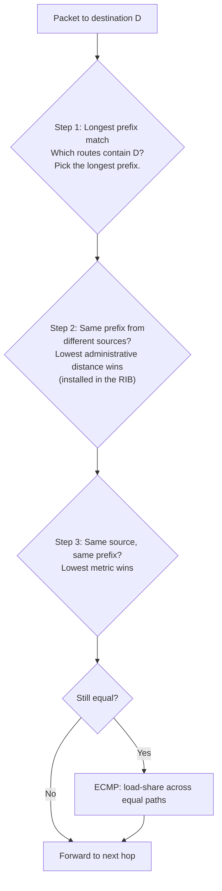
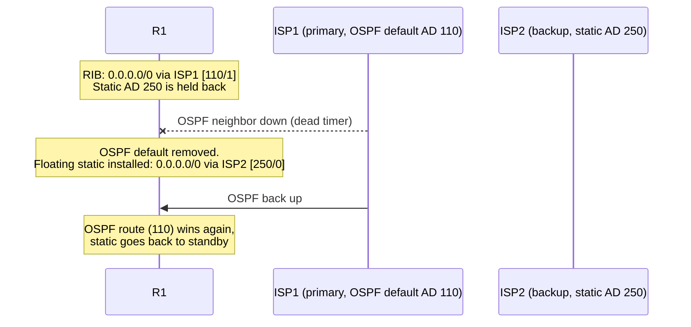
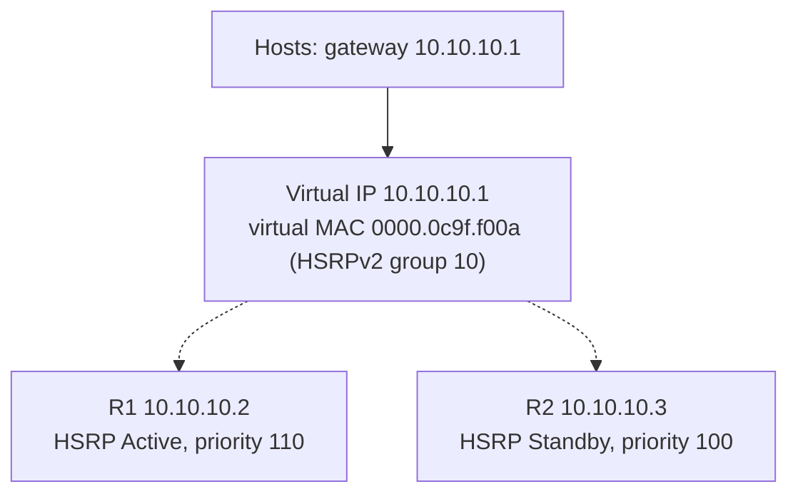

# Module 06 — Routing Basics: Routing Table, Static Routes, Longest Prefix Match, Administrative Distance

**Time:** 3 sessions. **Prerequisites:** Module 03.

## Learning objectives

1. Read a Cisco and a Linux routing table and find the next hop for any destination.
2. Apply the three-step route selection: longest prefix match, then administrative distance, then metric.
3. Configure default, network, host and floating static routes (IPv4 and IPv6).
4. Explain recursive lookups and why exit-interface-only static routes on Ethernet are risky.
5. Explain first-hop redundancy (HSRP, VRRP) and read their status.

## 1. First principles

A router has one job: for each packet, look at the **destination IP**, find the best matching route, and send the packet to the **next hop**. It does not care about the source (unless you add policy routing).

Routes come from three sources:

1. **Connected:** an interface with an IP address that is up/up. (Plus a **local** /32 route for the interface IP itself.)
2. **Static:** typed by an engineer.
3. **Dynamic:** learned from a routing protocol (Module 07).

### How the router picks a route



**Important:** AD and metric only compare routes for the **same prefix**. Longest prefix match always comes first, at forwarding time. A static /8 (AD 1) never beats an OSPF /24 (AD 110) for an address inside the /24.

### Administrative distance

| Source | AD |
|---|---|
| Connected | 0 |
| Static | 1 |
| eBGP | 20 |
| EIGRP (internal) | 90 |
| OSPF | 110 |
| IS-IS | 115 |
| RIP | 120 |
| EIGRP external | 170 |
| iBGP | 200 |
| Unusable | 255 |

**Exam tip:** Memorize this table. A **floating static route** is a static route with a higher AD (for example, 115 or 250) so it is used only when the dynamic route disappears.

## 2. How it works on the wire

### Reading a Cisco routing table

```text
R1# show ip route
Codes: L - local, C - connected, S - static, O - OSPF, * - candidate default
Gateway of last resort is 203.0.113.1 to network 0.0.0.0

S*    0.0.0.0/0 [1/0] via 203.0.113.1
      10.0.0.0/8 is variably subnetted, 5 subnets, 4 masks
O        10.1.0.0/16 [110/20] via 10.0.12.2, 00:12:44, GigabitEthernet0/1
O        10.1.5.0/24 [110/30] via 10.0.13.3, 00:12:44, GigabitEthernet0/2
S        10.1.5.128/25 [1/0] via 10.0.12.2
C        10.0.12.0/30 is directly connected, GigabitEthernet0/1
L        10.0.12.1/32 is directly connected, GigabitEthernet0/1
```

Read `[110/30]` as `[AD/metric]`.

| Destination | Matching routes | Winner | Next hop |
|---|---|---|---|
| 10.1.5.200 | /0, /16, /24, /25 | 10.1.5.128/25 (longest) | 10.0.12.2 |
| 10.1.5.10 | /0, /16, /24 | 10.1.5.0/24 | 10.0.13.3 |
| 10.1.9.9 | /0, /16 | 10.1.0.0/16 | 10.0.12.2 |
| 8.8.8.8 | /0 | default | 203.0.113.1 |

**Exam tip (v2.0 topic 3.1):** "Interpret a routing table to identify the next hop" is a direct exam topic. Practise with the computed questions in the practice exams.

### Linux equivalent

```text
$ ip route
default via 203.0.113.1 dev eth0 proto static metric 100
10.1.0.0/16 via 10.0.12.2 dev eth1 proto ospf metric 20
10.1.5.0/24 via 10.0.13.3 dev eth2 proto ospf metric 30
10.1.5.128/25 via 10.0.12.2 dev eth1 proto static
$ ip route get 10.1.5.200
10.1.5.200 via 10.0.12.2 dev eth1 src 10.0.12.1 uid 1000
```

`ip route get` does the longest prefix match for you. Use it in every troubleshooting session.

### Static route types

```text
! Network route (recursive: next hop is resolved through another route)
R1(config)# ip route 10.2.0.0 255.255.0.0 10.0.12.2
! Default route
R1(config)# ip route 0.0.0.0 0.0.0.0 203.0.113.1
! Host route
R1(config)# ip route 10.9.9.9 255.255.255.255 10.0.12.2
! Floating static (backup) with AD 250
R1(config)# ip route 0.0.0.0 0.0.0.0 198.51.100.1 250
! Fully specified (interface + next hop): best practice on Ethernet
R1(config)# ip route 10.2.0.0 255.255.0.0 GigabitEthernet0/1 10.0.12.2
! IPv6
R1(config)# ipv6 route ::/0 2001:db8:ffff::2
R1(config)# ipv6 route 2001:db8:2::/64 GigabitEthernet0/1 fe80::2
```

**Production note:** A static route that names only an Ethernet exit interface (`ip route 10.2.0.0 255.255.0.0 g0/1`) makes the router ARP for **every destination** in 10.2.0.0/16. It works only if the next router does proxy ARP. Always give a next-hop IP.

### Floating static failover



A floating static route only fails over when the primary route **disappears from the table**. If the primary is also static, and its next hop stays reachable (but the internet behind it is down), there is no failover. Use **IP SLA tracking** (`ip sla` + `track` + `ip route ... track 1`) or a dynamic protocol.

### First-hop redundancy (HSRP and VRRP)

Hosts have one default gateway IP. If that router fails, hosts lose access. FHRPs give a **virtual IP and virtual MAC** shared by two or more routers.



| | HSRP | VRRP |
|---|---|---|
| Standard | Cisco | IETF (RFC 5798, v3) |
| Roles | Active / Standby | Master / Backup |
| Default priority | 100 | 100 |
| Preemption | Off by default | On by default |
| Virtual MAC | v1: 0000.0c07.acXX; v2: 0000.0c9f.fXXX | 0000.5e00.01XX |
| Multicast | 224.0.0.2 (v1), 224.0.0.102 (v2) | 224.0.0.18 |
| VIP can equal real IP | No | Yes (owner gets priority 255) |

```text
R1# show standby brief
Interface   Grp  Pri P State   Active          Standby         Virtual IP
Gi0/0       10   110 P Active  local           10.10.10.3      10.10.10.1
```

**Exam tip (v2.0 topic 3.4):** "Interpret the operational status of HSRP and VRRP." Know how to read `show standby brief` and `show vrrp brief`, and know that the higher priority wins (then the higher IP). Preemption decides if a recovered router takes back the active role.

## 3. Production example

A branch had a primary MPLS link (eBGP default, AD 20) and a backup LTE router (floating static default, AD 250). During an MPLS outage, the BGP session stayed up for 3 minutes because the BGP hold timer is 180 s by default. Users had no internet for 3 minutes. Adding **BFD** to the BGP session cut failover to under 1 second.

## 4. Cloud equivalent (AWS)

| Concept | AWS |
|---|---|
| Routing table | VPC route table, one per subnet (main table by default) |
| Connected route | The `local` route for the VPC CIDR. It cannot be removed, but you can now point more specific routes for subnets at an appliance (middlebox routing). |
| Longest prefix match | Yes. More specific routes win. |
| Static route | Every VPC route is static: targets are IGW, NAT GW, TGW, VGW, ENI, VPC endpoint, peering |
| AD equivalent | Longest prefix match always comes first. For identical prefixes, AWS uses a fixed order: local route, then static routes, then propagated routes (Direct Connect BGP, then VPN static, then VPN BGP). |
| FHRP | Not needed. The VPC router at subnet+1 is always available and highly available |

**Production note:** A common outage: a team adds `10.0.0.0/8 → TGW` to a route table. A more specific peering route to a partner VPC disappears during a change, and traffic silently takes the /8 to TGW, where it is dropped. Always check the **effective** route with VPC Reachability Analyzer before a change.

## 5. Common failures

| Symptom | Cause | Check |
|---|---|---|
| Traffic goes one way only | Missing return route | `show ip route <source>` on the far router |
| `% Invalid next hop address` | Next hop is the router's own IP | Fix the next hop |
| Static route missing from table | Next hop not reachable (recursive lookup failed) or exit interface down | `show ip route <next-hop>` |
| Floating static never activates | Primary route stays in the table | IP SLA tracking, BFD |
| Traceroute shows a loop between two routers | Two static routes point at each other | Check both routers |
| Host traffic black-holed after one gateway fails | No FHRP or preemption issue | `show standby brief` |

## Next

[Lab](lab.md) · [Quiz](quiz.md) · [Cheatsheet](cheatsheet.md) · [Module 07](../07-dynamic-routing/README.md)
