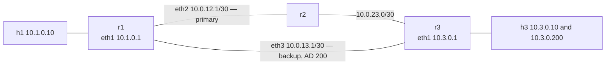

# Lab 06 — Static Routes, Longest Prefix Match and Floating Static Failover

## Objective

Read routing tables. Prove that longest prefix match beats administrative distance. Watch a floating static route take over. Find the case where a floating static route does **not** fail over.

## Topology

File: [`labs/topologies/m06-static/m06-static.clab.yml`](../../labs/topologies/m06-static/m06-static.clab.yml)



## Steps

### 1. Deploy and check

```bash
cd labs/topologies/m06-static
sudo containerlab deploy -t m06-static.clab.yml
docker exec clab-m06-static-r1 vtysh -c "show ip route"
```

Expected output:

```text
C>* 10.0.12.0/30 is directly connected, eth2
C>* 10.0.13.0/30 is directly connected, eth3
C>* 10.1.0.0/24 is directly connected, eth1
S>* 10.3.0.0/24 [1/0] via 10.0.12.2, eth2, weight 1
```

The AD 200 route is not shown as selected. See all candidates:

```bash
docker exec clab-m06-static-r1 vtysh -c "show ip route 10.3.0.0/24"
```

```text
Routing entry for 10.3.0.0/24
  Known via "static", distance 200, metric 0
    10.0.13.2, via eth3
Routing entry for 10.3.0.0/24
  Known via "static", distance 1, metric 0, best
  * 10.0.12.2, via eth2
```

### 2. Trace the primary path

```bash
docker exec clab-m06-static-h1 traceroute -n 10.3.0.10
```

Expected: `10.1.0.1 → 10.0.12.2 → 10.0.23.2 (r3) → 10.3.0.10`.

### 3. Fail the primary link and watch the floating route

```bash
docker exec clab-m06-static-r1 ip link set eth2 down
docker exec clab-m06-static-r1 vtysh -c "show ip route 10.3.0.0/24 longer-prefixes"
docker exec clab-m06-static-h1 traceroute -n 10.3.0.10
docker exec clab-m06-static-r1 ip link set eth2 up
```

Expected: the route now shows `[200/0] via 10.0.13.2, eth3` and the trace has 2 router hops.

### 4. Longest prefix match beats AD

Add a more specific route for the top half of the LAN through the backup link with a **high** AD:

```bash
docker exec clab-m06-static-r1 vtysh -c "conf t" -c "ip route 10.3.0.128/25 10.0.13.2 250"
docker exec clab-m06-static-r1 ip route get 10.3.0.10
docker exec clab-m06-static-r1 ip route get 10.3.0.200
```

Expected output:

```text
10.3.0.10 via 10.0.12.2 dev eth2 src 10.0.12.1
10.3.0.200 via 10.0.13.2 dev eth3 src 10.0.13.1
```

The /25 with AD 250 wins for 10.3.0.200 because AD only compares routes with the **same prefix**.

### 5. The failover that does not happen

Now fail the link **behind** r2, not the link on r1:

```bash
docker exec clab-m06-static-r2 ip link set eth2 down
docker exec clab-m06-static-h1 ping -c 3 -W 1 10.3.0.10
docker exec clab-m06-static-r1 vtysh -c "show ip route 10.3.0.0/24"
```

Ping fails. r1 still uses the AD 1 route via r2, because the next hop 10.0.12.2 is still reachable. The floating static route never activates. This is why production networks use dynamic routing, BFD or IP SLA tracking.

```bash
docker exec clab-m06-static-r2 ip link set eth2 up
```

## Verification

- [ ] You can explain each line of `show ip route` on r1.
- [ ] Failover in step 3 worked, and failback happened when eth2 came up.
- [ ] Step 4 proved LPM wins over AD.
- [ ] You can explain why step 5 did not fail over.

## Break it and fix it

| # | Break | Find and fix |
|---|---|---|
| 1 | `docker exec clab-m06-static-r3 vtysh -c "conf t" -c "no ip route 10.1.0.0/24 10.0.23.1"` | h1 → h3 ping fails. Where? |
| 2 | On r2: `ip route 10.3.0.0/24 10.0.12.1` (replace the correct route) | traceroute shows what pattern? |
| 3 | On r1: `ip route 10.3.0.0/24 10.0.99.2` (AD 1) and remove the old primary | Why is the route not in the table? |

<details><summary>Answers</summary>

1. The echo request reaches h3, but r3's reply goes out the AD 200 backup path (eth3) because the primary route is gone. The ping still works through asymmetric routing. If you also remove the AD 200 route, the reply has no route and the ping fails at r3. Asymmetric paths break stateful firewalls in real networks.
2. A routing loop: r1 → r2 → r1 → r2... traceroute shows the two IPs alternating until TTL expires.
3. The next hop 10.0.99.2 is not in any connected or other route, so the recursive lookup fails and the route is inactive. `show ip route static` in FRR shows it as inactive. The floating route (AD 200) becomes active.

</details>

## Clean up

```bash
sudo containerlab destroy -t m06-static.clab.yml --cleanup
```
