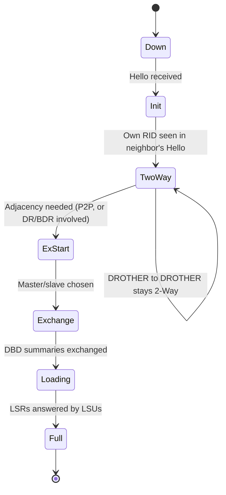
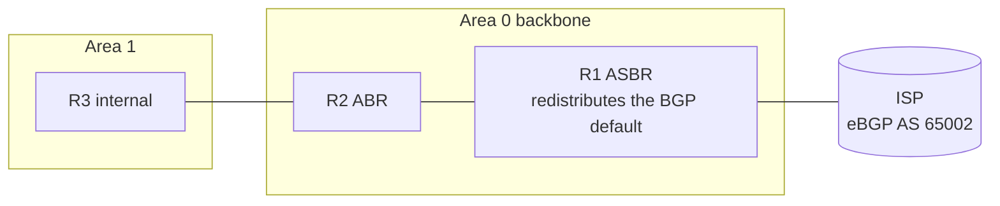
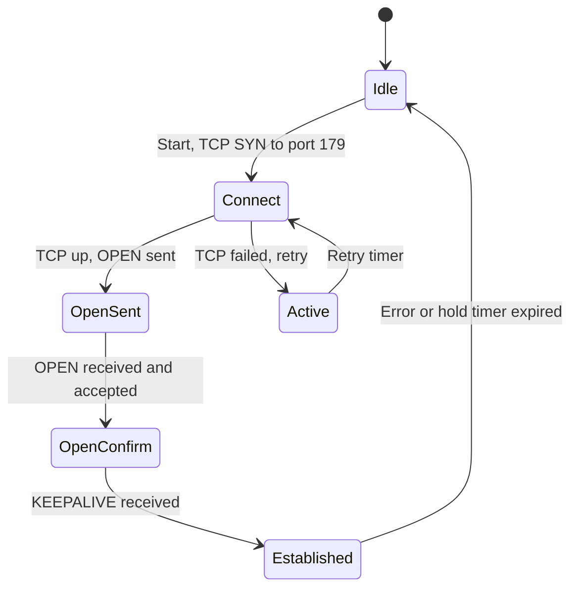

# Module 07 — Dynamic Routing: OSPF, EIGRP Overview, BGP Fundamentals

**Time:** 6 sessions. **Prerequisites:** Module 06.

## Learning objectives

1. Compare distance-vector, link-state and path-vector protocols.
2. Configure single-area and multi-area OSPFv2, and OSPFv3 for IPv6.
3. Explain OSPF neighbor states, DR/BDR election, router ID selection, LSA types 1-5 and cost.
4. Troubleshoot OSPF adjacencies that do not form.
5. Describe EIGRP (DUAL, feasible successor, metric) at overview level.
6. Configure eBGP, read the BGP table, and explain the best-path algorithm and basic filtering.

## 1. First principles

Static routes do not scale and do not react to failures. **Dynamic routing protocols** let routers tell each other about networks and recompute paths when links fail.

| Type | How it works | Examples | Analogy |
|---|---|---|---|
| Distance vector | Tell neighbors "I can reach X at distance N" | RIP, EIGRP (advanced DV) | Road signs |
| Link state | Every router floods its links. Everyone builds the same map and runs Dijkstra (SPF) | OSPF, IS-IS | Everyone has the full map |
| Path vector | Advertise the full list of ASes on the path; apply policy | BGP | Shipping with customs rules |

| | IGP (inside one organization) | EGP (between organizations) |
|---|---|---|
| Goal | Fast convergence, best technical path | Policy, scale, stability |
| Protocols | OSPF, IS-IS, EIGRP | BGP |

## 2. OSPF on the wire

OSPF runs directly on IP (**protocol 89**). It uses multicast **224.0.0.5** (all OSPF routers) and **224.0.0.6** (DR/BDR).

### Neighbor state machine



**Hello parameters that must match:** area ID, subnet and mask (on broadcast networks), hello and dead timers (10/40 s on broadcast), authentication, stub area flags, and MTU (checked in the DBD stage: mismatches stick in ExStart/Exchange). **Router IDs must be unique.**

### Router ID selection

1. `router-id` command.
2. Highest IP on an up **loopback**.
3. Highest IP on an up physical interface.

The RID is chosen when the OSPF process starts. Changing it needs `clear ip ospf process`.

### DR/BDR election (broadcast networks)

On a shared segment, every router forming a full adjacency with every other router would be n(n−1)/2 adjacencies. Instead, a **DR** and **BDR** are elected. Others (DROTHERs) form full adjacencies only with the DR and BDR.

- Highest **interface priority** wins (default 1; 0 = never DR).
- Tie: highest **router ID**.
- No preemption: a new router with a higher priority does not take over an existing DR.
- On **point-to-point** links (or `ip ospf network point-to-point`), there is no DR/BDR election. Use it on routed links between two routers; adjacencies form faster.

**Exam tip (v2.0 topic 3.3):** Know neighbor adjacencies, point-to-point vs broadcast (DR/BDR), and router ID. Expect output-reading questions on `show ip ospf neighbor` and `show ip ospf interface`.

### Cost

`cost = reference bandwidth / interface bandwidth`. Default reference bandwidth = **100 Mbps**, so FastEthernet, Gigabit and 10G all get cost 1. Fix it on every router: `auto-cost reference-bandwidth 100000` (100 Gbps).

### Areas and LSAs



| LSA | Name | Created by | Flooded | Contains |
|---|---|---|---|---|
| 1 | Router | Every router | Within the area | Its links and costs |
| 2 | Network | DR | Within the area | Routers on a broadcast segment |
| 3 | Summary | ABR | Into other areas | Prefixes from another area (route code `O IA`) |
| 4 | ASBR summary | ABR | Into other areas | How to reach an ASBR |
| 5 | External | ASBR | Whole domain (not stub areas) | Redistributed routes (`O E2` / `O E1`) |
| 7 | NSSA external | ASBR in an NSSA | Within the NSSA | Converted to type 5 by the ABR |

Multi-area design keeps the LSDB small: a link flap in area 1 runs SPF only in area 1. All areas must touch **area 0**.

### Configuration (Cisco IOS)

```text
R2(config)# router ospf 1
R2(config-router)# router-id 2.2.2.2
R2(config-router)# auto-cost reference-bandwidth 100000
R2(config-router)# passive-interface default
R2(config-router)# no passive-interface g0/0
R2(config-router)# no passive-interface g0/1
R2(config)# interface g0/0
R2(config-if)# ip ospf 1 area 0
R2(config-if)# ip ospf network point-to-point
R2(config)# interface g0/1
R2(config-if)# ip ospf 1 area 1
R2(config)# interface loopback0
R2(config-if)# ip ospf 1 area 0
```

Network statement form: `network 10.0.12.0 0.0.0.3 area 0` (wildcard mask). Both forms are tested.

OSPFv3 for IPv6:

```text
R2(config)# ipv6 unicast-routing
R2(config)# ipv6 router ospf 1
R2(config-rtr)# router-id 2.2.2.2
R2(config)# interface g0/0
R2(config-if)# ipv6 ospf 1 area 0
```

OSPFv3 uses link-local addresses for neighbors and needs an IPv4-format router ID even on IPv6-only routers.

Real output:

```text
R2# show ip ospf neighbor
Neighbor ID     Pri   State           Dead Time   Address         Interface
1.1.1.1           0   FULL/  -        00:00:35    10.0.12.1       GigabitEthernet0/0
3.3.3.3           1   FULL/DR         00:00:31    10.0.23.3       GigabitEthernet0/1

R3# show ip route ospf
O IA  10.0.12.0/30 [110/2] via 10.0.23.2, 00:05:11, GigabitEthernet0/0
O*E2  0.0.0.0/0 [110/1] via 10.0.23.2, 00:05:11, GigabitEthernet0/0
```

`FULL/ -` means point-to-point (no DR). `O IA` is inter-area (LSA 3). `O*E2` is an external default (LSA 5).

## 3. EIGRP overview

EIGRP is Cisco's advanced distance-vector protocol (published as RFC 7868). It is **not** on the CCNA v2.0 blueprint, but you will meet it in enterprise networks.

- Protocol 88, multicast 224.0.0.10. AD 90 internal, 170 external.
- **DUAL** keeps a **successor** (best path) and a **feasible successor** (a loop-free backup). Failover to a feasible successor is instant.
- **Feasibility condition:** a neighbor's reported distance must be less than the current feasible distance.
- Metric uses minimum bandwidth and total delay by default (K1 = K3 = 1).
- Configuration: `router eigrp 100` → `network 10.0.0.0 0.0.255.255`. Neighbors need the same AS number and K values.

## 4. BGP fundamentals

BGP is the routing protocol of the internet and of every AWS hybrid connection (Direct Connect, VPN, TGW Connect).

- Runs over **TCP 179**. Neighbors are configured manually.
- **eBGP:** between different ASes (AD 20, TTL 1 by default). **iBGP:** same AS (AD 200, does not change next hop, needs full mesh or route reflectors).
- Private ASNs: 64512-65534 (16-bit), 4200000000-4294967294 (32-bit).

### Session states



A session stuck in **Active** usually means TCP cannot connect: wrong neighbor IP, ACL/security group blocking 179, or no route to the peer.

### Best-path selection (simplified, Cisco order)

| Step | Attribute | Prefer |
|---|---|---|
| 1 | Weight (Cisco only, local) | Highest |
| 2 | LOCAL_PREF (within your AS) | Highest |
| 3 | Locally originated | Yes |
| 4 | AS_PATH length | Shortest |
| 5 | ORIGIN | IGP < EGP < incomplete |
| 6 | MED (from neighbor AS) | Lowest |
| 7 | eBGP over iBGP | eBGP |
| 8 | IGP metric to next hop | Lowest |
| 9+ | Oldest path, lowest router ID, lowest neighbor IP | — |

Memory aid: "**W**e **L**ove **O**ranges **AS** **O**ranges **M**ean **P**ure **R**efreshment" (Weight, Local pref, Originated, AS path, Origin, MED, Paths eBGP>iBGP, Router ID).

**Production note:** Use LOCAL_PREF to choose your **outbound** exit. Use AS_PATH prepending (and MED, or more specific prefixes) to influence **inbound** traffic. AWS Direct Connect supports BGP communities (`7224:7100` etc.) for local preference and scope.

### eBGP configuration with filtering

```text
R1(config)# router bgp 65001
R1(config-router)# bgp router-id 1.1.1.1
R1(config-router)# neighbor 203.0.113.2 remote-as 65002
R1(config-router)# address-family ipv4 unicast
R1(config-router-af)# network 198.51.100.0 mask 255.255.255.0
R1(config-router-af)# neighbor 203.0.113.2 prefix-list OUT out
R1(config-router-af)# neighbor 203.0.113.2 prefix-list IN in
R1(config)# ip prefix-list OUT seq 10 permit 198.51.100.0/24
R1(config)# ip prefix-list IN seq 10 permit 0.0.0.0/0
R1# show ip bgp summary
Neighbor        V    AS MsgRcvd MsgSent   TblVer  InQ OutQ Up/Down  State/PfxRcd
203.0.113.2     4 65002      12      14        3    0    0 00:08:41        1
R1# show ip bgp
     Network          Next Hop            Metric LocPrf Weight Path
 *>  0.0.0.0          203.0.113.2              0             0 65002 i
 *>  198.51.100.0/24  0.0.0.0                  0         32768 i
```

The `network` command advertises a prefix only if an **exact match** exists in the routing table.

## 5. Production example

An enterprise with two ISPs leaked its full internet table from ISP-A to ISP-B because it had no outbound filter. For a few minutes, ISP-B sent part of its traffic through the enterprise's small link. Fix: always filter eBGP in **both directions** with prefix lists, set `maximum-prefix`, and follow MANRS (RPKI route origin validation).

## 6. Cloud equivalent (AWS)

| Feature | Protocol |
|---|---|
| Site-to-Site VPN dynamic routing | eBGP over IPsec (AWS ASN 64512 by default) |
| Direct Connect private/transit VIF | eBGP over 802.1Q VLAN, BFD supported |
| TGW Connect | GRE + eBGP to SD-WAN appliances |
| VPC route tables | Static only; propagate BGP-learned routes from VGW/TGW |
| Route 53 Resolver, ALB | No routing protocol |
| Cloud WAN | Policy-based global network with BGP at the edge |

**Production note:** AWS Site-to-Site VPN accepts up to 100 propagated routes per route table from BGP (check current quotas). Summarize on-prem routes before you advertise them.

## 7. Common failures

| Symptom | Likely cause | Command |
|---|---|---|
| OSPF neighbor not seen | Area, subnet, timers, auth mismatch; passive interface; ACL blocks 89 | `show ip ospf interface`, `debug ip ospf adj` |
| Stuck in ExStart/Exchange | MTU mismatch | `show interfaces`, `ip ospf mtu-ignore` (temporary) |
| Stuck in 2-Way | Normal for DROTHER-DROTHER | `show ip ospf neighbor` |
| Duplicate router ID log | Copied config | Set unique `router-id`, `clear ip ospf process` |
| All links cost 1 | Default reference bandwidth | `auto-cost reference-bandwidth` |
| BGP Active/Idle | TCP 179 blocked, wrong peer IP/AS, no route to peer | `show ip bgp summary`, `telnet peer 179` |
| BGP up, no routes | Missing `network` match, filter, missing `activate`, next hop unreachable | `show ip bgp neighbors x advertised-routes` |

## Next

[Lab](lab.md) · [Quiz](quiz.md) · [Cheatsheet](cheatsheet.md) · [Module 08](../08-transport/README.md)
