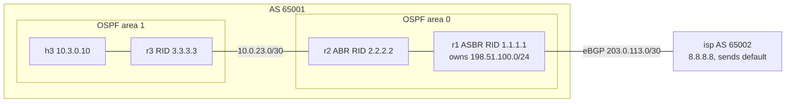

# Lab 07 — Multi-Area OSPF and eBGP to an ISP

## Objective

Bring up a two-area OSPF domain. Read neighbor states, LSAs and route codes. Peer with an ISP over eBGP, filter routes in both directions, and inject a default route into OSPF. Then fix five classic faults.

## Topology

File: [`labs/topologies/m07-ospf-bgp/m07-ospf-bgp.clab.yml`](../../labs/topologies/m07-ospf-bgp/m07-ospf-bgp.clab.yml)



## Steps

### 1. Deploy

```bash
cd labs/topologies/m07-ospf-bgp
sudo containerlab deploy -t m07-ospf-bgp.clab.yml
alias r1='docker exec -it clab-m07-ospf-bgp-r1 vtysh -c'
alias r2='docker exec -it clab-m07-ospf-bgp-r2 vtysh -c'
alias r3='docker exec -it clab-m07-ospf-bgp-r3 vtysh -c'
alias isp='docker exec -it clab-m07-ospf-bgp-isp vtysh -c'
```

### 2. Check OSPF neighbors

```bash
r2 "show ip ospf neighbor"
```

Expected output:

```text
Neighbor ID     Pri State           Up Time         Dead Time Address         Interface                        RXmtL RqstL DBsmL
1.1.1.1           1 Full/-          1m02s             35.112s 10.0.12.1       eth1:10.0.12.2                       0     0     0
3.3.3.3           1 Full/-          1m01s             36.004s 10.0.23.2       eth2:10.0.23.1                       0     0     0
```

`Full/-` = point-to-point, no DR/BDR.

### 3. Read the LSDB on the ABR

```bash
r2 "show ip ospf database"
```

You see **Router Link States** (type 1) for each area, **Summary Link States** (type 3) created by r2, and **AS External Link States** (type 5) for the default route from r1.

### 4. Read the route codes on r3

```bash
r3 "show ip route ospf"
```

Expected output (abridged):

```text
O>* 0.0.0.0/0 [110/10] via 10.0.23.1, eth1, weight 1, 00:01:10
O>* 1.1.1.1/32 [110/20] via 10.0.23.1, eth1, weight 1, 00:01:10
O>* 10.0.12.0/30 [110/20] via 10.0.23.1, eth1, weight 1, 00:01:10
O>* 198.51.100.1/32 [110/20] via 10.0.23.1, eth1, weight 1, 00:01:10
```

Costs depend on the link speed FRR detects. veth links report 10 Gbps, so each link costs 10 with a 100 Gbps reference bandwidth. FRR does not print "IA"/"E2" in this view. Run `r3 "show ip ospf route"` to see `N IA` (inter-area) and `N E2` (external type 2) labels. External type 2 routes have a fixed metric (here the external metric is 10 in the route table; the cost to the ASBR is not added).

### 5. Check BGP

```bash
r1 "show bgp ipv4 unicast summary"
r1 "show bgp ipv4 unicast"
isp "show bgp ipv4 unicast"
```

Expected on r1:

```text
Neighbor        V         AS   MsgRcvd   MsgSent   TblVer  InQ OutQ  Up/Down State/PfxRcd   PfxSnt Desc
203.0.113.2     4      65002        10        10        0    0    0 00:02:01            2        1 ISP
     Network          Next Hop            Metric LocPrf Weight Path
 *> 0.0.0.0/0        203.0.113.2                            0 65002 i
 *> 8.8.8.0/24       203.0.113.2              0             0 65002 i
 *> 198.51.100.0/24  0.0.0.0                  0         32768 i
```

The ISP sees only 198.51.100.0/24 from you. Your outbound prefix list stops any leak of private routes.

### 6. Test end to end

```bash
docker exec clab-m07-ospf-bgp-r1 ping -c 2 -I 198.51.100.1 8.8.8.8
docker exec clab-m07-ospf-bgp-h3 ping -c 2 -W 1 8.8.8.8
```

The first ping works. The second fails. Explain why before you read the break/fix answers. (Hint: what source address does h3 use, and does the ISP have a route back to it?)

### 7. Change the reference bandwidth and see the cost

```bash
r2 "show ip ospf interface eth1" | grep -i cost
```

With `auto-cost reference-bandwidth 100000`, a 10 Gbps veth gets cost 10, while the default reference (100 Mbps) gives cost 1 for every fast link.

## Verification

- [ ] Both OSPF adjacencies on r2 are Full.
- [ ] r3 has inter-area routes and an external default route.
- [ ] The BGP session is Established with 2 prefixes received and 1 sent.
- [ ] You can explain why h3 cannot reach 8.8.8.8.

## Break it and fix it

| # | Break | Symptom and task |
|---|---|---|
| 1 | `r3 "conf t" -c "interface eth1" -c "ip ospf hello-interval 5"` | r2-r3 neighbor drops after the dead time. Find the mismatch with `show ip ospf interface`. |
| 2 | `r3 "conf t" -c "interface eth1" -c "ip ospf area 0"` (remove area 1 first with `no ip ospf area 1`) | Neighbor does not form. Which log/field shows it? |
| 3 | `r3 "conf t" -c "router ospf" -c "ospf router-id 2.2.2.2"` then `r3 "clear ip ospf process"` | What happens to the adjacency and routes? |
| 4 | `docker exec clab-m07-ospf-bgp-r1 ip link set eth1 mtu 1400` | Neighbor state on r2? |
| 5 | `isp "conf t" -c "router bgp 65002" -c "neighbor 203.0.113.1 remote-as 65009"` | BGP state on both sides? |
| 6 | Fix step 6 so h3 can reach 8.8.8.8 | Two possible fixes. |

<details><summary>Answers</summary>

1. Hello/dead timers must match. r3 now uses 5/20 s while r2 uses 10/40 s. Restore `ip ospf hello-interval 10` (FRR resets dead interval to 4× hello).
2. Area mismatch. r2 logs a packet received with the wrong area ID (`debug ospf packet hello` shows it). Both ends of a link must be in the same area.
3. Duplicate router ID. The adjacency fails or flaps, and FRR logs a duplicate router-id. Restore 3.3.3.3 and clear the process.
4. Stuck in **ExStart/Exchange**. The DBD packets carry the interface MTU, and r2 rejects the mismatch. Fix the MTU (or use `ip ospf mtu-ignore` only as a temporary workaround).
5. The ISP expects AS 65009, but r1 sends OPEN with AS 65001. The session goes down with an OPEN error (Bad Peer AS) and cycles Idle/Active/Connect. Restore `remote-as 65001`.
6. 10.3.0.10 is private and not advertised to the ISP, so return traffic has no route. Fix A (production): source NAT on r1 to 198.51.100.x (`iptables -t nat -A POSTROUTING -o eth2 -s 10.0.0.0/8 -j SNAT --to-source 198.51.100.1`). Fix B (lab only): advertise 10.3.0.0/24 to the ISP. Never do Fix B on the real internet.

</details>

## Clean up

```bash
sudo containerlab destroy -t m07-ospf-bgp.clab.yml --cleanup
```
