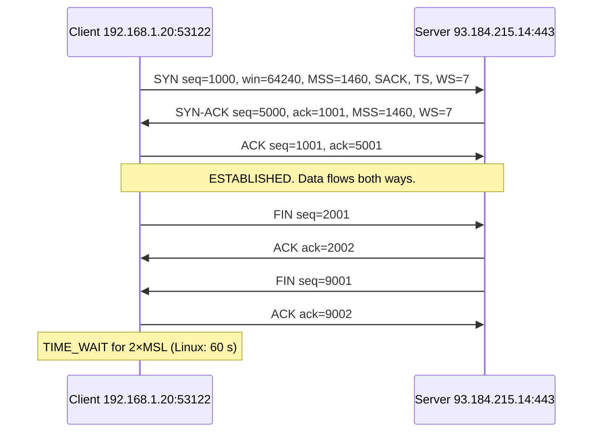
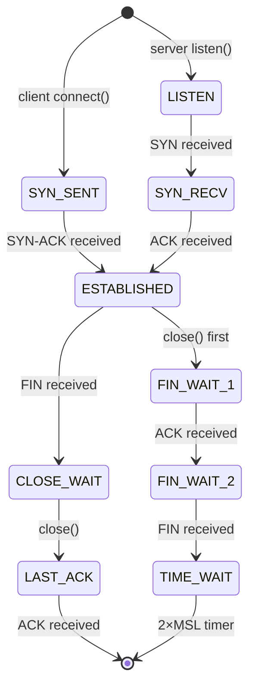
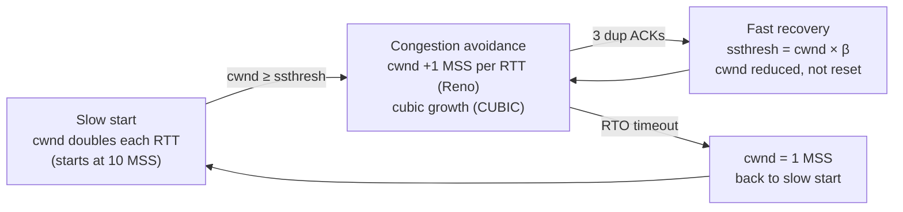
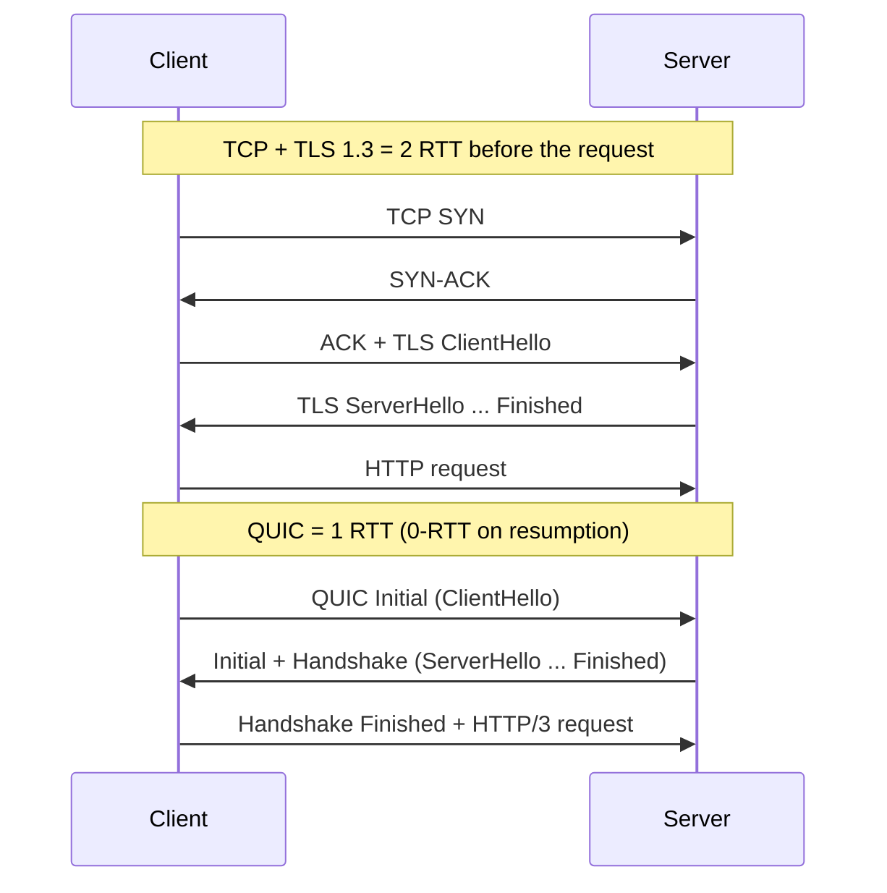

# Module 08 — Transport: TCP, UDP, QUIC

**Time:** 4 sessions. **Prerequisites:** Module 01.

## Learning objectives

1. Explain ports, sockets and the 5-tuple.
2. Explain the TCP 3-way handshake, 4-way close, and the main TCP states (including TIME_WAIT).
3. Explain sequence numbers, ACKs, retransmission, flow control (receive window) and window scaling.
4. Explain congestion control: slow start, congestion avoidance, fast retransmit, CUBIC and BBR.
5. Compare TCP, UDP and QUIC, and choose the right one.
6. Diagnose transport problems with `ss`, `tcpdump` and `tc netem`.

## 1. First principles

IP delivers packets **best effort**: they can be lost, duplicated, reordered or delayed. The transport layer gives applications what they need on top of that:

- **Multiplexing:** many conversations on one IP, identified by ports.
- **Reliability (TCP):** every byte arrives once, in order.
- **Flow control (TCP):** do not overrun the receiver.
- **Congestion control (TCP, QUIC):** do not overrun the network.

A connection is identified by the **5-tuple**: protocol, source IP, source port, destination IP, destination port. Ports 0-1023 are well known, 1024-49151 registered, 49152-65535 dynamic/ephemeral (Linux uses 32768-60999 by default).

| | TCP | UDP | QUIC (over UDP) |
|---|---|---|---|
| Connection | Yes (handshake) | No | Yes (combined with TLS 1.3) |
| Reliable, ordered | Yes (one byte stream) | No | Yes, **per stream** |
| Head-of-line blocking | Yes | No | No (between streams) |
| Header | 20-60 B | 8 B | Small, mostly encrypted |
| Encryption | Optional (TLS on top) | Optional (DTLS) | Mandatory |
| Connection migration | No (bound to the 4-tuple) | n/a | Yes (connection ID) |
| Uses | HTTP/1.1, HTTP/2, SSH, databases | DNS, NTP, SNMP, syslog, VoIP, VXLAN, WireGuard | HTTP/3 |

## 2. TCP on the wire

### Handshake and close



- The handshake agrees on initial sequence numbers (random), MSS, SACK, timestamps and window scale.
- A **RST** aborts a connection at once. You see RST when the port is closed (no listener) or a firewall rejects it.
- **TIME_WAIT** sits on the side that closes first. It prevents old segments from being accepted by a new connection with the same 4-tuple. Many short connections from one client can exhaust ephemeral ports: use connection pooling or keep-alive.

### TCP states you see in `ss`



**Production note:** Thousands of sockets in **CLOSE_WAIT** mean your application never calls `close()`. It is an application bug, not a network bug. Many sockets stuck in **SYN_SENT** mean the server or a firewall drops SYNs silently.

### Reliability, flow control and windows

- Each byte has a **sequence number**. The receiver sends a cumulative **ACK** = next byte expected.
- **SACK** lets the receiver report blocks it already has, so the sender resends only the gaps.
- **Retransmission timeout (RTO)** is computed from measured RTT (min 200 ms on Linux). **Fast retransmit:** 3 duplicate ACKs trigger a resend without waiting for RTO.
- The **receive window (rwnd)** says how many bytes the receiver can accept. The window field is 16 bits (max 65,535), so **window scaling** (a shift of up to 14) allows windows up to 1 GB.

**Bandwidth-delay product (BDP):** to fill a path, the window must be ≥ bandwidth × RTT.

Example: 1 Gbps × 100 ms (Pune to us-east-1) = 10^9 × 0.1 / 8 = **12.5 MB**. Without window scaling, one TCP flow would top out at 65,535 B / 0.1 s ≈ 5.2 Mbps.

### Congestion control

The sender keeps a **congestion window (cwnd)**. It sends at most min(cwnd, rwnd) unacknowledged bytes.



| Algorithm | Signal | Notes |
|---|---|---|
| Reno | Loss | Classic AIMD |
| CUBIC | Loss | Linux default. Good for high BDP |
| BBR (v1/v2/v3) | Measured bandwidth and RTT | Used by Google. Much better on lossy long links |

```text
$ sysctl net.ipv4.tcp_congestion_control
net.ipv4.tcp_congestion_control = cubic
$ ss -tin dst 93.184.215.14
ESTAB 0 0 192.168.1.20:53122 93.184.215.14:443
     cubic wscale:7,7 rto:308 rtt:104.2/2.1 mss:1448 cwnd:42 ssthresh:30 bytes_acked:812345 retrans:0/3 rcv_space:14480
```

`ss -ti` is the single best command for TCP performance: RTT, cwnd, retransmits and congestion algorithm per socket.

## 3. UDP and QUIC

UDP adds ports and a checksum, nothing else. The application handles loss. That is perfect for DNS (one question, one answer), real-time media (late data is useless) and tunnels (the inner TCP handles reliability).

**QUIC** (RFC 9000) runs over UDP 443. It combines transport and TLS 1.3:



QUIC streams are independent: one lost packet blocks only its own stream. The **connection ID** lets a phone move from Wi-Fi to 4G without a new handshake.

**Production note:** Some corporate firewalls block UDP 443. Browsers fall back to TCP, so HTTP/3 problems show up as slowness, not errors. AWS NLB supports QUIC passthrough; CloudFront supports HTTP/3 to viewers.

## 4. Production example

A data-sync job from Mumbai to an S3 bucket in us-east-1 reached only 40 Mbps on a 1 Gbps link. `ss -ti` showed `rtt:190` and the receive buffer capped at 4 MB. BDP = 1 Gbps × 0.19 s = 23.75 MB. Raising `net.ipv4.tcp_rmem`/`tcp_wmem` max to 64 MB, switching to BBR and using parallel multipart uploads raised throughput to 850 Mbps.

## 5. Cloud equivalent (AWS)

| Topic | AWS behaviour |
|---|---|
| Security groups | Stateful: track TCP/UDP flows, return traffic allowed |
| NACLs | Stateless: you must allow the **ephemeral port range** (1024-65535) for return traffic |
| Idle timeouts | NLB TCP 350 s (configurable 60-6000 s), ALB 60 s default, NAT gateway 350 s. Long-lived idle connections get dropped: use TCP keepalive below the timeout |
| NLB | L4, preserves client IP, supports TCP, UDP, TLS, QUIC passthrough |
| Global Accelerator | Terminates TCP at the AWS edge near the user, reducing handshake RTT |

## 6. Common failures

| Symptom | Cause | Check |
|---|---|---|
| `Connection refused` | RST: no listener on the port | `ss -tlnp` on server |
| `Connection timed out` | SYNs dropped (firewall, SG, routing) | `tcpdump 'tcp[tcpflags] & tcp-syn != 0'` |
| Slow transfers on long links | Window too small, loss | `ss -ti`: rtt, cwnd, retrans |
| Connections drop after N minutes idle | NAT/LB idle timeout | Enable keepalive |
| Many TIME_WAIT on client | Short-lived connections | Connection pooling |
| Many CLOSE_WAIT | App does not close sockets | Fix the application |
| `EADDRNOTAVAIL` / cannot assign address | Ephemeral port exhaustion | `ip_local_port_range`, pooling, more source IPs |

## Next

[Lab](lab.md) · [Quiz](quiz.md) · [Cheatsheet](cheatsheet.md) · [Module 09](../09-network-services/README.md)
