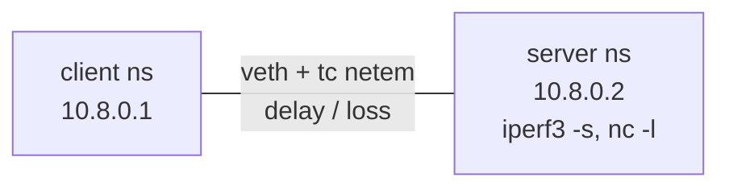

# Lab 08 — TCP Handshake, Windows and Congestion Under Loss

## Objective

Capture a TCP handshake and close. Measure how latency and loss change throughput. Compare CUBIC with BBR. See RST, TIME_WAIT and CLOSE_WAIT on purpose.

## Topology

Two namespaces joined by a veth pair. `tc netem` adds delay and loss on one side.



Packages: `iperf3`, `iproute2`, `tcpdump`, `netcat-openbsd`, `python3`.

## Steps

### 1. Build

```bash
sudo ip netns add client; sudo ip netns add server
sudo ip link add c0 type veth peer name s0
sudo ip link set c0 netns client; sudo ip link set s0 netns server
sudo ip -n client addr add 10.8.0.1/24 dev c0; sudo ip -n client link set c0 up
sudo ip -n server addr add 10.8.0.2/24 dev s0; sudo ip -n server link set s0 up
sudo ip netns exec server iperf3 -s -D
```

### 2. Capture a handshake and a close

```bash
sudo ip netns exec server tcpdump -i s0 -nn -S 'tcp port 5201' -c 6 &
sudo ip netns exec client iperf3 -c 10.8.0.2 -t 1 -n 1K
```

Expected (abridged, `-S` prints absolute sequence numbers):

```text
10.8.0.1.40112 > 10.8.0.2.5201: Flags [S], seq 3012345678, win 64240, options [mss 1460,sackOK,TS ...,nop,wscale 7]
10.8.0.2.5201 > 10.8.0.1.40112: Flags [S.], seq 1987654321, ack 3012345679, win 65160, options [mss 1460,...]
10.8.0.1.40112 > 10.8.0.2.5201: Flags [.], ack 1987654322, win 502
```

Check: the SYN-ACK acknowledges the client ISN + 1. `win 502` with `wscale 7` means 502 × 128 = 64,256 bytes.

### 3. Baseline throughput

```bash
sudo ip netns exec client iperf3 -c 10.8.0.2 -t 5
```

Expected: many Gbit/s (veth is in memory).

### 4. Add 100 ms delay (a Pune to US path)

```bash
sudo ip netns exec client tc qdisc add dev c0 root netem delay 100ms
sudo ip netns exec client ping -c 3 10.8.0.2
sudo ip netns exec client iperf3 -c 10.8.0.2 -t 10
```

Watch the bitrate climb during slow start in the first seconds.

### 5. Add 1% loss and compare CUBIC vs BBR

```bash
sudo ip netns exec client tc qdisc change dev c0 root netem delay 100ms loss 1%
sudo ip netns exec client iperf3 -c 10.8.0.2 -t 15 -C cubic
sudo modprobe tcp_bbr
sudo ip netns exec client iperf3 -c 10.8.0.2 -t 15 -C bbr
```

Record the results:

| Test | Bitrate | Retransmits (`Retr` column) |
|---|---|---|
| No delay, no loss | | |
| 100 ms delay | | |
| 100 ms + 1% loss, CUBIC | | |
| 100 ms + 1% loss, BBR | | |

Expected pattern: CUBIC collapses with loss (often below 10 Mbit/s), while BBR keeps much higher throughput.

### 6. Watch the TCP internals live

In a second terminal during an iperf3 run:

```bash
sudo ip netns exec client watch -n1 "ss -tin dst 10.8.0.2"
```

Note `rtt`, `cwnd`, `ssthresh` and `retrans`.

### 7. See RST, TIME_WAIT and CLOSE_WAIT

```bash
# RST: nothing listens on 9999
sudo ip netns exec client nc -vz 10.8.0.2 9999
# TIME_WAIT: client closes first
sudo ip netns exec server sh -c 'nc -l 7000 >/dev/null &'
sudo ip netns exec client sh -c 'echo hi | nc -q0 10.8.0.2 7000'
sudo ip netns exec client ss -tan state time-wait
# CLOSE_WAIT: server never closes the socket
sudo ip netns exec server python3 -c "
import socket,time
s=socket.socket(); s.bind(('10.8.0.2',7100)); s.listen()
c,_=s.accept(); time.sleep(60)" &
sudo ip netns exec client sh -c 'echo hi | nc -q0 10.8.0.2 7100'
sudo ip netns exec server ss -tan state close-wait
```

Expected: `Connection refused`, one socket in TIME-WAIT on the client, one socket in CLOSE-WAIT on the server.

## Verification

- [ ] You identified SYN, SYN-ACK, ACK, and the window scale option.
- [ ] Your table shows the effect of delay and loss.
- [ ] BBR beat CUBIC under loss.
- [ ] You produced RST, TIME_WAIT and CLOSE_WAIT on purpose.

## Break it and fix it

| # | Break | Task |
|---|---|---|
| 1 | `sudo ip netns exec server iptables -A INPUT -p tcp --dport 5201 -j DROP` | What error does iperf3 show, and how long does it take? Compare with `-j REJECT --reject-with tcp-reset`. |
| 2 | `sudo ip netns exec client sysctl -w net.ipv4.tcp_window_scaling=0` and rerun step 4 | What is the new ceiling? Calculate it. |
| 3 | `sudo ip netns exec client sysctl -w net.ipv4.ip_local_port_range="40000 40010"` and open 20 connections fast | What error appears? |

<details><summary>Answers</summary>

1. DROP: the client retransmits SYNs with exponential backoff (1, 2, 4, 8… s) and times out after about 2 minutes (`tcp_syn_retries` = 6). REJECT with a TCP reset gives "Connection refused" at once. Firewalls that DROP make troubleshooting slower; in AWS, security groups always drop silently.
2. Without scaling, the window is at most 65,535 bytes. netem adds delay only on c0 egress, so RTT ≈ 100 ms (check with ping). Ceiling = 65,535 × 8 / 0.1 s ≈ 5.2 Mbit/s. Restore `tcp_window_scaling=1`.
3. `Cannot assign requested address` (EADDRNOTAVAIL): only 11 ephemeral ports exist, and closed sockets sit in TIME_WAIT. This is ephemeral port exhaustion. Restore the range `32768 60999`.

</details>

## Clean up

```bash
sudo ip netns del client; sudo ip netns del server
```
