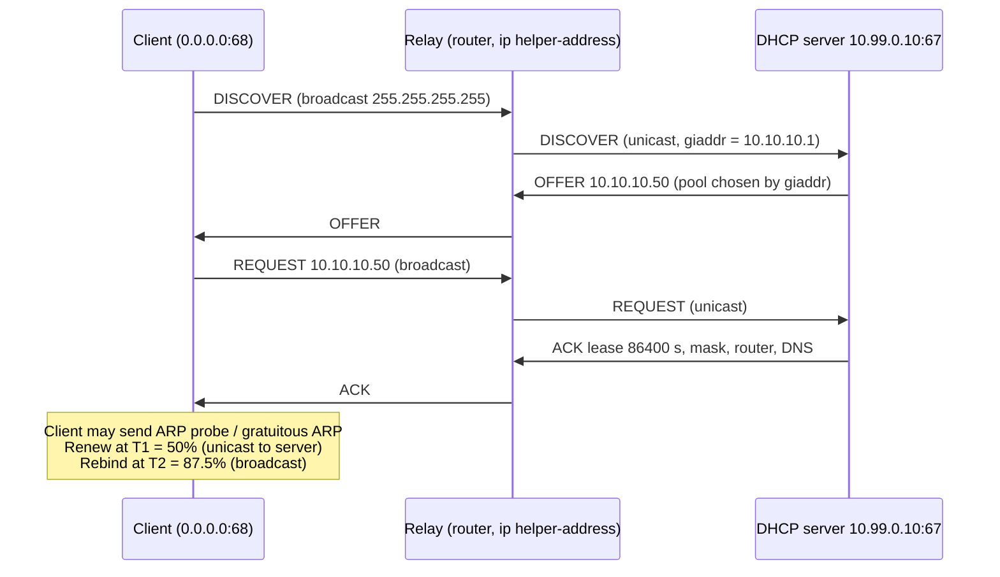
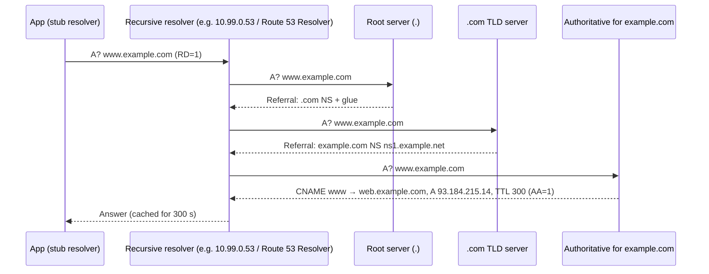
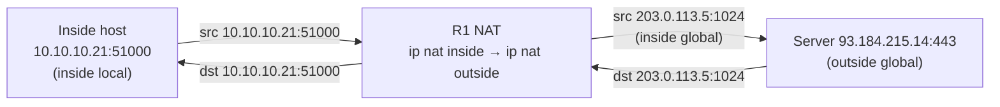

# Module 09 — Network Services: DHCP, DNS (Deep Dive), NAT/PAT, NTP, SNMP, Syslog

**Time:** 6 sessions. **Prerequisites:** Modules 03, 06, 08.

## Learning objectives

1. Explain DHCP DORA, leases, options and relay; troubleshoot clients, servers and relays on IOS.
2. Explain DNS resolution end to end: stub, recursive resolver, root, TLD, authoritative; record types; TTL and caching; diagnose with `dig`.
3. Configure static NAT, dynamic NAT and PAT (overload) on IOS XE and read the translation table.
4. Explain NTP stratum and why time matters for logs, TLS and authentication.
5. Explain SNMP versions, MIB/OID, get/set/trap/inform.
6. Read syslog messages: facility, severity and the Cisco message format.

## 1. DHCP

### DORA



- UDP **67** (server) and **68** (client).
- Routers do not forward broadcasts. A **relay agent** (`ip helper-address`) turns the broadcast into a unicast and sets **giaddr** to the receiving interface's IP. The server uses giaddr to pick the right pool.
- Common options: 1 subnet mask, 3 router, 6 DNS, 15 domain name, 42 NTP, 43 vendor (WLC discovery), 66/67 PXE boot, 82 relay agent info.

```text
R1(config)# ip dhcp excluded-address 10.10.10.1 10.10.10.20
R1(config)# ip dhcp pool USERS
R1(dhcp-config)# network 10.10.10.0 255.255.255.0
R1(dhcp-config)# default-router 10.10.10.1
R1(dhcp-config)# dns-server 10.99.0.53
R1(dhcp-config)# lease 1
! Relay on the client-facing interface of another router:
R2(config)# interface g0/1
R2(config-if)# ip helper-address 10.99.0.10
R1# show ip dhcp binding
IP address       Client-ID/              Lease expiration        Type
                 Hardware address
10.10.10.21      0100.5079.6668.00       Nov 25 2026 09:14 AM    Automatic
R1# show ip dhcp pool
R1# show ip dhcp conflict
```

**Exam tip (v2.0 topic 1.7):** "Troubleshoot DHCPv4 client, server, and relay on IOS." Know: excluded addresses, wrong `default-router`, `ip helper-address` on the **wrong interface** (it must be on the interface facing the clients), pool exhausted, and an ACL blocking UDP 67/68. A client with **169.254.x.x** means "no DHCP reply".

## 2. DNS deep dive

### Resolution path



- DNS uses **UDP 53**, and **TCP 53** for responses larger than the UDP limit (EDNS0 ~1232 B recommended) and for zone transfers (AXFR/IXFR). DNS over TLS uses 853; DNS over HTTPS uses 443.
- **Recursive resolvers** do the work and cache. **Authoritative servers** own a zone and set **AA=1**.
- **TTL** controls caching. Lower the TTL **before** a migration (e.g. 24 h → 60 s a day earlier).
- **Negative caching:** NXDOMAIN answers are cached for the SOA minimum TTL.

### Record types

| Type | Purpose | Example |
|---|---|---|
| A / AAAA | Name → IPv4 / IPv6 | `www IN A 93.184.215.14` |
| CNAME | Alias → canonical name. Not allowed at the zone apex | `www IN CNAME web.example.com.` |
| MX | Mail servers with priority (lower first) | `@ IN MX 10 mx1.example.com.` |
| NS | Authoritative name servers | `@ IN NS ns-123.awsdns-15.com.` |
| PTR | IP → name (reverse, in in-addr.arpa / ip6.arpa) | `14.215.184.93.in-addr.arpa. PTR www.example.com.` |
| SOA | Zone authority, serial, timers, negative TTL | |
| TXT | Text: SPF, DKIM, domain verification | `"v=spf1 include:amazonses.com -all"` |
| SRV | Service location (port, weight) | `_sip._tcp IN SRV 10 60 5060 sip.example.com.` |
| CAA | Which CAs may issue certificates | `@ CAA 0 issue "amazon.com"` |
| Alias (Route 53) | CNAME-like at the apex, free for AWS targets | `example.com → ALB` |

**Exam tip (v2.0 topic 4.4):** "Diagnose DNS records (A, AAAA, CNAME, MX, NS, PTR)." Expect questions like "mail bounces: which record is wrong?" (MX) or "reverse lookup fails" (PTR).

### dig, the essential tool

```text
$ dig www.example.com +noall +answer +ttlid
www.example.com.        300   IN  A   93.184.215.14
$ dig example.com MX +short
10 mx1.example.com.
$ dig -x 8.8.8.8 +short
dns.google.
$ dig @1.1.1.1 www.example.com +trace     # follow referrals from the root
$ dig example.com NS +short
$ dig www.example.com +norecurse @ns1.example.net   # ask the authoritative server directly
```

Read the header: `status: NOERROR` (found), `NXDOMAIN` (name does not exist), `SERVFAIL` (resolver failed, often DNSSEC or unreachable authoritative servers), `REFUSED` (policy).

## 3. NAT and PAT

NAT rewrites IP addresses (and ports, for PAT) as packets cross a boundary. It saves public IPv4 addresses.

| Term | Meaning |
|---|---|
| Inside local | Private address of the inside host (10.10.10.21) |
| Inside global | Public address that represents the inside host (203.0.113.5) |
| Outside global | Real address of the outside host (93.184.215.14) |
| Outside local | Outside host as seen from inside (usually = outside global) |



```text
! Mark interfaces
R1(config)# interface g0/1
R1(config-if)# ip nat inside
R1(config)# interface g0/0
R1(config-if)# ip nat outside
! Static NAT (inbound access to a server)
R1(config)# ip nat inside source static 10.10.10.80 203.0.113.80
! Dynamic NAT with a pool
R1(config)# ip nat pool PUB 203.0.113.10 203.0.113.20 netmask 255.255.255.0
R1(config)# access-list 1 permit 10.10.10.0 0.0.0.255
R1(config)# ip nat inside source list 1 pool PUB
! PAT (overload) on the outside interface address — the common one
R1(config)# ip nat inside source list 1 interface g0/0 overload
R1# show ip nat translations
Pro Inside global        Inside local          Outside local         Outside global
tcp 203.0.113.5:1024     10.10.10.21:51000     93.184.215.14:443     93.184.215.14:443
--- 203.0.113.80         10.10.10.80           ---                   ---
R1# show ip nat statistics
R1# clear ip nat translation *
```

**Exam tip (v2.0 topic 4.3):** Most NAT faults: `ip nat inside`/`outside` swapped or missing, the ACL does not match the inside subnet, or `overload` missing (only one host works at a time with a single-address pool).

## 4. NTP

- UDP **123**. Hierarchy by **stratum**: stratum 0 = reference clock (GPS, atomic), stratum 1 = server attached to it, each hop +1. Stratum 16 = unsynchronized.
- Time matters: log correlation, TLS certificate validity, Kerberos (5-minute skew limit), TOTP codes, distributed databases.

```text
R1(config)# ntp server 169.254.169.123 prefer   ! Amazon Time Sync from inside AWS
R1(config)# ntp server 0.pool.ntp.org
R1(config)# clock timezone IST 5 30
R1# show ntp status
Clock is synchronized, stratum 3, reference is 10.99.0.123
R1# show ntp associations
```

On Linux: `chronyc tracking`, `chronyc sources -v`, `timedatectl`.

## 5. SNMP

| Version | Security | Notes |
|---|---|---|
| v1 / v2c | Community string in clear text | v2c adds GetBulk and Inform |
| v3 | Users, auth (SHA), privacy (AES) | Use this. Levels: noAuthNoPriv, authNoPriv, authPriv |

- Manager polls agent on **UDP 161**. Agent sends **traps/informs** to UDP **162** (informs are acknowledged).
- Data lives in the **MIB**, addressed by **OIDs** (e.g. `1.3.6.1.2.1.2.2.1.10` = ifInOctets).

```text
$ snmpwalk -v3 -l authPriv -u monitor -a SHA -A 'authpass' -x AES -X 'privpass' 10.0.0.1 IF-MIB::ifHCInOctets
IF-MIB::ifHCInOctets.1 = Counter64: 9876543210
```

**Exam tip (v2.0 topic 5.4):** Know the function of SNMP in network operations: polling vs traps, v3 security, MIB/OID. Modern networks add **streaming telemetry** (gNMI) for high-frequency data (Module 18).

## 6. Syslog

- UDP **514** (TCP 514/6514 with TLS for reliability).
- **Severity** (lower = worse):

| Level | Keyword | Mnemonic word |
|---|---|---|
| 0 | Emergency | **E**very |
| 1 | Alert | **A**wesome |
| 2 | Critical | **C**isco |
| 3 | Error | **E**ngineer |
| 4 | Warning | **W**ill |
| 5 | Notification | **N**eed |
| 6 | Informational | **I**ce cream |
| 7 | Debugging | **D**aily |

- `logging trap 4` sends levels 0-4 (warning and worse) to the server.
- Cisco message format: `seq: timestamp: %FACILITY-SEVERITY-MNEMONIC: description`.

```text
*Nov 24 10:41:07.112 IST: %LINEPROTO-5-UPDOWN: Line protocol on Interface GigabitEthernet0/1, changed state to down
*Nov 24 10:41:09.003 IST: %OSPF-5-ADJCHG: Process 1, Nbr 2.2.2.2 on GigabitEthernet0/1 from FULL to DOWN, Neighbor Down: Interface down or detached
*Nov 24 10:45:00.551 IST: %SEC_LOGIN-4-LOGIN_FAILED: Login failed [user: admin] [Source: 198.51.100.7]
```

```text
R1(config)# service timestamps log datetime msec localtime show-timezone
R1(config)# logging host 10.99.0.14
R1(config)# logging trap warnings
R1(config)# logging buffered 64000 informational
R1# show logging
```

**Exam tip (v2.0 topic 5.6):** "Interpret syslog message content, severity levels, and facilities." In `%LINEPROTO-5-UPDOWN`, the facility is LINEPROTO, the severity is 5 (notification), and the mnemonic is UPDOWN.

## 7. Production example

A Kubernetes platform had random 5-second DNS delays. `tcpdump` on a node showed A and AAAA queries sent from the same UDP socket at the same time; the conntrack race in the kernel dropped one, and the resolver retried after 5 s. Fixes: `options single-request-reopen` in pod resolv.conf, NodeLocal DNSCache, and lowering `ndots` from 5 to 2 so external names are not tried with every search domain first.

## 8. Cloud equivalent (AWS)

| Service | AWS |
|---|---|
| DHCP | VPC DHCP option sets (domain name, DNS servers, NTP) |
| DNS resolver | Route 53 Resolver at VPC base + 2 (and 169.254.169.253) |
| Hybrid DNS | Resolver inbound/outbound endpoints + forwarding rules |
| Authoritative DNS | Route 53 public and private hosted zones; Alias records; health-check routing |
| NAT | NAT gateway (managed PAT, 55,000 simultaneous connections per destination per IP) |
| NTP | Amazon Time Sync Service 169.254.169.123 (and fd00:ec2::123) |
| Syslog/SNMP | CloudWatch Logs, VPC Flow Logs; SNMP only on your own appliances |

## 9. Common failures

| Symptom | Cause | Check |
|---|---|---|
| Client has 169.254.x.x | No DHCP reply: relay missing, pool full, ACL | `debug ip dhcp server packet`, `show ip dhcp pool` |
| Client gets an address from the wrong pool | Relay on wrong interface / wrong giaddr | `show run int` |
| `NXDOMAIN` for an internal name | Wrong search domain or private zone not associated with the VPC | `dig +search`, Route 53 associations |
| `SERVFAIL` | DNSSEC failure, authoritative unreachable | `dig +cd` (checking disabled) |
| Change not visible | Old TTL still cached | `dig +ttlid`, wait or flush |
| Only one inside host reaches the internet | NAT without `overload` | `show ip nat translations` |
| Logs show wrong times | NTP not synced | `show ntp status` |
| SNMP timeouts | Wrong community/user, ACL, UDP 161 blocked | `snmpwalk -v2c -c ...` |

## Next

[Lab](lab.md) · [Quiz](quiz.md) · [Cheatsheet](cheatsheet.md) · [Module 10](../10-wireless/README.md)
