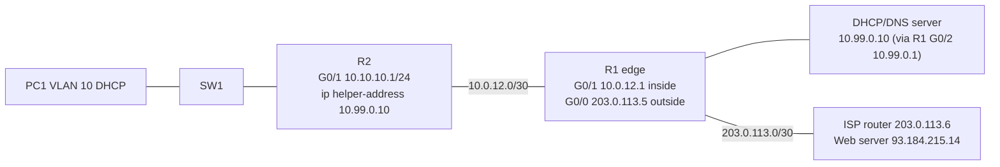

# Lab 09 — DHCP Relay and PAT on IOS, DNS Deep Dive with dig, and Syslog/NTP/SNMP on Linux

## Objective

- **Part A (Packet Tracer):** central DHCP server behind a relay, plus PAT to the internet.
- **Part B (Linux):** trace DNS resolution from the root, and read every record type.
- **Part C (Linux):** read syslog severities, check NTP, and walk SNMP.

## Part A — DHCP relay and PAT (Packet Tracer)

### Topology



### Steps

1. Address all interfaces as shown. Add static routes: R2 default → 10.0.12.1; R1 route 10.10.10.0/24 → 10.0.12.2; R1 default → 203.0.113.6.
2. On the Packet Tracer server 10.99.0.10, enable DHCP with a pool: network 10.10.10.0/24, gateway 10.10.10.1, DNS 10.99.0.10, start 10.10.10.21.
3. On R2 G0/1: `ip helper-address 10.99.0.10`.
4. Set PC1 to DHCP. Expected: PC1 gets 10.10.10.21, gateway 10.10.10.1.
5. Configure PAT on R1:

   ```text
   R1(config)# interface g0/1
   R1(config-if)# ip nat inside
   R1(config)# interface g0/2
   R1(config-if)# ip nat inside
   R1(config)# interface g0/0
   R1(config-if)# ip nat outside
   R1(config)# access-list 1 permit 10.0.0.0 0.255.255.255
   R1(config)# ip nat inside source list 1 interface g0/0 overload
   ```

6. From PC1, open `http://93.184.215.14` in the Packet Tracer browser.

### Expected output

```text
R1# show ip nat translations
Pro  Inside global      Inside local       Outside local      Outside global
tcp 203.0.113.5:1025   10.10.10.21:1025   93.184.215.14:80   93.184.215.14:80
R2# show ip interface g0/1 | include Helper
  Helper address is 10.99.0.10
```

## Part B — DNS deep dive (any Linux host with internet)

```bash
dig +trace www.wikipedia.org
dig wikipedia.org NS +short
dig wikipedia.org MX +short
dig wikipedia.org TXT +short | head -3
dig wikipedia.org SOA +noall +answer
dig -x 1.1.1.1 +short
dig www.wikipedia.org +noall +answer +ttlid; sleep 5; dig www.wikipedia.org +noall +answer +ttlid
dig doesnotexist-$RANDOM.wikipedia.org | grep status
dig @1.1.1.1 www.wikipedia.org +tcp +short
```

Record what you see:

| Test | What to note |
|---|---|
| `+trace` | Root → org → wikipedia.org authoritative servers; where the CNAME appears |
| NS / MX / TXT / SOA | Server names, MX priorities, SPF record, SOA serial and minimum TTL |
| Reverse | The PTR name for 1.1.1.1 |
| TTL twice | The TTL counts down in the resolver cache |
| Random name | `status: NXDOMAIN` |
| `+tcp` | DNS works over TCP 53 too |

## Part C — Syslog, NTP, SNMP (Ubuntu)

```bash
sudo apt-get install -y chrony snmpd snmp
# Syslog severities
logger -p user.warning "lab09 test warning"
logger -p user.err "lab09 test error"
journalctl -p warning --since "5 min ago" | grep lab09
# NTP
chronyc tracking
chronyc sources -v
# SNMP v2c to localhost (default snmpd allows public read on localhost systemonly view)
snmpwalk -v2c -c public localhost SNMPv2-MIB::sysDescr
snmpget  -v2c -c public localhost SNMPv2-MIB::sysUpTime.0
```

Expected:

```text
Reference ID    : A9FEA97B (169.254.169.123)     # on EC2; your pool server elsewhere
Stratum         : 4
System time     : 0.000012345 seconds fast of NTP time
SNMPv2-MIB::sysDescr.0 = STRING: Linux lab 6.8.0-49-generic ...
```

## Verification

- [ ] PC1 gets its address through the relay.
- [ ] `show ip nat translations` shows PAT entries with port numbers.
- [ ] You traced DNS from the root and found the authoritative servers.
- [ ] You saw NXDOMAIN and the TTL decreasing.
- [ ] `journalctl -p warning` shows your warning and error, not lower severities.
- [ ] chrony shows a synchronized source and stratum.

## Break it and fix it

| # | Break | Find and fix |
|---|---|---|
| 1 | Move `ip helper-address` from R2 G0/1 to R2 G0/0 | PC1 IP? |
| 2 | In the server pool, set gateway 10.10.10.254 | What can PC1 reach? |
| 3 | `no ip nat inside` on R1 G0/1 | Translations? |
| 4 | Change ACL 1 to `permit 10.20.0.0 0.0.255.255` | Which hosts are translated? |
| 5 | `echo "nameserver 192.0.2.1" \| sudo tee /etc/resolv.conf` (restore after) | What does `dig wikipedia.org` show? Which tool still works? |

<details><summary>Answers</summary>

1. PC1 gets 169.254.x.x. The helper must be on the interface that receives the client broadcasts.
2. PC1 has an IP but a wrong gateway. It reaches only its own subnet. Fix the pool's default router.
3. Traffic from VLAN 10 enters R1 on a non-inside interface and is not translated. The ISP drops replies to private addresses.
4. Nothing from 10.10.10.0/24 matches. No translations, no internet.
5. `connection timed out; no servers could be reached`. `dig @1.1.1.1 wikipedia.org` still works because you name the server explicitly. In production, check `/etc/resolv.conf`, `resolvectl status` and the VPC DHCP option set.

</details>
