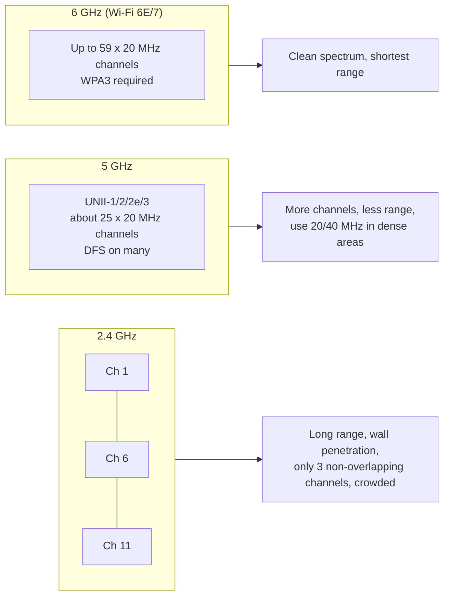
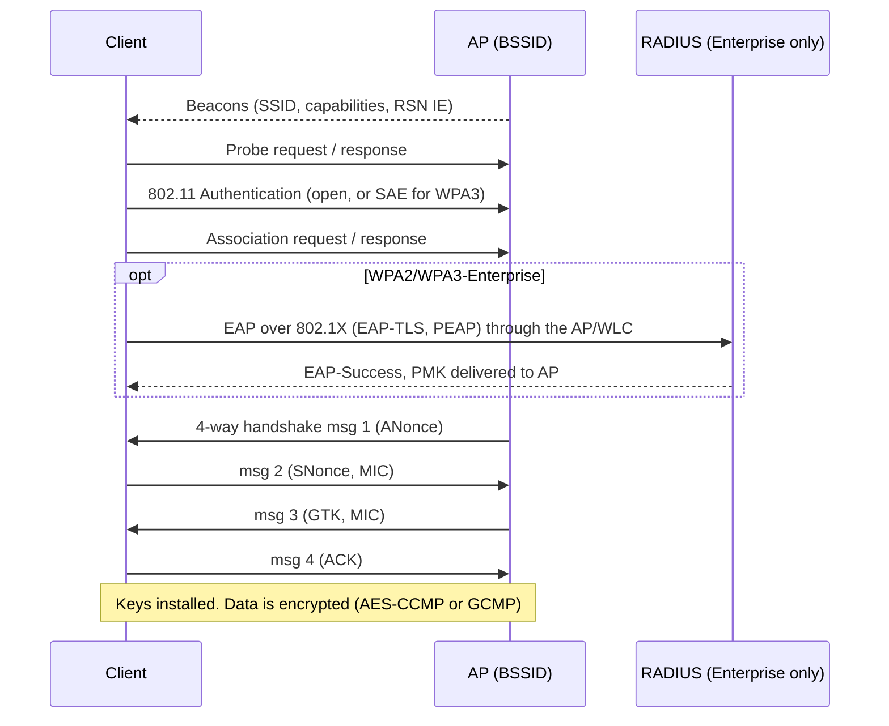
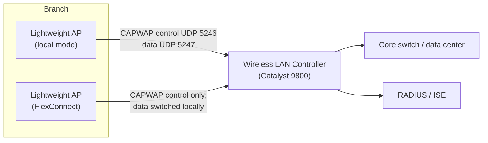
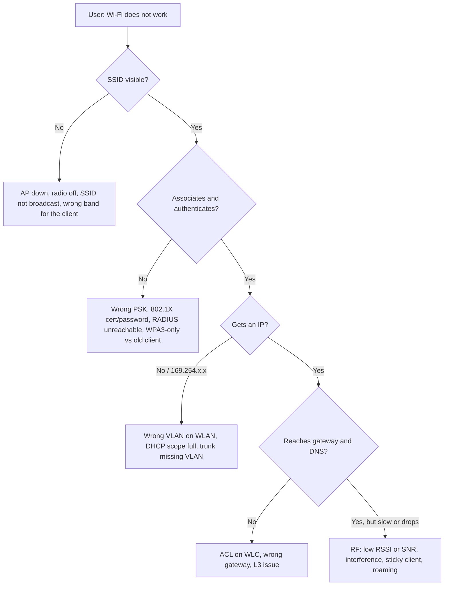

# Module 10 — Wireless: 802.11 Standards, WLC Architecture, WPA2/WPA3

**Time:** 3 sessions. **Prerequisites:** Modules 02, 05, 09.

## Learning objectives

1. Compare 802.11 standards (Wi-Fi 4/5/6/6E/7), bands and channel plans.
2. Explain RF basics: signal strength (dBm), SNR, interference, roaming.
3. Explain autonomous, lightweight (CAPWAP + WLC) and cloud-managed architectures and AP modes.
4. Compare WPA2 and WPA3, Personal and Enterprise (802.1X), and know which to deploy.
5. Troubleshoot wireless client connectivity in a layered way.

## 1. First principles

Wi-Fi is Ethernet-like framing over radio. Radio is a **shared, half-duplex medium**: only one device on a channel talks at a time. So Wi-Fi uses **CSMA/CA** (collision avoidance, with ACKs), not CSMA/CD.

| Term | Meaning |
|---|---|
| SSID | Network name (up to 32 characters) |
| BSS / BSSID | One AP radio's cell / that radio's MAC address |
| ESS | Several APs with the same SSID, so clients can roam |
| Association | The client joins one BSSID |
| RSSI | Received signal strength, in dBm (−30 excellent, −67 good for voice/video, −80 poor) |
| SNR | Signal minus noise floor, in dB (≥ 25 dB good) |

dBm is logarithmic: **+3 dB = double power, +10 dB = 10× power**.

### 802.11 standards

| Standard | Wi-Fi name | Band(s) | Max PHY rate (theoretical) |
|---|---|---|---|
| 802.11n | Wi-Fi 4 | 2.4 / 5 GHz | 600 Mbps |
| 802.11ac | Wi-Fi 5 | 5 GHz | ~6.9 Gbps |
| 802.11ax | Wi-Fi 6 / 6E | 2.4 / 5 (/6 GHz for 6E) | ~9.6 Gbps |
| 802.11be | Wi-Fi 7 | 2.4 / 5 / 6 GHz | ~46 Gbps (320 MHz channels, MLO) |

### Bands and channels

**Exam tip (v2.0 topic 1.5.a):** In 2.4 GHz, use only **channels 1, 6 and 11** (in the US/India). Adjacent APs must use different channels. In 5 GHz, prefer 20 or 40 MHz channel width in dense areas so you have more channels to reuse.

### Interference (topic 1.5.d)

| Source | Effect |
|---|---|
| Co-channel interference | Nearby APs on the same channel share airtime |
| Adjacent-channel interference | Overlapping channels (e.g. 1 and 3) corrupt frames |
| Non-Wi-Fi | Microwave ovens, Bluetooth, baby monitors (2.4 GHz); radar (5 GHz DFS) |
| Physical | Metal, concrete, water (people), elevators |
| Hidden node | Two clients cannot hear each other but both reach the AP; use RTS/CTS |

## 2. How it works on the wire

### Association and 4-way handshake (WPA2/WPA3)

### Security protocols (topic 1.5.c)

| | WEP | WPA | WPA2 | WPA3 |
|---|---|---|---|---|
| Cipher | RC4 (broken) | TKIP (deprecated) | AES-CCMP 128 | AES-CCMP 128 / GCMP-256 (Enterprise 192-bit mode) |
| Personal auth | Shared key | PSK | PSK (offline dictionary attack possible) | **SAE** (Dragonfly): resists offline guessing, forward secrecy |
| Enterprise auth | — | 802.1X | 802.1X/EAP | 802.1X/EAP, optional 192-bit suite |
| Management frame protection | No | No | Optional (802.11w) | **Required** (PMF) |
| Open networks | — | — | Open (no encryption) | **OWE** (Enhanced Open): encryption without a password |

**Production note:** Deploy **WPA3-Enterprise with EAP-TLS** (certificates) for corporate devices. Use WPA2/WPA3 **transition mode** only while old clients remain. Never use WEP or TKIP.

### Architectures and CAPWAP

| Architecture | Where the brain is | Example |
|---|---|---|
| Autonomous | Each AP is configured alone | Home router, small office |
| Lightweight (split MAC) | WLC: config, RF management, roaming; AP: real-time radio | Cisco Catalyst 9800 + Catalyst APs |
| Cloud-managed | Cloud dashboard; data stays local | Cisco Meraki, Juniper Mist |

| AP mode | Use |
|---|---|
| Local | Default. Tunnels all client data to the WLC over CAPWAP |
| FlexConnect | Branch: switches client data locally; survives WLC loss |
| Monitor | Scans only (rogue detection, location) |
| Sniffer | Captures frames for Wireshark |
| SE-Connect | Spectrum analysis |
| Bridge/mesh | Wireless backhaul |

APs find the WLC by DHCP option 43, DNS (`CISCO-CAPWAP-CONTROLLER.<domain>`), broadcast, or a configured address.

**Switch port for an AP:** local-mode AP → **access port** (management VLAN). FlexConnect AP with many SSIDs → **trunk** (management VLAN native + client VLANs). (v2.0 topic 2.2.b.)

## 3. Production example

A warehouse had good RSSI (−60 dBm) everywhere but scanners kept disconnecting. A spectrum scan showed every AP set to 80 MHz channels in 5 GHz, so only 6 non-overlapping channels existed for 40 APs. Co-channel interference consumed the airtime. The fix: 20 MHz channels, lower AP transmit power, disable the lowest data rates (1, 2, 5.5, 11 Mbps) and enable 802.11k/v/r for faster roaming.

## 4. Cloud equivalent (AWS)

AWS has no Wi-Fi. The related cloud pieces are:

| Need | AWS / cloud |
|---|---|
| Wi-Fi 802.1X RADIUS | RADIUS on EC2, or a SaaS RADIUS; AWS Directory Service as identity store |
| Guest portal | Meraki/Mist cloud + Cognito or SAML IdP |
| Wireless controller in cloud | Catalyst 9800-CL on EC2 (for lab or small sites) |
| Logs | WLC syslog → CloudWatch Logs or OpenSearch |

## 5. Troubleshooting wireless clients (topic 1.6)

| Symptom | Likely cause |
|---|---|
| Client sees SSID but "cannot connect" | Wrong PSK, unsupported security (WPA3 on old client), RADIUS failure |
| Associates, gets 169.254.x.x | WLAN mapped to wrong VLAN or VLAN not on the AP trunk / WLC uplink |
| Good signal, slow | Co-channel interference, high utilization, low data rates enabled |
| Drops when walking | Poor roaming design, no 802.11r, coverage gaps |
| AP not joining the WLC | No option 43/DNS, CAPWAP blocked (UDP 5246/5247), version mismatch |

## Next

[Lab](lab.md) · [Quiz](quiz.md) · [Cheatsheet](cheatsheet.md) · [Module 11](../11-security/README.md)
