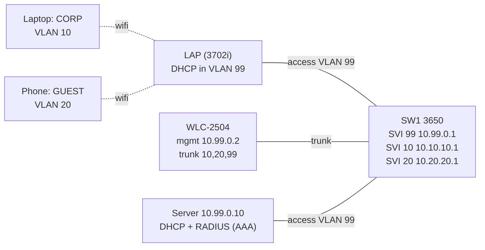

# Lab 10 — WLC, Lightweight APs, WPA2-PSK and WPA2-Enterprise (Packet Tracer)

## Objective

Join a lightweight AP to a Wireless LAN Controller. Create two WLANs: a WPA2-Personal guest WLAN and a WPA2-Enterprise corporate WLAN that uses a RADIUS server. Map each WLAN to its own VLAN. Then fix four common faults.

Packet Tracer 8.2 supports the WLC-2504 (AireOS GUI) and LAP-PT/3702i APs. WPA3 is not available in Packet Tracer; the steps for WPA3 on a Catalyst 9800 are at the end for reference.

## Topology



## Steps

### 1. Switch

```text
SW1(config)# ip routing
SW1(config)# vlan 10
SW1(config)# vlan 20
SW1(config)# vlan 99
SW1(config)# interface vlan 99
SW1(config-if)# ip address 10.99.0.1 255.255.255.0
SW1(config-if)# ip helper-address 10.99.0.10
SW1(config)# interface vlan 10
SW1(config-if)# ip address 10.10.10.1 255.255.255.0
SW1(config-if)# ip helper-address 10.99.0.10
SW1(config)# interface vlan 20
SW1(config-if)# ip address 10.20.20.1 255.255.255.0
SW1(config-if)# ip helper-address 10.99.0.10
SW1(config)# interface g1/0/1
SW1(config-if)# description LAP
SW1(config-if)# switchport mode access
SW1(config-if)# switchport access vlan 99
SW1(config)# interface g1/0/2
SW1(config-if)# description WLC
SW1(config-if)# switchport mode trunk
SW1(config-if)# switchport trunk allowed vlan 10,20,99
SW1(config)# interface g1/0/3
SW1(config-if)# switchport mode access
SW1(config-if)# switchport access vlan 99
```

### 2. Server (Services tab)

- DHCP pools: `AP-MGMT` 10.99.0.0/24 gateway 10.99.0.1 start 10.99.0.100, **WLC address 10.99.0.2** (Packet Tracer field for option 43); `CORP` 10.10.10.0/24 gw .1; `GUEST` 10.20.20.0/24 gw .1.
- AAA: enable, add client `WLC` 10.99.0.2 secret `Radius123` type RADIUS; add user `varun` / `Lab@2026`.

### 3. WLC (from a PC browser on VLAN 99, `https://10.99.0.2`)

1. Management interface: 10.99.0.2/24, gateway 10.99.0.1, VLAN 99.
2. **Controller → Interfaces → New:** `corp` VLAN 10, 10.10.10.2/24, gw 10.10.10.1, DHCP 10.99.0.10. `guest` VLAN 20, 10.20.20.2/24, gw 10.20.20.1, DHCP 10.99.0.10.
3. **Security → RADIUS → Authentication → New:** 10.99.0.10, secret `Radius123`.
4. **WLANs → New:** `CORP`, interface `corp`, Security: WPA2 + AES, Auth Key Mgmt **802.1X**, AAA server 10.99.0.10.
5. **WLANs → New:** `GUEST`, interface `guest`, Security: WPA2 + AES, **PSK** `Guest@2026`.

### 4. Join the AP and connect clients

Power on the LAP. In 1-2 minutes it gets a DHCP address with the WLC address and joins. Connect the laptop to CORP (WPA2-Enterprise, user varun) and the phone to GUEST (PSK).

## Expected output and verification

- WLC **Monitor → Access Points**: 1 AP joined, status Registered.
- WLC **Monitor → Clients**: 2 clients, one in WLAN CORP (VLAN 10), one in GUEST (VLAN 20).
- Laptop `ipconfig`: 10.10.10.x, gateway 10.10.10.1. Phone: 10.20.20.x.

Checklist:

- [ ] AP joined the WLC through DHCP-based discovery.
- [ ] Each WLAN maps to the correct VLAN.
- [ ] CORP authenticates through RADIUS.
- [ ] You can explain why the WLC port is a trunk and the AP port is an access port (local mode).

## Break it and fix it

| # | Break | Find and fix |
|---|---|---|
| 1 | Remove the WLC address from the AP-MGMT DHCP pool | AP status? |
| 2 | Remove VLAN 20 from the trunk to the WLC | Phone gets which IP? |
| 3 | Change the RADIUS secret on the WLC to `wrong` | What does the laptop show? |
| 4 | Set the AP's switch port to VLAN 10 | Does the AP still join? Which IP does it get? |

<details><summary>Answers</summary>

1. The AP cannot discover the WLC (no option 43, no DNS name) and keeps rebooting/searching. Restore the option, or create the DNS record `CISCO-CAPWAP-CONTROLLER.<domain>`.
2. 169.254.x.x (or nothing). Client traffic for VLAN 20 leaves the WLC tagged, but the switch drops it. Add VLAN 20 back to the trunk.
3. Authentication fails. The RADIUS server ignores requests with a bad shared secret; the WLC logs a RADIUS timeout. Fix the secret on both sides.
4. The AP gets a 10.10.10.x address from the CORP pool, which has no WLC option. It does not join. Put the AP port back in VLAN 99.

</details>

## Reference: WPA3 on a Catalyst 9800 (CLI)

```text
wlan CORP3 3 CORP3
 no security wpa wpa2
 security wpa wpa3
 security wpa akm dot1x-sha256
 security pmf mandatory
 no shutdown
wlan HOME3 4 HOME3
 no security wpa wpa2
 security wpa wpa3
 security wpa akm sae
 security pmf mandatory
 no shutdown
```
