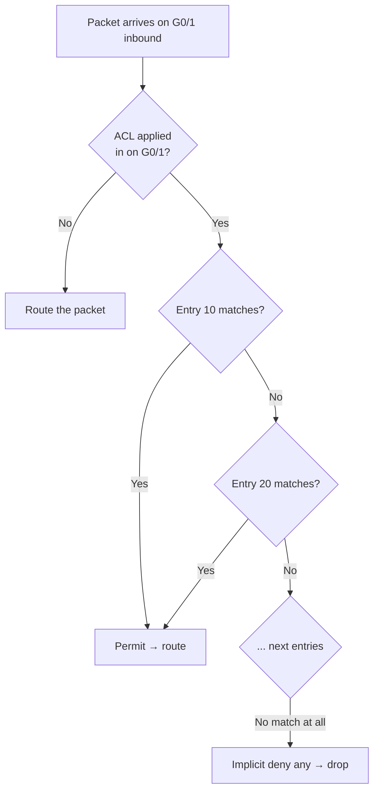
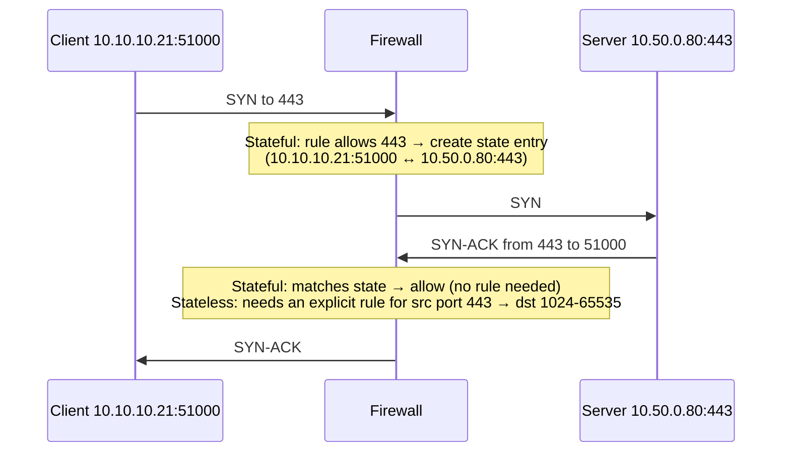
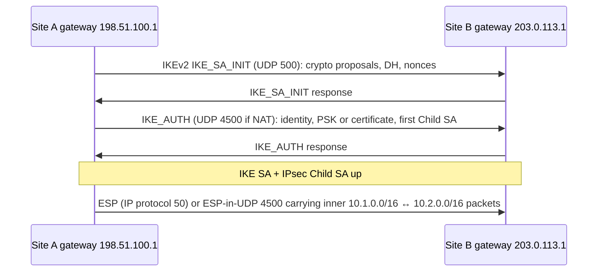
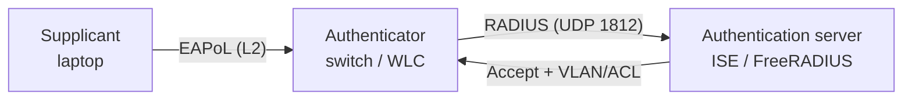
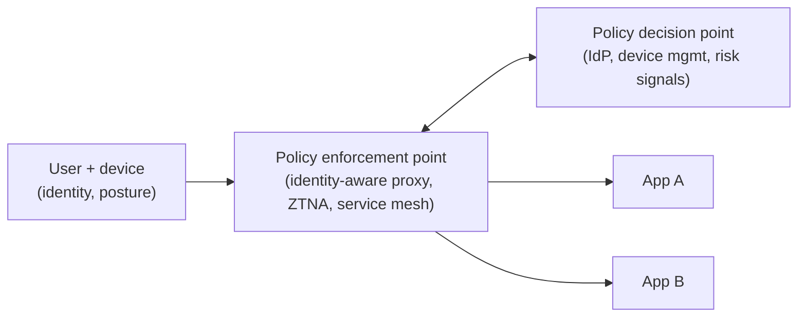

# Module 11 — Security: ACLs, Firewalls, VPNs, AAA, 802.1X, Layer 2 Security, Zero Trust

**Time:** 5 sessions. **Prerequisites:** Modules 03, 05, 08, 09.

## Learning objectives

1. Write standard, extended, numbered and named IPv4 ACLs with correct wildcards and placement.
2. Compare stateless and stateful filtering, and map them to NACLs and security groups.
3. Explain IPsec (IKEv2, ESP, tunnel mode) and TLS/SSL VPNs; compare site-to-site and remote access.
4. Configure local users and AAA with RADIUS/TACACS+; explain 802.1X roles.
5. Configure DHCP snooping, Dynamic ARP Inspection, storm control, RA guard and port security.
6. Explain zero trust and how it changes network design.

## 1. First principles

Security controls answer three questions: **who** is this (authentication), **what** may they do (authorization), and **what did they do** (accounting). Network controls add a fourth: **which traffic may pass** between which places (filtering and segmentation). Use **defense in depth**: many layers, each one imperfect.

## 2. Access control lists (IOS)

An ACL is an ordered list of permit/deny entries. The router checks entries **top down**; the **first match wins**. Every ACL ends with an invisible **implicit deny any**.

| Type | Numbers | Matches | Place it |
|---|---|---|---|
| Standard | 1-99, 1300-1999 | Source IP only | **Close to the destination** |
| Extended | 100-199, 2000-2699 | Protocol, source/dest IP, ports | **Close to the source** |
| Named | Any name | Standard or extended; allows editing by sequence number | Same rules |

```text
! Standard: only the admin subnet may SSH to the router (applied to VTY lines)
R1(config)# ip access-list standard MGMT
R1(config-std-nacl)# permit 10.99.0.0 0.0.0.255
R1(config)# line vty 0 15
R1(config-line)# access-class MGMT in
R1(config-line)# transport input ssh

! Extended: users may browse the web servers and use DNS; nothing else to the DC
R1(config)# ip access-list extended USERS-TO-DC
R1(config-ext-nacl)# 10 permit tcp 10.10.10.0 0.0.0.255 host 10.50.0.80 eq 443
R1(config-ext-nacl)# 20 permit udp 10.10.10.0 0.0.0.255 host 10.50.0.53 eq 53
R1(config-ext-nacl)# 30 deny   ip  10.10.10.0 0.0.0.255 10.50.0.0 0.0.255.255 log
R1(config-ext-nacl)# 40 permit ip  any any
R1(config)# interface g0/1
R1(config-if)# ip access-group USERS-TO-DC in
R1# show access-lists USERS-TO-DC
Extended IP access list USERS-TO-DC
    10 permit tcp 10.10.10.0 0.0.0.255 host 10.50.0.80 eq 443 (1432 matches)
    20 permit udp 10.10.10.0 0.0.0.255 host 10.50.0.53 eq domain (88 matches)
    30 deny ip 10.10.10.0 0.0.0.255 10.50.0.0 0.0.255.255 log (3 matches)
    40 permit ip any any (9210 matches)
```



**Exam tips (v2.0 topic 4.6):**

- Wildcard `0.0.0.0` = `host`, `255.255.255.255` = `any`.
- One ACL **per interface, per direction, per protocol**.
- An ACL with only deny entries blocks everything (implicit deny).
- Router-generated traffic is not filtered by an outbound ACL on the same router.
- A wildcard of `0.0.0.255` on 10.10.10.0 matches 10.10.10.0-255. Practise converting masks.

## 3. Firewalls: stateless vs stateful



| | Stateless (ACL, NACL) | Stateful (firewall, SG) | NGFW |
|---|---|---|---|
| Looks at | Each packet alone | Connection state (5-tuple, TCP flags, seq) | + application ID, user, TLS inspection, IPS |
| Return traffic | Needs explicit rules | Allowed automatically | Allowed automatically |
| Examples | IOS ACL, AWS NACL | iptables/nftables conntrack, AWS SG, Cisco ASA | Palo Alto, Fortinet, AWS Network Firewall (Suricata rules) |

## 4. VPNs

### IPsec site-to-site



| Term | Meaning |
|---|---|
| IKE (v2) | Negotiates keys and SAs. UDP 500, 4500 with NAT-T |
| ESP (protocol 50) | Encrypts + authenticates the payload. Use this |
| AH (protocol 51) | Authenticates only; breaks with NAT. Rare |
| Tunnel mode | New outer IP header; whole inner packet protected. Site-to-site |
| Transport mode | Original IP header kept. Host-to-host, GRE over IPsec |
| Policy-based vs route-based | Crypto ACL selects traffic vs a tunnel interface (VTI) you route into. Route-based works with BGP |

**Remote access VPN:** a client on a laptop connects to a VPN gateway. Types: IPsec/IKEv2 client, **SSL/TLS VPN** (Cisco AnyConnect/Secure Client, OpenVPN; works through most firewalls on TCP/UDP 443), and **WireGuard** (UDP, modern crypto, very small codebase).

**Exam tip (v2.0 topic 4.5):** "Describe IPsec remote access and site-to-site VPNs." Know the components (IKE, ESP, tunnel mode), the ports/protocols (UDP 500/4500, IP 50) and the use cases.

## 5. AAA, RADIUS, TACACS+ and 802.1X

| | RADIUS | TACACS+ |
|---|---|---|
| Transport | UDP 1812/1813 | TCP 49 |
| Encryption | Password only | Whole payload |
| AAA separation | Authentication + authorization combined | Separate A, A and A |
| Typical use | Network access (802.1X, VPN, Wi-Fi) | Device administration (per-command authorization) |

```text
R1(config)# username admin privilege 15 algorithm-type scrypt secret Str0ng!Pass
R1(config)# aaa new-model
R1(config)# tacacs server ISE1
R1(config-server-tacacs)# address ipv4 10.99.0.30
R1(config-server-tacacs)# key T4cKey
R1(config)# aaa authentication login default group tacacs+ local
R1(config)# aaa authorization exec default group tacacs+ local
R1(config)# aaa accounting commands 15 default start-stop group tacacs+
```

`group tacacs+ local` = try TACACS+ first; use local users **only if the server does not respond** (not if it rejects the password).

**802.1X** port-based access control:



Until authentication succeeds, the port allows only EAPoL. Methods: EAP-TLS (certificates, best), PEAP-MSCHAPv2 (password). MAB is a fallback for printers and IoT.

## 6. Layer 2 security (v2.0 topic 4.7)

| Feature | Stops | How |
|---|---|---|
| **DHCP snooping** | Rogue DHCP servers, DHCP starvation | Only **trusted** ports may send OFFER/ACK. Builds a binding table (MAC, IP, VLAN, port). Rate-limit DHCP on untrusted ports |
| **Dynamic ARP Inspection** | ARP spoofing / MITM | Checks ARP packets on untrusted ports against the DHCP snooping binding table |
| **Storm control** | Broadcast/multicast/unknown-unicast storms | Drops (or shuts) when traffic exceeds a % of bandwidth or pps |
| **RA guard** | Rogue IPv6 Router Advertisements | Drops RAs on host ports |
| **Port security** | MAC flooding, unauthorized devices | Limits MACs per port (Module 05) |

```text
SW1(config)# ip dhcp snooping
SW1(config)# ip dhcp snooping vlan 10
SW1(config)# no ip dhcp snooping information option     ! if the server rejects option 82
SW1(config)# interface g1/0/48
SW1(config-if)# ip dhcp snooping trust                  ! uplink toward the real DHCP server
SW1(config)# interface range g1/0/1-24
SW1(config-if-range)# ip dhcp snooping limit rate 15
SW1(config-if-range)# storm-control broadcast level 5.00
SW1(config-if-range)# storm-control action trap
SW1(config)# ip arp inspection vlan 10
SW1(config)# interface g1/0/48
SW1(config-if)# ip arp inspection trust
SW1(config)# ipv6 nd raguard policy HOSTS
SW1(config-nd-raguard)# device-role host
SW1(config)# interface range g1/0/1-24
SW1(config-if-range)# ipv6 nd raguard attach-policy HOSTS
SW1# show ip dhcp snooping binding
SW1# show ip arp inspection statistics
```

**Exam tip:** DAI depends on DHCP snooping bindings. A host with a **static IP** fails DAI unless you add an ARP ACL. Trust the uplinks, not the host ports.

## 7. Zero trust

Old model: a hard perimeter, a soft trusted inside. Zero trust (NIST SP 800-207): **never trust, always verify**. Every request is authenticated and authorized based on identity, device posture and context, no matter where it comes from.



In practice: SSO + MFA, device certificates, micro-segmentation (security groups per workload, Kubernetes NetworkPolicy), mTLS between services, least privilege, and continuous logging. AWS examples: **AWS Verified Access** (VPN-less app access), IAM, security group references, VPC Lattice auth policies.

## 8. Production example

A security audit found that a NACL allowed `0.0.0.0/0` on all ports "because SGs are stateful". An exposed Redis on an EC2 instance had a security group rule `6379 from 0.0.0.0/0` added during debugging. The team added: AWS Config rule `restricted-common-ports`, Terraform policy checks (OPA/Conftest) in CI, and SG references (`source_security_group_id`) instead of CIDRs.

## 9. Cloud equivalent (AWS)

| On-prem | AWS |
|---|---|
| Interface ACL | NACL (stateless, numbered rules, first match, per subnet) |
| Stateful firewall | Security group (stateful, allow-only, per ENI, can reference other SGs) |
| NGFW / IPS | AWS Network Firewall, Gateway Load Balancer + third-party appliance |
| WAF | AWS WAF on ALB/CloudFront/API Gateway |
| Site-to-site IPsec | Site-to-Site VPN (2 tunnels, IKEv1/v2, BGP or static) |
| Remote access VPN | AWS Client VPN (OpenVPN-based TLS) or Verified Access |
| AAA for admins | IAM Identity Center, SSM Session Manager (no SSH keys, no open port 22) |
| DDoS | AWS Shield (Standard free, Advanced paid) |

## 10. Common failures

| Symptom | Cause | Check |
|---|---|---|
| All traffic blocked after adding an ACL | Implicit deny, no final permit | `show access-lists` counters |
| ACL has no effect | Wrong interface/direction, or ACL not applied | `show ip interface g0/1` |
| VPN Phase 1 fails | Proposal mismatch, wrong PSK, UDP 500/4500 blocked | `show crypto ikev2 sa`, logs |
| VPN up, no traffic | Crypto ACL/selectors mismatch, missing route, NAT not exempted | `show crypto ipsec sa` (encaps/decaps counters) |
| Hosts lose connectivity after enabling DAI | No DHCP snooping bindings or untrusted uplink | `show ip arp inspection statistics` |
| Clients get IPs from a rogue server | DHCP snooping off | Enable snooping, trust uplinks only |
| Admin locked out when TACACS+ is down | No `local` fallback | `aaa authentication login default group tacacs+ local` |

## Next

[Lab](lab.md) · [Quiz](quiz.md) · [Cheatsheet](cheatsheet.md) · [Module 12](../12-application-layer/README.md)
