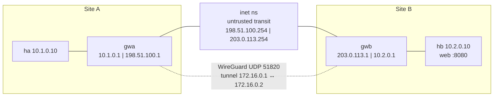

# Lab 11 — Stateless vs Stateful Filtering, a WireGuard Tunnel, and IOS ACL + DHCP Snooping

## Objective

- **Part A (Linux):** build the same policy as a stateless filter and as a stateful filter. See why stateless needs return rules.
- **Part B (Linux):** build a WireGuard site-to-site tunnel between two "sites" over an untrusted "internet" namespace.
- **Part C (Packet Tracer):** extended named ACL, VTY access-class, and DHCP snooping against a rogue DHCP server.

## Topology (Parts A and B)



Build script (save as `/tmp/lab11.sh` and run with `sudo bash /tmp/lab11.sh`):

```bash
#!/bin/bash
set -e
for n in ha gwa inet gwb hb; do ip netns add $n; ip -n $n link set lo up; done
link() { ip link add $1 type veth peer name $3; ip link set $1 netns $2; ip link set $3 netns $4; ip -n $2 link set $1 up; ip -n $4 link set $3 up; }
link ha-e0 ha gwa-in gwa
link gwa-out gwa inet-a inet
link inet-b inet gwb-out gwb
link gwb-in gwb hb-e0 hb
ip -n ha   addr add 10.1.0.10/24 dev ha-e0;        ip -n ha route add default via 10.1.0.1
ip -n gwa  addr add 10.1.0.1/24 dev gwa-in;         ip -n gwa addr add 198.51.100.1/24 dev gwa-out
ip -n gwa  route add default via 198.51.100.254
ip -n inet addr add 198.51.100.254/24 dev inet-a;   ip -n inet addr add 203.0.113.254/24 dev inet-b
ip -n gwb  addr add 203.0.113.1/24 dev gwb-out;     ip -n gwb addr add 10.2.0.1/24 dev gwb-in
ip -n gwb  route add default via 203.0.113.254
ip -n hb   addr add 10.2.0.10/24 dev hb-e0;         ip -n hb route add default via 10.2.0.1
for n in gwa inet gwb; do ip netns exec $n sysctl -qw net.ipv4.ip_forward=1; done
ip netns exec hb python3 -m http.server 8080 --bind 10.2.0.10 >/dev/null 2>&1 &
echo "built"
```

Note: the internet namespace has **no routes** to 10.1.0.0/16 or 10.2.0.0/16, like the real internet. Private sites can only talk through the tunnel.

## Part A — Stateless vs stateful on gwb

For this part, temporarily give `inet` routes to the private ranges so traffic can flow without a tunnel:

```bash
sudo ip -n inet route add 10.1.0.0/24 via 198.51.100.1
sudo ip -n inet route add 10.2.0.0/24 via 203.0.113.1
```

### A1. Stateless policy (like an AWS NACL)

Goal: allow only ha → hb TCP 8080.

```bash
sudo ip netns exec gwb nft -f - <<'EOF'
table inet stateless {
  chain fwd {
    type filter hook forward priority 0; policy drop;
    ip saddr 10.1.0.10 ip daddr 10.2.0.10 tcp dport 8080 accept
  }
}
EOF
sudo ip netns exec ha curl -s -m 3 -o /dev/null -w "%{http_code}\n" http://10.2.0.10:8080/ || echo "timeout"
```

Expected: `timeout`. The SYN passes, but the SYN-ACK from hb (source port 8080 → ephemeral port) is dropped. Add the return rule:

```bash
sudo ip netns exec gwb nft add rule inet stateless fwd ip saddr 10.2.0.10 ip daddr 10.1.0.10 tcp sport 8080 tcp dport 1024-65535 accept
sudo ip netns exec ha curl -s -m 3 -o /dev/null -w "%{http_code}\n" http://10.2.0.10:8080/
```

Expected: `200`.

### A2. Stateful policy (like an AWS security group)

```bash
sudo ip netns exec gwb nft delete table inet stateless
sudo ip netns exec gwb nft -f - <<'EOF'
table inet stateful {
  chain fwd {
    type filter hook forward priority 0; policy drop;
    ct state established,related accept
    ct state invalid drop
    ip saddr 10.1.0.10 ip daddr 10.2.0.10 tcp dport 8080 ct state new accept
  }
}
EOF
sudo ip netns exec ha curl -s -m 3 -o /dev/null -w "%{http_code}\n" http://10.2.0.10:8080/
sudo ip netns exec gwb conntrack -L 2>/dev/null | grep 8080 || sudo ip netns exec gwb cat /proc/net/nf_conntrack | grep 8080
```

Expected: `200`, and a conntrack entry with state `ESTABLISHED` or `TIME_WAIT`. No return rule was needed.

Clean up Part A:

```bash
sudo ip netns exec gwb nft delete table inet stateful
sudo ip -n inet route del 10.1.0.0/24; sudo ip -n inet route del 10.2.0.0/24
```

## Part B — WireGuard site-to-site tunnel

```bash
umask 077
wg genkey | tee /tmp/a.key | wg pubkey > /tmp/a.pub
wg genkey | tee /tmp/b.key | wg pubkey > /tmp/b.pub

sudo ip -n gwa link add wg0 type wireguard
sudo ip netns exec gwa wg set wg0 listen-port 51820 private-key /tmp/a.key \
  peer $(cat /tmp/b.pub) endpoint 203.0.113.1:51820 allowed-ips 10.2.0.0/24,172.16.0.2/32 persistent-keepalive 25
sudo ip -n gwa addr add 172.16.0.1/30 dev wg0; sudo ip -n gwa link set wg0 up
sudo ip -n gwa route add 10.2.0.0/24 dev wg0

sudo ip -n gwb link add wg0 type wireguard
sudo ip netns exec gwb wg set wg0 listen-port 51820 private-key /tmp/b.key \
  peer $(cat /tmp/a.pub) endpoint 198.51.100.1:51820 allowed-ips 10.1.0.0/24,172.16.0.1/32
sudo ip -n gwb addr add 172.16.0.2/30 dev wg0; sudo ip -n gwb link set wg0 up
sudo ip -n gwb route add 10.1.0.0/24 dev wg0

sudo ip netns exec ha curl -s -o /dev/null -w "%{http_code}\n" http://10.2.0.10:8080/
sudo ip netns exec gwa wg show
sudo ip netns exec inet tcpdump -i inet-b -nn -c 4 udp port 51820
```

Expected: `200`; `wg show` lists a `latest handshake`; the capture on `inet` shows only UDP 51820 between the public IPs. The inner 10.x addresses are invisible to the "internet".

## Part C — IOS ACL and DHCP snooping (Packet Tracer)

1. Topology: R1 G0/0 (10.10.10.1/24, users) and G0/1 (10.50.0.1/24, servers: web 10.50.0.80, DNS 10.50.0.53). Switch SW1 for users with a legitimate DHCP server on uplink G0/1 and a **rogue** server PC on Fa0/10.
2. Apply the `USERS-TO-DC` extended ACL from the README inbound on G0/0. Test HTTPS to .80 (works), ping to .80 (blocked).
3. Apply `MGMT` access-class on VTY lines. SSH from a user PC fails; from 10.99.0.x works.
4. On SW1: `ip dhcp snooping`, `ip dhcp snooping vlan 1`, `no ip dhcp snooping information option`, trust only G0/1. Renew a client: it must get an address from the legitimate server, never the rogue.

Expected:

```text
R1# show access-lists USERS-TO-DC
    10 permit tcp 10.10.10.0 0.0.0.255 host 10.50.0.80 eq 443 (12 matches)
    30 deny ip 10.10.10.0 0.0.0.255 10.50.0.0 0.0.255.255 log (4 matches)
SW1# show ip dhcp snooping binding
MacAddress          IpAddress        Lease(sec)  Type           VLAN  Interface
00:50:79:66:68:01   10.10.10.21      86400       dhcp-snooping  1     FastEthernet0/1
```

## Verification

- [ ] Stateless filtering needed an explicit return rule; stateful did not.
- [ ] The WireGuard tunnel carries site-to-site traffic; the transit sees only UDP 51820.
- [ ] ACL counters match your tests.
- [ ] The rogue DHCP server is ignored.

## Break it and fix it

| # | Break | Task |
|---|---|---|
| 1 | On gwb, change `allowed-ips` to `10.9.0.0/24` | What happens to ha → hb? Why? |
| 2 | Block UDP 51820 in `inet`: `sudo ip netns exec inet nft 'add table inet t; add chain inet t f { type filter hook forward priority 0; }; add rule inet t f udp dport 51820 drop'` | What does `wg show` report? |
| 3 | In the IOS ACL, move line 40 (`permit ip any any`) to sequence 5 | What changes? |
| 4 | Trust the rogue server port on SW1 | Result? |

<details><summary>Answers</summary>

1. WireGuard uses allowed-ips as both a routing table and an ACL (cryptokey routing). Packets from 10.1.0.10 arrive at gwb but are dropped because the source is not in the peer's allowed-ips. Fix the list.
2. `latest handshake` stops updating (and goes past 2-3 minutes); traffic stops. This is what "UDP blocked by a firewall" looks like. Use port 443/UDP or an SSL VPN where UDP is filtered.
3. First match wins: `permit ip any any` matches everything first, so the deny never hits. Order matters.
4. The rogue server's OFFERs are now allowed, so clients may take its address. Trust only uplinks toward real servers.

</details>

## Clean up

```bash
for n in ha gwa inet gwb hb; do sudo ip netns del $n; done; rm -f /tmp/a.key /tmp/b.key /tmp/a.pub /tmp/b.pub
```
