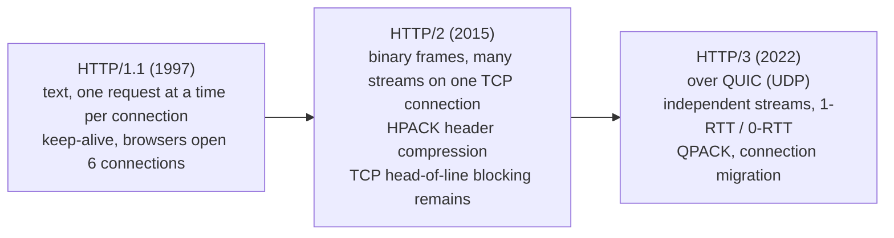
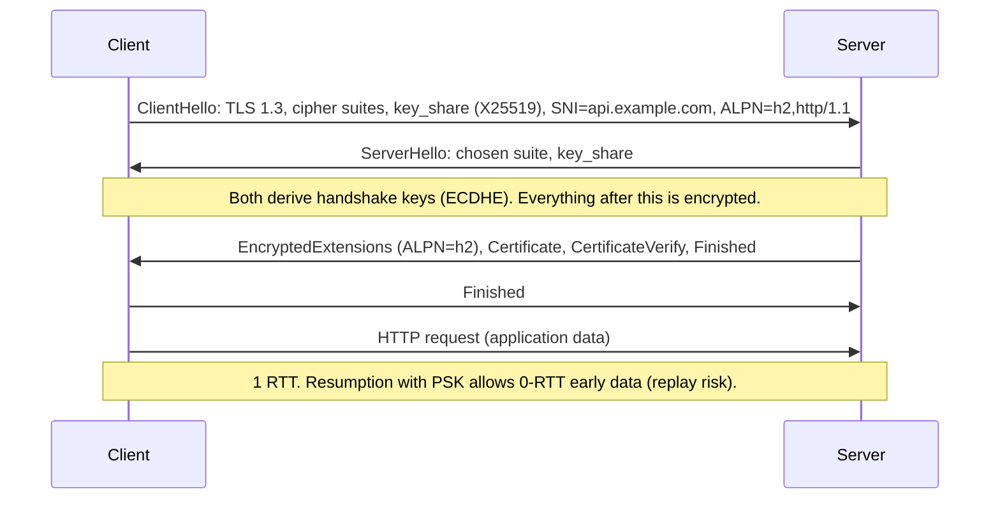
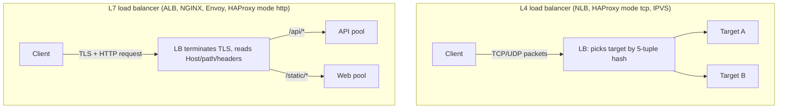

# Module 12 — Application Layer: HTTP/1.1, HTTP/2, HTTP/3, TLS 1.3, Load Balancing, CDNs, Proxies

**Time:** 4 sessions. **Prerequisites:** Module 08.

## Learning objectives

1. Read an HTTP request and response line by line; know methods, status codes and key headers.
2. Compare HTTP/1.1, HTTP/2 and HTTP/3 and explain what each fixed.
3. Walk through the TLS 1.3 handshake; explain certificates, chains, SNI and ALPN.
4. Compare L4 and L7 load balancing, health checks, stickiness and algorithms.
5. Explain forward proxies, reverse proxies and CDNs (caching, TTL, origin shield).
6. Debug with `curl -v`, `openssl s_client` and browser dev tools.

## 1. HTTP first principles

HTTP is a request/response protocol. The client sends a **method**, a **path** and **headers**; the server returns a **status code**, **headers** and a **body**.

```text
$ curl -v https://example.com/
*   Trying 93.184.215.14:443...
* Connected to example.com (93.184.215.14) port 443
* ALPN: curl offers h2,http/1.1
* TLSv1.3 (OUT), TLS handshake, Client hello (1):
* TLSv1.3 (IN), TLS handshake, Server hello (2):
* SSL connection using TLSv1.3 / TLS_AES_256_GCM_SHA384 / X25519 / RSASSA-PSS
* Server certificate:
*  subject: CN=www.example.org
*  issuer: C=US; O=DigiCert Inc; CN=DigiCert Global G3 TLS ECC SHA384 2020 CA1
* ALPN: server accepted h2
> GET / HTTP/2
> Host: example.com
> User-Agent: curl/8.5.0
> Accept: */*
< HTTP/2 200
< content-type: text/html
< cache-control: max-age=3600
< age: 1203
< content-length: 1256
```

| Status | Meaning | Ops hint |
|---|---|---|
| 200 / 201 / 204 | OK / Created / No content | — |
| 301 / 302 / 307 / 308 | Redirects | Check `Location` |
| 304 | Not modified (cache revalidation) | ETag/If-None-Match |
| 400 / 401 / 403 / 404 | Bad request / not authenticated / forbidden / not found | 403 from a WAF or S3 policy |
| 429 | Too many requests | Rate limiting |
| 500 | Server error | App bug |
| 502 | Bad gateway | LB/proxy got an invalid response or connection reset from the upstream |
| 503 | Service unavailable | No healthy targets, overload |
| 504 | Gateway timeout | Upstream too slow (LB idle/timeout) |

### HTTP versions



Discovery: HTTP/2 is negotiated with **ALPN** inside TLS. HTTP/3 is advertised with the `Alt-Svc: h3=":443"` header or the DNS **HTTPS** record.

## 2. TLS 1.3

TLS gives **confidentiality** (encryption), **integrity** (no tampering) and **authentication** (certificates prove the server's identity).



| Concept | Meaning |
|---|---|
| Certificate chain | Leaf (server) → intermediate CA → root CA (in the client trust store). The server must send the intermediate |
| SNI | Hostname in ClientHello, so one IP can host many certificates |
| ALPN | Negotiates h2 or http/1.1 inside the handshake |
| Forward secrecy | Ephemeral (EC)DHE keys: stolen private keys cannot decrypt old traffic. Mandatory in TLS 1.3 |
| mTLS | The client also presents a certificate (service mesh, B2B APIs) |
| TLS 1.3 cipher suites | `TLS_AES_128_GCM_SHA256`, `TLS_AES_256_GCM_SHA384`, `TLS_CHACHA20_POLY1305_SHA256` |

```text
$ openssl s_client -connect example.com:443 -servername example.com -alpn h2 </dev/null 2>/dev/null | grep -E "Protocol|Cipher|Verify|ALPN"
New, TLSv1.3, Cipher is TLS_AES_256_GCM_SHA384
ALPN protocol: h2
Verify return code: 0 (ok)
$ echo | openssl s_client -connect example.com:443 -servername example.com 2>/dev/null | openssl x509 -noout -dates -subject -ext subjectAltName
```

## 3. Load balancing: L4 vs L7



| | L4 | L7 |
|---|---|---|
| Sees | IPs, ports | Full HTTP: host, path, headers, cookies |
| Connection | Passes through (or proxies TCP) | Terminates client connection; new connection to backend |
| Features | Very fast, any TCP/UDP protocol, preserves source IP (NLB) | Path/host routing, header rewrite, WAF, auth, gRPC, retries |
| Client IP at backend | Preserved (NLB) or PROXY protocol | `X-Forwarded-For` header |
| AWS | NLB, GWLB (L3) | ALB, API Gateway, CloudFront |

**Algorithms:** round robin, least connections, least outstanding requests (ALB), weighted, consistent hashing (sticky by key). **Health checks:** L4 (TCP connect) vs L7 (HTTP 200 on `/healthz`). **Stickiness:** cookie-based (ALB `AWSALB`), avoid when possible; store sessions in Redis instead.

## 4. Proxies and CDNs

| Type | Who uses it | Example |
|---|---|---|
| Forward proxy | Clients, to reach the internet (filtering, egress control) | Squid, corporate proxy, `HTTPS_PROXY` |
| Reverse proxy | Servers, to front applications | NGINX, Envoy, ALB |
| Transparent proxy | Intercepts without client config | Some enterprise web gateways |

A **CDN** caches content at edge locations near users. Cache keys usually combine host, path and selected query strings/headers. `Cache-Control: max-age`, `s-maxage` and `Age` show cache behaviour. `X-Cache: Hit from cloudfront` confirms a hit. **Origin shield** adds a regional cache layer to protect the origin.

**Production note:** HTTP `CONNECT` is how a forward proxy carries HTTPS. In Kubernetes, set `NO_PROXY` to include `.svc,.cluster.local,10.0.0.0/8,169.254.169.254`, or pods send internal traffic to the proxy and break.

## 5. Production example

After moving a service behind an ALB, clients saw intermittent **502** errors. ALB logs showed `target_processing_time = -1` and `elb_status_code = 502`. The backend (Node.js) had a keep-alive timeout of 5 s, lower than the ALB idle timeout of 60 s. The ALB reused a connection that the backend had just closed. Fix: set the backend keep-alive timeout above the ALB idle timeout (e.g. 65 s).

## 6. Cloud equivalent (AWS)

| Need | AWS |
|---|---|
| L7 HTTP(S), gRPC, path/host routing | Application Load Balancer |
| L4 TCP/UDP/TLS, static IPs, source IP preservation | Network Load Balancer |
| Inline appliances (firewalls) | Gateway Load Balancer (GENEVE, UDP 6081) |
| CDN, HTTP/3, edge TLS | CloudFront |
| Global anycast IPs, TCP termination at edge | Global Accelerator |
| Certificates | ACM (free public certs for AWS endpoints, auto renewal) |
| Service-to-service L7 | VPC Lattice, App Mesh (being retired), Istio on EKS |

## 7. Common failures

| Symptom | Cause | Check |
|---|---|---|
| `SSL certificate problem: unable to get local issuer certificate` | Server does not send the intermediate | `openssl s_client -showcerts` |
| `certificate has expired` | Expired leaf or chain | `openssl x509 -noout -dates` |
| Wrong certificate returned | SNI missing (old client) or wrong default cert | `-servername` in s_client |
| 502 at the LB | Backend reset/closed connection, keep-alive mismatch, TLS to backend failing | LB access logs |
| 504 at the LB | Backend slower than LB timeout | Timing in logs |
| 503 at the LB | No healthy targets | Target health, health check path |
| Users see stale content | CDN TTL, wrong cache key | `Age`, `X-Cache`, invalidation |
| App sees LB IP, not client IP | L7 proxy | Use `X-Forwarded-For` / PROXY protocol v2 |

## Next

[Lab](lab.md) · [Quiz](quiz.md) · [Cheatsheet](cheatsheet.md) · [Module 13](../13-troubleshooting/README.md)
