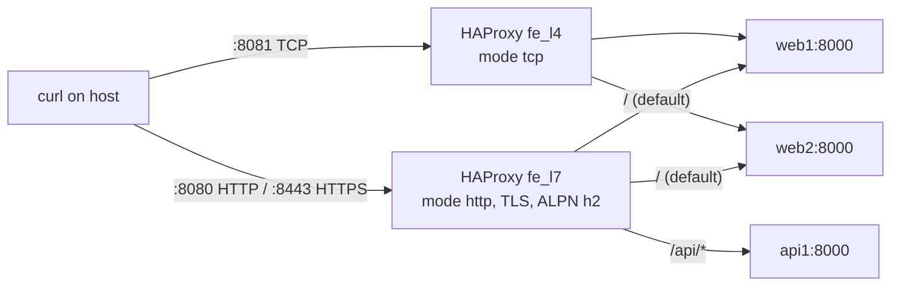

# Lab 12 — L4 vs L7 Load Balancing, TLS 1.3 and HTTP Versions

## Objective

Run HAProxy as an L4 and an L7 load balancer in front of Python backends. Compare what the backend sees. Terminate TLS 1.3 and negotiate HTTP/2 with ALPN. Inspect real-world HTTP/2 and HTTP/3 with curl and openssl.

## Topology

Files: [`labs/topologies/m12-lb/`](../../labs/topologies/m12-lb/docker-compose.yml)



## Steps

### 1. Start

```bash
cd labs/topologies/m12-lb
chmod +x gen-cert.sh && ./gen-cert.sh
docker compose up -d
docker compose ps
```

### 2. L4 round robin

```bash
for i in 1 2 3 4; do curl -s http://localhost:8081/; done
```

Expected output:

```text
backend=web1 path=/ peer=172.20.0.5 xff=-
backend=web2 path=/ peer=172.20.0.5 xff=-
backend=web1 path=/ peer=172.20.0.5 xff=-
backend=web2 path=/ peer=172.20.0.5 xff=-
```

`peer` is the HAProxy container IP (HAProxy proxies TCP), and there is no `X-Forwarded-For`, because an L4 proxy does not touch HTTP. Request `/api/x` on 8081: it still goes to web1/web2. L4 cannot route by path.

### 3. L7 path routing

```bash
curl -s http://localhost:8080/
curl -s http://localhost:8080/api/orders
curl -sI http://localhost:8080/ | grep -i x-lb
```

Expected output:

```text
backend=web1 path=/ peer=172.20.0.5 xff=172.20.0.1
backend=api1 path=/api/orders peer=172.20.0.5 xff=172.20.0.1
X-LB: l7-haproxy
```

The L7 proxy adds `X-Forwarded-For` with the real client IP and can route `/api` to a different pool.

### 4. TLS 1.3 and ALPN

```bash
curl -sk --http2 -v https://localhost:8443/ 2>&1 | grep -E "SSL connection|ALPN|HTTP/2 200"
echo | openssl s_client -connect localhost:8443 -servername lab.local -alpn h2 2>/dev/null | grep -E "Protocol|Cipher is|ALPN"
```

Expected output:

```text
* SSL connection using TLSv1.3 / TLS_AES_256_GCM_SHA384 / X25519 / RSASSA-PSS
* ALPN: server accepted h2
< HTTP/2 200
New, TLSv1.3, Cipher is TLS_AES_256_GCM_SHA384
ALPN protocol: h2
```

`-k` is needed because the certificate is self-signed. Without `-k`, curl shows `self-signed certificate`. That is the error you would see with a missing CA in production.

### 5. Health checks

Open `http://localhost:8404/` (HAProxy stats). Then stop one backend:

```bash
docker compose stop web2
sleep 5; for i in 1 2 3; do curl -s http://localhost:8080/; done
docker compose start web2
```

All requests go to web1 while web2 is down. The stats page shows web2 red (DOWN) after failed health checks.

### 6. Real-world protocols

```bash
curl -sI --http2 https://www.cloudflare.com | head -1
curl -sI https://www.cloudflare.com | grep -i alt-svc
curl -sI --http3-only https://www.cloudflare.com 2>&1 | head -1   # needs curl built with HTTP/3
dig www.cloudflare.com HTTPS +short
```

`alt-svc: h3=":443"` and the HTTPS DNS record advertise HTTP/3. If your curl lacks HTTP/3, note it and use a browser's dev tools (Protocol column shows `h3`).

## Verification

- [ ] L4 alternates backends and does not add XFF or route by path.
- [ ] L7 routes `/api` to api1 and adds XFF.
- [ ] TLS 1.3 with ALPN h2 on 8443.
- [ ] Health checks remove a stopped backend.

## Break it and fix it

| # | Break | Task |
|---|---|---|
| 1 | In `haproxy.cfg`, change `option httpchk GET /healthz` to `GET /health` in `be_web`, then `docker compose restart lb` | What does `curl :8080` return? Why? |
| 2 | Remove `alpn h2,http/1.1` from the 8443 bind and restart | What protocol does `curl --http2` use now? |
| 3 | Set `timeout server 1s` and change backend.py to `time.sleep(2)` before responding | What status code appears? |
| 4 | Generate the certificate with `-days 0` (or set your clock forward) | What does curl report without `-k`? |

<details><summary>Answers</summary>

1. The backend returns a page for `/health` too (it answers 200 for any path), so it stays UP. Lesson: health check endpoints must really test health. Change backend.py to return 404 for unknown paths and you get **503** (no servers available).
2. HTTP/1.1. Without ALPN, the server never agrees to h2 during the TLS handshake.
3. **504 Gateway Timeout**: the server did not answer within the proxy timeout.
4. `certificate has expired` (and self-signed). Check dates with `openssl x509 -noout -dates -in certs/lab.crt`.

</details>

## Clean up

```bash
docker compose down
```
